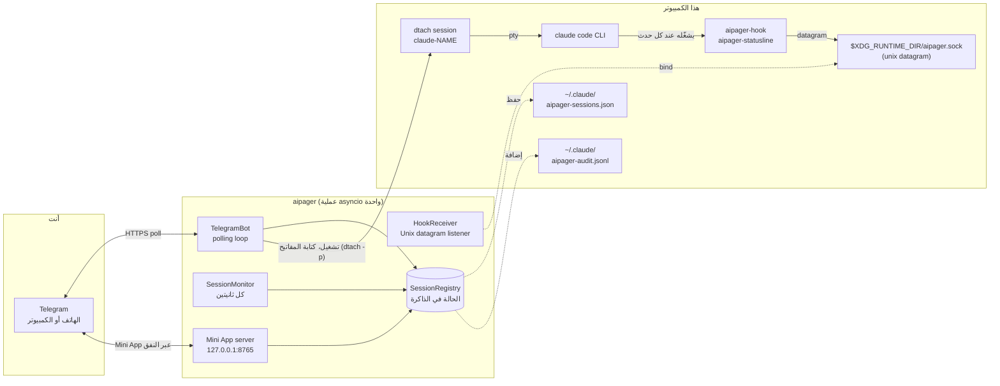

# البنية

<!-- i18n-source: docs/architecture.md @ 7e36944 -->

> هذه الصفحة مترجمة عن الإنجليزية؛ إذا اختلفت النسختان، فالنسخة الإنجليزية هي الصحيحة. ([English](../../architecture.md))

aipager برنامج asyncio يعمل في الخلفية في عملية واحدة. يربط بين ثلاثة عوالم: دردشتك في Telegram، وعمليات Claude Code التي تعمل تحت `dtach`، ونظام الهوكات في Claude Code. كل شيء يمر عبر event loop واحدة: بلا worker pool، وبلا قاعدة بيانات، وبلا طوابير بين العمليات.

## مخطط الأجزاء

كل ما في المخطط يعمل على هذا الكمبيوتر، باستثناء Telegram. يتصل aipager أيضًا ببضعة خوادم أخرى: نفق Cloudflare الخاص بـ Mini App (وGitHub مرة واحدة، من أجل `cloudflared`)، و`telegram.org` لجلب سكربت Mini App، وفحص الإصدارات عند طلب تحديث، وتنزيل نموذج التعرف على الكلام عند أول استخدام للرسائل الصوتية، وعنوان استقبال تقارير المشكلات عند إرسال تقرير. كلها مذكورة في [نموذج الأمان ← الاتصالات الشبكية](security.md#network-surface).

## بنية العملية

استدعاء واحد لـ `asyncio.run` في `aipager/cli/daemon.py` يشغّل كل شيء. وفي داخله:

- **`TelegramBot`** (`aipager/bot/`): يملك `Application` من `python-telegram-bot`. يستقبل التحديثات من Telegram، ويوزعها على معالجات الرسائل والأزرار والرسائل الصوتية، ويُبقي بطاقات العمل وشريط الحالة المثبّت والإجابات محدّثة.
- **`HookReceiver`** (`aipager/dtach/hook_receiver.py`): يفتح مقبس datagram من نوع Unix في `$XDG_RUNTIME_DIR/aipager.sock`، ويقرأ JSON الذي يرسله `aipager-hook` و`aipager-statusline`، ويوزع العمل بحسب `hook_event_name` (أو `type` لرسائل aipager نفسه؛ يُنظر [أحداث الهوك](hooks.md)).
- **`SessionMonitor`** (`aipager/session_monitor.py`): يستيقظ كل ثانيتين ليفحص `/tmp/claude-dtach-*.sock`، ويطابق الجلسات التي يجدها مع قائمة الجلسات، ويشغّل المراقبات: بطاقة عمل توقفت عن الحركة، ورسالة لم يأخذها Claude Code أبدًا، وطلب إذن بلا أخبار منذ ٥ دقائق تُظهر المحادثة المحفوظة أنه انتهى (`AIPAGER_INTERACTIVE_TIMEOUT`)، ومهمة فاتت لحظة انتهائها.
- **`SessionRegistry`** (`aipager/state.py`): كائنات `TrackedSession` مفهرسة بالاسم. تُحفظ في `~/.claude/aipager-sessions.json` (بشكل ذري) عند الإيقاف وكلما تغيّر شيء يجب أن يبقى بعد إعادة التشغيل.
- **`ObserverBroadcaster`** (اختياري، `aipager/bot/observer.py`): إذا ضُبط `OBSERVER_BOTS`، يرسل الإشعارات أيضًا إلى بوتات مراقبة للقراءة فقط ([بوتات المراقبة](observers.md)).
- **خادم Mini App** (`aipager/miniapp/server.py`): تطبيق aiohttp على `127.0.0.1` في المنفذ `MINIAPP_PORT` (الافتراضي 8765)، ويُتاح لـ Telegram عبر نفق Cloudflare مُدار ما دام مفعّلًا (وهو مفعّل افتراضيًا). يقدّم لوحة `/app`.

كل هذه الأجزاء تعمل كمهام على الحلقة نفسها. والعمل الذي قد يعطّل الحلقة يجري في خيوط منفصلة: تحويل الرسائل الصوتية إلى نص، وبناء تقرير المشكلة وإرساله، وفحص التحديثات وتخطيط إعادة التشغيل، وتنزيل سكربت Mini App و`cloudflared`، وفحص تسجيل الدخول عند البدء.

## تسلسل الإقلاع

من `aipager/cli/daemon.py`:

1. نقل الإعداد القديم (`config.env` و`team.yaml`) إلى `aipager.yaml`، مرة واحدة، وإحالة الملفات القديمة إلى التقاعد.
2. رفض البدء إذا كان aipager آخر يجيب على المقبس، ثم أخذ قفل aipager (`~/.local/share/aipager/daemon.lock`).
3. التحقق من توكن البوت لدى Telegram (`getMe`).
4. إصلاح ملفات Claude Code نفسه: إضافة أي هوك أو سطر حالة لـ aipager ينقص إلى `~/.claude/settings.json`، والإجابة عن أسئلة التشغيل الأول التي لا يستطيع مستخدم Telegram الإجابة عنها (يُنظر [الأمان](security.md#who-decides-whether-a-tool-call-runs)).
5. `SessionRegistry.load()`: يقرأ `~/.claude/aipager-sessions.json`. إذا كان الملف غير موجود أو غير مقروء، تبدأ القائمة فارغة.
6. تحديد عنوان Mini App (عنوانك الخاص، أو Tailscale)، ثم `bot.start()`: بدء استقبال التحديثات من Telegram.
7. `ObserverBroadcaster.start()`، فقط إذا كان مضبوطًا.
8. `HookReceiver.start()`: يحذف ملف مقبس قديمًا متبقيًا، ثم bind، ثم الاستماع.
9. `bot.recover_sessions()`: يعيد البطاقات والطلبات للجلسات التي كانت تعمل أو تنتظر عندما توقف aipager (يُنظر [الأوامر ← الإجابات](commands.md#idle-responses)).
10. `SessionMonitor.start()`: يبدأ الفحص كل ثانيتين.
11. يبدأ خادم Mini App، ثم النفق (حين لا يكون هناك عنوان خاص بك)، وتُنشر أزرار `📱 App`.
12. ينتظر aipager الإشارات: SIGINT أو SIGTERM يوقفه، وSIGUSR1 يعيد تحميل الدردشات والقواعد ([المجموعات ← إعادة التحميل دون إعادة تشغيل](groups.md#live-reload)).

## تسلسل الإيقاف

1. SIGINT أو SIGTERM يضبط الحدث `stop`.
2. يُمنح `/update` الجاري مهلة قصيرة، ثم يُوقف المثبّت الخاص به (يُنظر [الأوامر ← التحديث](commands.md#update)).
3. `registry.save()`.
4. يتوقف النفق، ثم خادم Mini App.
5. `session_monitor.stop()`، و`hook_receiver.stop()` (يغلق المقبس ويحذف ملفه)، و`observers.stop()` إن كان يعمل.
6. `bot.stop()`: يلغي الحركات ويوقف `Application`.
7. `registry.save()` مرة أخرى، لبطاقة لم يكتمل إرسالها بعد.

تعتمد إعادة التشغيل الذاتية من Telegram على اكتمال هذا المسار كله قبل أن يربط البديلُ المقبس. ما يظهر أثناء ذلك موصوف في [أوامر البوت ← إعادة التشغيل](commands.md#restart).

## أماكن الملفات والمقابس

| المسار | الغرض | من يكتبه |
|---|---|---|
| `$XDG_RUNTIME_DIR/aipager.sock` | مقبس datagram من نوع Unix لأحداث الهوك (`/tmp/aipager.sock` عند غياب `$XDG_RUNTIME_DIR`؛ و`$AIPAGER_SOCKET_PATH` مقدَّم على كليهما) | aipager (bind) |
| `aipager-reply-<id>.sock` (بجانب مقبس التحكم) | مقبس رد قصير العمر لكل طلب إذن ينتظره الهوك | `aipager-hook` |
| `aipager-flood-mute.json`، `aipager-flood-backoff.json` (بجانب مقبس التحكم) | حالة حدود السرعة الحالية في Telegram، من أجل `aipager status` وdoctor | aipager |
| `aipager-modelswitch-<name>.json` (بجانب مقبس التحكم) | يعلّم تبديل نموذج كتبه aipager، لمدة ٣٠ ثانية ([الهوكات](hooks.md#premodelswitch)) | aipager (يكتب)، `aipager-hook` (يأخذه) |
| `/tmp/claude-dtach-<name>.sock` | مقبس التحكم الخاص بـ dtach لكل جلسة | dtach |
| `/tmp/claude-status-<name>.json` | بيانات سطر الحالة لكل جلسة | `aipager-statusline` |
| `/tmp/claude-notes-<name>/` | ملاحظة إذن لكل رسالة Telegram لم تُؤخذ بعد، وعلامة `turn-open` يحتفظ بها الهوك ما دامت المهمة جارية (الرسالة التي تنضم إلى المهمة لا يمكنها إلا تضييق قواعدها) | aipager (الملاحظات، يكتبها)، `aipager-hook` (يستهلك الملاحظات؛ ويكتب `turn-open`، ويمسحها الاثنان) |
| `/tmp/claude-policy-<name>.json` | لقطة الأذونات المعتمدة للمهمة الجارية | `aipager-hook` (يكتبها عند أخذ الرسالة)، ويقرؤها فحص `PreToolUse` |
| `/tmp/claude-policy-.floor-<uid>.json` | الحد الأدنى للأمان: القائمة المدمجة مع قسم `safety:` الخاص بك، للمسارات الاحتياطية في الهوك | aipager |
| `/tmp/claude-reply-<name>.txt` | الرسالة التي رددت عليها، عند الرد على رسالة أقدم | aipager |
| `/tmp/aipager-files/` | الملفات والرسائل الصوتية المرسلة من Telegram | aipager |
| `/tmp/aipager.log` | مخرجات إعادة التشغيل الذاتية عند غياب الخدمة | aipager |
| `~/.claude/aipager-sessions.json` | الحالة الدائمة لقائمة الجلسات | aipager |
| `~/.claude/aipager-audit.jsonl` | سجل السماح / الرفض / الإجابات | aipager (إضافة فقط) |
| `~/.claude/aipager-flood-state.json` | سجل حدود السرعة في Telegram لكل دردشة، محفوظ عبر إعادات التشغيل ([حل المشكلات](troubleshooting.md#the-bot-went-quiet-flood-control)) | aipager |
| `~/.claude/aipager-pending-users.json` | الأشخاص الذين خاطبوا البوت في مجموعة لا يخدمها، أو ليسوا أعضاء في مجموعة يخدمها، لكي يضيفهم `aipager config` (الصلاحية 0600، يُستبدل كاملًا عند كل كتابة، أحدث ٢٠٠ شخص ظهروا خلال آخر ٣٠ يومًا) | aipager (يكتب)، `aipager config` (يقرأ) |
| `~/aipager-users/<label>/` | [المجلدات الجذرية](groups.md#root-folders) الافتراضية للأعضاء (الصلاحية 0700)، حيث يبدأ أعضاء `user` و`read_only` جلساتهم؛ ويحتفظ بها `aipager uninstall` | aipager (يُنشئها عند أول `/new` أو أول «بدء الجلسة» في Mini App لعضو) |
| `~/.claude/settings.json` | إعداد الهوكات في Claude Code | `aipager config` / `aipager setup`؛ وعند كل بدء يضيف aipager أي هوك أو سطر حالة لـ aipager ينقص ويضبط `skipDangerousModePermissionPrompt` ([الأمان](security.md#who-decides-whether-a-tool-call-runs)) |
| `~/.claude/settings.json.bak.*` | نسخ احتياطية قبل كل إعادة كتابة | `aipager config`، `aipager setup`، `aipager uninstall` |
| `~/.claude.json` | ملف Claude Code نفسه: عند البدء يعلّم aipager مجلد الجلسات الافتراضي (مجلد عمل aipager، أو `AIPAGER_WORK_DIR`) بأنه موثوق، حتى لا يوقف سؤالُ الثقة في Claude Code جلسةً بدأت من Telegram في ذلك المجلد | aipager |
| `~/.claude/.credentials.json` ← `.credentials.json.stale` | ملف تسجيل الدخول في Claude Code، يُنقل جانبًا عندما تبدأ جلسة مع ضبط `CLAUDE_CODE_OAUTH_TOKEN` والملف لا يحتوي إلا على تسجيل دخول منتهٍ أو فارغ (وإلا لتقدّم على التوكن)؛ وللتراجع يُعاد إلى مكانه | aipager |
| `~/.config/aipager/aipager.yaml` | توكن البوت، والدردشات، والأعضاء مع الأدوار، وإعدادات Mini App | `aipager config` (الصلاحية 600)؛ وينقل aipager مدخل المجموعة عندما يرقّيها Telegram إلى supergroup، ويحتفظ بنسخة `aipager.yaml.bak.<time>` عندما ينقل إليه إعدادات Mini App القديمة |
| `~/.config/aipager/policy.yaml` | قواعد كل دور + إضافات الحد الأدنى للأمان | أنت (يُتحقق منه بـ `aipager policy validate`)؛ ويُكتب قالب عليه تعليقات مرة واحدة عند ترحيل تثبيت قديم |
| `~/.config/aipager/preferences.json` | اختيارات `/settings` لكل دردشة ولكل جلسة | aipager |
| `~/.config/aipager/daemon.env` | بيانات اعتماد Claude للجلسات التي يبدؤها | أنت / `aipager service install` / `aipager doctor --fix` (الصلاحية 600) |
| `~/.config/aipager/config.env`، `team.yaml` ← `*.bak.<time>`، `*.retired.<time>` | إعداد تثبيت قديم: يُنسخ، ثم يُعاد تسميته جانبًا بعد أن يحتويه `aipager.yaml` | aipager، `aipager config`، `aipager setup` |
| `~/.config/aipager/keyboard.json` | تخصيصات اختيارية للوحة المفاتيح | أنت |
| `~/.local/share/aipager/sessions/` | مجلد لكل جلسة فيه `SESSION.md` الخاص بها (من يمكنه مخاطبتها، والقواعد)، يُعاد بناؤه عند كل تشغيل | aipager |
| `~/.local/share/aipager/webapp-sdk/`، `cloudflared/` | سكربت Mini App من Telegram وبرنامج `cloudflared` المُتحقَّق منه | aipager |
| `~/.local/share/aipager/daemon.lock`، `update.lock`، `update-restart.json` | aipager واحد في كل مرة؛ تحديث واحد في كل مرة؛ التحديث الذي يُعلن عنه بعد إعادة التشغيل | aipager |
| `~/.local/share/aipager/install.json`، `running.json` | متى بدأ aipager هنا أول مرة؛ وهل يعمل الآن (للتمييز بين التعطل والإيقاف العادي) | aipager |
| `~/.local/state/aipager/reports.json` | تقارير المشكلات: بصمات الأخطاء المسجّلة، وأعدادها، وحالة العرض (الصلاحية 600)؛ يُنظر [تقارير المشكلات](problem-reports.md#what-is-kept-on-your-machine) | aipager |
| `~/.local/state/aipager/report-sends.json` | تقارير المشكلات المرسلة اليوم (الحد اليومي) | aipager، `aipager report` |
| `~/.local/state/aipager/languages.json` | حالة اللغة (الصلاحية 600): من استخدم aipager قبل إضافة اللغات، وآخر لغة Telegram رُئيت لكل شخص، وهل أُرسل عرض اللغة الذي يأتي مرة واحدة وسطر الترحيب الأول، وبصمة كل وصف للبوت ضبطه aipager؛ يُنظر [اللغات](commands.md#languages) | aipager |
| `~/.config/systemd/user/aipager.service` (Linux)، `~/Library/LaunchAgents/com.aipager.daemon.plist` (macOS)، ونسخة `.bak.<time>` من الملف الذي يستبدله التثبيت (على Linux فقط إذا كان مختلفًا) | خدمة الخلفية | `aipager service install` |
| `~/Library/Logs/aipager.log` (macOS) | سجل خدمة launchd، ويقرؤه `aipager logs` | launchd، للخدمة |

إلى جانب ذلك، ينشئ aipager مجلد جلسة جديدًا عند طلبه (مجلد جديد في `/new` أو في Mini App)، وتكتب المثبّتات ونموذج الصوت ملفاتها الخاصة عند التحديث أو استخدام الرسائل الصوتية. كل ذلك داخل مجلدك الرئيسي، أو في `/tmp`، أو بجانب مقبس التحكم. لا يرفع aipager صلاحياته أبدًا؛ يُنظر [الأمان](security.md#privilege-boundary).

### نسخة معزولة (للاختبار)

عند ضبط `AIPAGER_INSTANCE_DIR` على مجلد مطلق مملوك لك، تنتقل إليه كل الملفات المشتركة المذكورة أعلاه: مقبس التحكم (ومقابس الرد وملفات إشارات حدود السرعة وعلامة تبديل النموذج التي بجانبه)، ومقابس `claude-dtach-*`، وملفات `claude-policy-*` و`claude-notes-*` و`claude-status-*` و`claude-reply-*`، وملف الحد الأدنى، ومجلد التنزيلات `aipager-files`، وسجل إعادة التشغيل الذاتية. الجلسات التي تبدؤها هذه النسخة ترث الإعداد، فلا تتحدث هوكاتها إلا مع تلك النسخة، وتحمي قواعد الأمان الملفات المنقولة بالطريقة نفسها. لا تقرأ هذه النسخة ملف `.env` من نسخة الشيفرة.

الملفات الموجودة في مجلدك الرئيسي لا تنتقل، لذا يلزم توجيه `HOME` أيضًا إلى مجلد منفصل. يرفض `aipager start` العمل عندما يكون مجلد النسخة مضبوطًا و`HOME` هو مجلدك الرئيسي الحقيقي، أو عندما لا يكون المجلد مسارًا مطلقًا إلى مجلد مملوك لك، أو عندما يكون أطول من أن يصلح مسارًا لمقبس.

`/update` و`/restart` غير معزولين: يعملان على حزمة aipager المثبّتة وعلى الخدمة `aipager.service`، فلا تُرسلان أبدًا إلى نسخة اختبار.

يرسل `AIPAGER_TELEGRAM_API_BASE` (مثلًا `http://127.0.0.1:41234`) كل طلب Bot API وكل تنزيل ملف إلى ذلك العنوان بدل `https://api.telegram.org`. يجب أن يكون هذا العنوان هو هذا الكمبيوتر (`localhost` أو عنوان loopback) ما لم يُضبط `AIPAGER_TELEGRAM_API_ALLOW_REMOTE=1`، حتى لا يرسل خطأ مطبعي توكن البوت إلى مكان آخر.

يوجد هذان الإعدادان كي تشغّل الاختبارات الشاملة aipager ثانيًا مقابل بديل محلي لـ Telegram بجانب aipager الحقيقي. ومن دونهما، كل مسار وعنوان هو المذكور في الجدول أعلاه.

## لماذا dtach

يعطي dtach كل جلسة Claude Code طرفية حقيقية (PTY) دون ربطها بطرفية يجب أن تبقى مفتوحة. يبدأ aipager الجلسة بـ `dtach -n` ويكتب فيها بـ `dtach -p` (الرسائل، وEscape، والمفاتيح التي تجيب عن مربع حوار)؛ ولا يقرأ الشاشة أبدًا، لأن الهوكات وسجل المحادثة يخبرانه بما يحدث. يمكنك الاتصال تفاعليًا من أي طرفية عبر `aipager session <name>` للوصول المباشر. هذا الاتصال يتبع الجلسة عبر إعادة تشغيل من Telegram (`/mode` إلى الوصول الكامل أو منه، و`/restart`، وإعادة التشغيل): عندما يختفي مقبس الجلسة، ينتظر حتى ١٥ ثانية لعودة المقبس نفسه ثم يعيد الاتصال وحده. الجلسة التي انتهت فعلًا تعيدك إلى الطرفية بعد الانتظار (Ctrl-C ينهي الانتظار أسرع). يعمل الاتصال ومفتاح الفصل في dtach معطّل، فيذهب `Ctrl-\` إلى Claude؛ وللخروج يكفي إغلاق الطرفية أو لوحة tmux، وتستمر الجلسة في العمل.

النتيجة: يعمل Claude Code كما لو كانت الكتابة في طرفية عادية، لكن تلك الطرفية يمكن أن تأتي وتذهب دون إزعاج الجلسة الجارية. يكتشف aipager الجلسات بفحص `/tmp/claude-dtach-*.sock` في كل دورة مراقبة كل ثانيتين. الجلسة المكتشفة تخص الدردشة التي صُنع اسمها لها، أما الجلسة التي بدأت في الطرفية فتخص، في تثبيت فيه دردشة خاصة ومجموعة، الدردشة الخاصة للمالك.

## صفحات ذات صلة

- [أحداث الهوك](hooks.md): ما يدخل عبر مقبس التحكم.
- [أوامر البوت](commands.md): ما يدخل من Telegram.
- [نموذج الأمان](security.md): حدود الصلاحيات، والأسرار، والتدقيق.
- [حل المشكلات](troubleshooting.md): مرجع `aipager doctor`.

