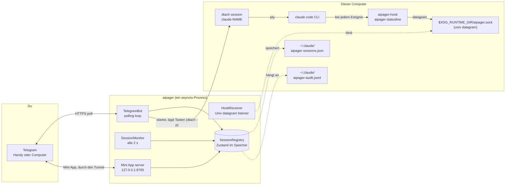

# Architektur

<!-- i18n-source: docs/architecture.md @ 7e36944 -->

> Diese Seite ist eine Übersetzung der englischen Seite; wenn die beiden voneinander abweichen, gilt die englische Fassung. ([English](../../architecture.md))

aipager ist ein asyncio-Programm aus einem einzigen Prozess, das im Hintergrund läuft. Es verbindet drei Welten: deinen Telegram-Chat, die Claude-Code-Prozesse, die du unter `dtach` laufen lässt, und das Hook-System von Claude Code. Alles läuft über eine einzige Event-Loop: keine Worker-Pools, keine Datenbank, keine Warteschlangen zwischen Prozessen.

## Diagramm der Teile

Alles im Diagramm läuft auf diesem Computer, außer Telegram. aipager spricht außerdem mit ein paar anderen Servern: dem Cloudflare-Tunnel der Mini App (und einmal mit GitHub, für sein `cloudflared`), mit `telegram.org` für das Skript der Mini App, mit der Versionsprüfung, wenn du ein Update anforderst, mit dem Download des Sprachmodells, wenn du Sprachnachrichten zum ersten Mal nutzt, und mit der Adresse für Problemberichte, wenn du einen sendest. Sie stehen alle unter [Sicherheitsmodell → Netzwerkverbindungen](security.md#network-surface).

## Wie der Prozess aufgebaut ist

Ein einziger Aufruf von `asyncio.run` in `aipager/cli/daemon.py` treibt alles an. Darin:

- **`TelegramBot`** (`aipager/bot/`): besitzt eine `Application` von `python-telegram-bot`. Holt die Updates von Telegram ab, gibt sie an die Handler für Nachrichten, Buttons und Sprachnachrichten weiter und hält die Arbeitskarten, die angeheftete Statusleiste und die Antworten aktuell.
- **`HookReceiver`** (`aipager/dtach/hook_receiver.py`): bindet einen Unix-Datagram-Socket unter `$XDG_RUNTIME_DIR/aipager.sock`, liest das JSON, das `aipager-hook` und `aipager-statusline` schicken, und verteilt die Arbeit nach dessen `hook_event_name` (oder `type`, für die eigenen Nachrichten von aipager; siehe [Hook-Ereignisse](hooks.md)).
- **`SessionMonitor`** (`aipager/session_monitor.py`): wacht alle 2 s auf, um `/tmp/claude-dtach-*.sock` zu durchsuchen, die gefundenen Sitzungen mit der Sitzungsliste abzugleichen und die Wächter laufen zu lassen: eine Arbeitskarte, die sich nicht mehr bewegt, eine Nachricht, die Claude Code nie angenommen hat, eine Berechtigungsanfrage seit 5 Minuten ohne Neuigkeiten, die laut gespeichertem Gespräch vorbei ist (`AIPAGER_INTERACTIVE_TIMEOUT`), eine Aufgabe, deren Ende verpasst wurde.
- **`SessionRegistry`** (`aipager/state.py`): die `TrackedSession`-Objekte nach Namen. Werden beim Herunterfahren und immer dann, wenn sich etwas ändert, das einen Neustart überstehen muss, (atomar) in `~/.claude/aipager-sessions.json` gespeichert.
- **Der Server der Mini App** (`aipager/miniapp/server.py`): eine aiohttp-App auf `127.0.0.1` mit `MINIAPP_PORT` (Standard 8765), die über einen verwalteten Cloudflare-Tunnel für Telegram erreichbar ist, solange sie an ist (das ist der Standard). Stellt das Dashboard von `/app` bereit.

All das läuft als Tasks in derselben Loop. Arbeit, die sie blockieren würde, läuft in eigenen Threads: das Umwandeln von Sprachnachrichten in Text, das Erstellen und Senden eines Problemberichts, die Prüfung auf Updates und die Planung des Neustarts, die Downloads des Mini-App-Skripts und von `cloudflared` und die Anmeldeprüfung beim Start.

## Reihenfolge beim Start

Aus `aipager/cli/daemon.py`:

1. Eine alte Konfiguration (`config.env`, `team.yaml`) einmalig nach `aipager.yaml` übernehmen und die alten Dateien beiseitelegen.
2. Den Start verweigern, wenn ein anderes aipager auf dem Socket antwortet, dann die Sperre von aipager nehmen (`~/.local/share/aipager/daemon.lock`).
3. Den Token des Bots bei Telegram prüfen (`getMe`).
4. Die eigenen Dateien von Claude Code in Ordnung bringen: jeden fehlenden Hook von aipager und die Statuszeile in `~/.claude/settings.json` eintragen und die Fragen beim ersten Start beantworten, die eine Person in Telegram nicht beantworten könnte (siehe [Sicherheit](security.md#who-decides-whether-a-tool-call-runs)).
5. `SessionRegistry.load()`: liest `~/.claude/aipager-sessions.json`. Eine fehlende oder unlesbare Datei startet mit einer leeren Liste.
6. Die Adresse der Mini App ermitteln (deine eigene URL oder Tailscale), dann `bot.start()`: beginnt, Telegram abzufragen.
7. `HookReceiver.start()`: entfernt eine alte Socket-Datei, bindet den Socket, hört zu.
8. `bot.recover_sessions()`: holt die Karten und Anfragen der Sitzungen zurück, die gearbeitet oder gewartet haben, als aipager gestoppt wurde (siehe [Befehle → Antworten](commands.md#idle-responses)).
9. `SessionMonitor.start()`: beginnt den Durchlauf alle 2 s.
10. Der Server der Mini App startet, dann der Tunnel (wenn keine eigene URL gesetzt ist), und die Buttons `📱 App` werden veröffentlicht.
11. aipager wartet auf Signale: SIGINT oder SIGTERM stoppen es, SIGUSR1 lädt die Chats und Regeln neu ([Gruppen → ohne Neustart neu laden](groups.md#live-reload)).

## Reihenfolge beim Herunterfahren

1. SIGINT oder SIGTERM setzt das Ereignis `stop`.
2. Ein laufendes `/update` bekommt eine kurze Frist, dann wird sein Installer gestoppt (siehe [Befehle → Update](commands.md#update)).
3. `registry.save()`.
4. Der Tunnel stoppt, dann der Server der Mini App.
5. `session_monitor.stop()`, `hook_receiver.stop()` (schließt den Socket und entfernt seine Datei).
6. `bot.stop()`: bricht die Animationen ab und stoppt die `Application`.
7. Noch einmal `registry.save()`, für eine Karte, deren Senden noch unterwegs war.

Der aus Telegram ausgelöste Neustart verlässt sich darauf, dass dieser ganze Ablauf zu Ende läuft, bevor der Nachfolger den Socket bindet. Was du davon siehst, steht unter [Befehle des Bots → Neustart](commands.md#restart).

## Wo die Dateien und Sockets liegen

| Pfad | Zweck | Wer ihn schreibt |
|---|---|---|
| `$XDG_RUNTIME_DIR/aipager.sock` | Unix-Datagram-Socket für Hook-Ereignisse (`/tmp/aipager.sock` ohne `$XDG_RUNTIME_DIR`; `$AIPAGER_SOCKET_PATH` überschreibt beide) | aipager (bindet ihn) |
| `aipager-reply-<id>.sock` (neben dem Steuer-Socket) | Ein kurzlebiger Antwort-Socket pro Berechtigungsanfrage, auf die der Hook wartet | `aipager-hook` |
| `aipager-flood-mute.json`, `aipager-flood-backoff.json` (neben dem Steuer-Socket) | Der aktuelle Stand der Telegram-Limits, für `aipager status` und den doctor | aipager |
| `aipager-modelswitch-<name>.json` (neben dem Steuer-Socket) | Markiert einen Modellwechsel, den aipager getippt hat, für 30 s ([Hooks](hooks.md#premodelswitch)) | aipager (schreibt), `aipager-hook` (übernimmt ihn) |
| `/tmp/claude-dtach-<name>.sock` | Steuer-Socket von dtach pro Sitzung | dtach |
| `/tmp/claude-status-<name>.json` | Die Daten der Statuszeile pro Sitzung | `aipager-statusline` |
| `/tmp/claude-notes-<name>/` | Eine Berechtigungsnotiz pro Telegram-Nachricht, die noch nicht abgeholt wurde, und eine Markierung `turn-open`, die der Hook hält, solange eine Aufgabe läuft (eine Nachricht, die der Aufgabe beitritt, kann ihre Regeln nur strenger machen) | aipager (Notizen, schreibt), `aipager-hook` (verbraucht die Notizen; schreibt `turn-open`, das beide löschen) |
| `/tmp/claude-policy-<name>.json` | Der maßgebliche Stand der Berechtigungen für die laufende Aufgabe | `aipager-hook` (schreibt ihn beim Abholen), gelesen von der Prüfung bei `PreToolUse` |
| `/tmp/claude-policy-.floor-<uid>.json` | Die Sicherheitsuntergrenze, die eingebaute Liste plus dein Abschnitt `safety:`, für die Rückfallebenen des Hooks | aipager |
| `/tmp/claude-reply-<name>.txt` | Die Nachricht, auf die du geantwortet hast, wenn du auf eine ältere Nachricht antwortest | aipager |
| `/tmp/aipager-files/` | Dateien und Sprachnachrichten, die aus Telegram geschickt wurden | aipager |
| `/tmp/aipager.log` | Die Ausgabe eines Neustarts durch aipager selbst, wenn kein Dienst da ist | aipager |
| `~/.claude/aipager-sessions.json` | Der dauerhafte Zustand der Sitzungsliste | aipager |
| `~/.claude/aipager-audit.jsonl` | Das Log der Erlauben / Ablehnen / Antworten | aipager (wird nur angehängt) |
| `~/.claude/aipager-flood-state.json` | Der Verlauf der Telegram-Limits jedes Chats, über Neustarts hinweg ([Fehlerbehebung](troubleshooting.md#the-bot-went-quiet-flood-control)) | aipager |
| `~/.claude/aipager-pending-users.json` | Personen, die den Bot in einer Gruppe angesprochen haben, für die er nicht zuständig ist, oder die nicht Mitglied einer Gruppe sind, für die er zuständig ist, damit `aipager config` sie hinzufügen kann (Rechte 0600, bei jedem Schreiben komplett ersetzt, die neuesten 200 der letzten 30 Tage) | aipager (schreibt), `aipager config` (liest) |
| `~/aipager-users/<label>/` | Die standardmäßigen [Stammordner](groups.md#root-folders) der Mitglieder (Rechte 0700), in denen Mitglieder mit `user` und `read_only` ihre Sitzungen starten; `aipager uninstall` behält sie | aipager (beim ersten `/new` oder der ersten Neuen Sitzung in der Mini App eines Mitglieds angelegt) |
| `~/.claude/settings.json` | Die Hook-Konfiguration von Claude Code | `aipager config` / `aipager setup`; bei jedem Start trägt aipager fehlende Hooks oder die Statuszeile von aipager ein und setzt `skipDangerousModePermissionPrompt` ([Sicherheit](security.md#who-decides-whether-a-tool-call-runs)) |
| `~/.claude/settings.json.bak.*` | Sicherungen vor jedem Überschreiben | `aipager config`, `aipager setup`, `aipager uninstall` |
| `~/.claude.json` | Die eigene Datei von Claude Code: Beim Start markiert aipager seinen Standardordner für Sitzungen (das Arbeitsverzeichnis von aipager oder `AIPAGER_WORK_DIR`) als vertrauenswürdig, damit die Vertrauensfrage von Claude Code eine aus Telegram gestartete Sitzung in diesem Ordner nicht blockiert | aipager |
| `~/.claude/.credentials.json` → `.credentials.json.stale` | Die Anmeldedatei von Claude Code, beiseitegelegt, wenn eine Sitzung mit gesetztem `CLAUDE_CODE_OAUTH_TOKEN` startet und die Datei nur eine abgelaufene oder leere Anmeldung enthält (sonst hätte sie Vorrang vor dem Token); zum Rückgängigmachen leg sie zurück | aipager |
| `~/.config/aipager/aipager.yaml` | Token des Bots, Chats, Mitglieder + Rollen, Einstellungen der Mini App | `aipager config` (Rechte 600); aipager verschiebt den Eintrag einer Gruppe, wenn Telegram sie zur Supergruppe macht, und behält eine Kopie `aipager.yaml.bak.<time>`, wenn es alte Einstellungen der Mini App hineinverschiebt |
| `~/.config/aipager/policy.yaml` | Regeln pro Rolle + Ergänzungen der Sicherheitsuntergrenze | du (geprüft mit `aipager policy validate`); eine kommentierte Vorlage wird einmal geschrieben, wenn eine alte Installation übernommen wird |
| `~/.config/aipager/preferences.json` | Die Einstellungen aus `/settings` für jeden Chat und jede Sitzung | aipager |
| `~/.config/aipager/daemon.env` | Die Claude-Anmeldedaten für gestartete Sitzungen | du / `aipager service install` / `aipager doctor --fix` (Rechte 600) |
| `~/.config/aipager/config.env`, `team.yaml` → `*.bak.<time>`, `*.retired.<time>` | Die Konfiguration einer alten Installation: kopiert und dann beiseite umbenannt, sobald `aipager.yaml` sie enthält | aipager, `aipager config`, `aipager setup` |
| `~/.config/aipager/keyboard.json` | Optionale Änderungen an der Tastatur | du |
| `~/.local/share/aipager/sessions/` | Ein Ordner pro Sitzung mit ihrer `SESSION.md` (wer sie ansprechen darf und die Regeln), bei jedem Start neu erstellt | aipager |
| `~/.local/share/aipager/webapp-sdk/`, `cloudflared/` | Das Mini-App-Skript von Telegram und das geprüfte Programm `cloudflared` | aipager |
| `~/.local/share/aipager/daemon.lock`, `update.lock`, `update-restart.json` | Nur ein aipager auf einmal; nur ein Update auf einmal; das Update, das nach dem Neustart gemeldet wird | aipager |
| `~/.local/share/aipager/install.json`, `running.json` | Wann aipager hier zum ersten Mal gestartet ist; ob es gerade läuft (um einen Absturz von einem sauberen Stopp zu unterscheiden) | aipager |
| `~/.local/state/aipager/reports.json` | Problemberichte: die aufgezeichneten Fingerabdrücke der Fehler, ihre Anzahl und der Stand der Angebote (Rechte 600); siehe [Problemberichte](problem-reports.md#what-is-kept-on-your-machine) | aipager |
| `~/.local/state/aipager/report-sends.json` | Die heute gesendeten Problemberichte (das Tageslimit) | aipager, `aipager report` |
| `~/.local/state/aipager/languages.json` | Der Stand der Sprachen (Rechte 600): wer aipager schon vor den Sprachen genutzt hat, die zuletzt gesehene Telegram-Sprache jeder Person, ob das einmalige Sprachangebot und die Zeile beim ersten Kontakt schon verschickt wurden, und ein Fingerabdruck jeder Bot-Beschreibung, die aipager gesetzt hat; siehe [Sprachen](commands.md#languages) | aipager |
| `~/.config/systemd/user/aipager.service` (Linux), `~/Library/LaunchAgents/com.aipager.daemon.plist` (macOS) und eine Kopie `.bak.<time>` derjenigen, die eine Installation ersetzt (auf Linux nur, wenn sie sich unterscheidet) | Der Hintergrunddienst | `aipager service install` |
| `~/Library/Logs/aipager.log` (macOS) | Das Log des launchd-Dienstes, gelesen von `aipager logs` | launchd, für den Dienst |

Außerdem legt aipager einen neuen Sitzungsordner an, wenn du einen anforderst (Neuer Ordner in `/new` oder in der Mini App), und die Installer und das Sprachmodell schreiben ihre eigenen Dateien, wenn du aktualisierst oder Sprachnachrichten nutzt. All das liegt in deinem Home-Ordner, unter `/tmp` oder neben dem Steuer-Socket. aipager verschafft sich nie mehr Rechte; siehe [Sicherheit](security.md#privilege-boundary).

### Eine isolierte Instanz (zum Testen)

Setz `AIPAGER_INSTANCE_DIR` auf einen absoluten Ordner, der dir gehört, und jede oben genannte gemeinsame Laufzeitdatei zieht dort hinein: der Steuer-Socket (und daneben die Antwort-Sockets, die Signaldateien der Limits und die Markierung für den Modellwechsel), die Sockets `claude-dtach-*`, die Dateien `claude-policy-*`, `claude-notes-*`, `claude-status-*` und `claude-reply-*`, die Datei der Untergrenze, der Download-Ordner `aipager-files` und das Log des Neustarts durch aipager selbst. Sitzungen, die die Instanz startet, erben die Einstellung, ihre Hooks sprechen also nur mit dieser Instanz, und die Sicherheitsregeln schützen die verschobenen Dateien genauso. Die Instanz liest nicht die `.env` einer Arbeitskopie des Repos.

Die Dateien in deinem Home-Ordner ziehen nicht um, lass also auch `HOME` auf einen eigenen Ordner zeigen. `aipager start` verweigert den Start, wenn der Instanzordner gesetzt ist und `HOME` dein echter Home-Ordner ist, wenn der Ordner kein absoluter Pfad zu einem Ordner ist, der dir gehört, oder wenn er für einen Socket-Pfad zu lang ist.

`/update` und `/restart` sind nicht isoliert: Sie wirken auf das installierte Paket aipager und den Dienst `aipager.service`, also schick sie nie an eine Testinstanz.

`AIPAGER_TELEGRAM_API_BASE` (zum Beispiel `http://127.0.0.1:41234`) schickt jede Anfrage an die Bot-API und jeden Datei-Download an diese Adresse statt an `https://api.telegram.org`. Sie muss dieser Computer sein (`localhost` oder eine Loopback-Adresse), außer bei `AIPAGER_TELEGRAM_API_ALLOW_REMOTE=1`, damit ein Tippfehler den Token des Bots nicht woandershin schicken kann.

Beide Einstellungen gibt es, damit die End-to-End-Tests neben deinem echten aipager ein zweites gegen einen lokalen Ersatz für Telegram laufen lassen können. Ohne sie ist jeder Pfad und jede Adresse die aus der Tabelle oben.

## Warum dtach

dtach gibt jeder Claude-Code-Sitzung ein echtes PTY, ohne es an ein Terminal zu binden, das offen bleiben muss. aipager startet eine Sitzung mit `dtach -n` und tippt mit `dtach -p` hinein (Nachrichten, Escape, die Tasten, die einen Dialog beantworten); den Bildschirm liest es nie, weil die Hooks und der Gesprächsverlauf sagen, was passiert. Du kannst dich aus jeder Shell mit `aipager session <name>` interaktiv verbinden, für den direkten Zugriff. Diese Verbindung folgt der Sitzung durch einen Neustart aus Telegram (`/mode` in den oder aus dem Vollzugriff, `/restart`, Neu starten): Wenn der Socket der Sitzung verschwindet, wartet sie bis zu 15 s, dass derselbe Socket zurückkommt, und verbindet sich selbst wieder. Eine Sitzung, die wirklich beendet ist, kehrt nach dem Warten zur Shell zurück (Ctrl-C beendet das Warten früher). Die Verbindung läuft mit abgeschalteter Trenntaste von dtach, `Ctrl-\` geht also an Claude; zum Gehen schließ das Terminal oder den tmux-Bereich, und die Sitzung läuft weiter.

Das Ergebnis: Claude Code läuft, als würdest du in einem Terminal tippen, aber dieses Terminal kann kommen und gehen, ohne die laufende Sitzung zu stören. aipager findet Sitzungen, indem es bei jedem Durchlauf des Monitors alle 2 s `/tmp/claude-dtach-*.sock` durchsucht. Eine gefundene Sitzung gehört zu dem Chat, für den ihr Name gemacht wurde, und eine im Terminal gestartete Sitzung gehört bei einer Installation mit privatem Chat und Gruppe zum privaten Chat des Besitzers.

## Siehe auch

- [Hook-Ereignisse](hooks.md): was über den Steuer-Socket hereinkommt.
- [Befehle des Bots](commands.md): was aus Telegram hereinkommt.
- [Sicherheitsmodell](security.md): Rechtegrenze, Geheimnisse, Audit.
- [Fehlerbehebung](troubleshooting.md): Referenz zu `aipager doctor`.
