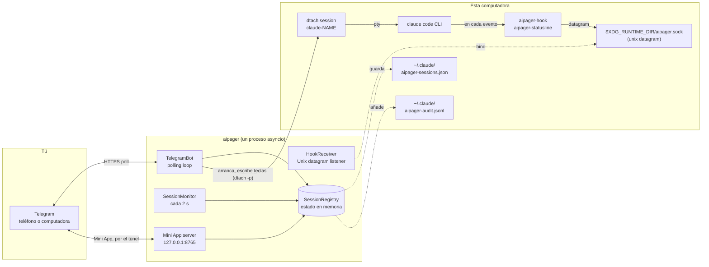

# Arquitectura

<!-- i18n-source: docs/architecture.md @ d4381f41 -->

> Esta página es una traducción de la página en inglés; si no coinciden, la versión en inglés es la correcta. ([English](../../architecture.md))

aipager es un programa asyncio de un solo proceso que funciona en segundo plano. Une tres mundos: tu chat de Telegram, los procesos de Claude Code que ejecutas bajo `dtach`, y el sistema de hooks de Claude Code. Todo pasa por un único event loop: sin grupos de workers, sin base de datos, sin colas entre procesos.

## Diagrama de piezas

Todo lo del diagrama, menos Telegram, funciona en esta computadora. aipager también habla con algunos otros servidores: el túnel de Cloudflare de la Mini App (y GitHub, una vez, para su `cloudflared`), `telegram.org` para el script de la Mini App, la búsqueda de versiones cuando pides una actualización, la descarga del modelo de voz la primera vez que usas audios, y el destino de los informes de problemas cuando envías uno. Todos están en [Modelo de seguridad → conexiones de red](security.md#network-surface).

## Cómo funciona el proceso

Una sola llamada a `asyncio.run` en `aipager/cli/daemon.py` lo mueve todo. Dentro:

- **`TelegramBot`** (`aipager/bot/`): tiene un `Application` de `python-telegram-bot`. Recibe las actualizaciones de Telegram, las reparte a los manejadores de mensajes, botones y audios, y mantiene al día las tarjetas de actividad, la barra de estado fijada y las respuestas.
- **`HookReceiver`** (`aipager/dtach/hook_receiver.py`): abre un socket datagram de Unix en `$XDG_RUNTIME_DIR/aipager.sock`, lee el JSON que envían `aipager-hook` y `aipager-statusline`, y reparte el trabajo según su `hook_event_name` (o `type`, para los mensajes propios de aipager; mira [eventos de hook](hooks.md)).
- **`SessionMonitor`** (`aipager/session_monitor.py`): se despierta cada 2 s para revisar `/tmp/claude-dtach-*.sock`, poner al día las sesiones que encuentra con la lista de sesiones, y ejecutar los vigilantes: una tarjeta de actividad que dejó de avanzar, un mensaje que Claude Code nunca recibió, una solicitud de permiso sin noticias durante 5 minutos que la conversación guardada muestra como terminada (`AIPAGER_INTERACTIVE_TIMEOUT`), una tarea cuyo final no se vio.
- **`SessionRegistry`** (`aipager/state.py`): los objetos `TrackedSession` por nombre de sesión. Se guardan en `~/.claude/aipager-sessions.json` (de forma atómica) al apagarse y cada vez que cambia algo que tiene que sobrevivir a un reinicio.
- **Servidor de la Mini App** (`aipager/miniapp/server.py`): una app aiohttp en `127.0.0.1` y el puerto `MINIAPP_PORT` (por defecto 8765), que mientras está activada (por defecto) llega a Telegram por un túnel de Cloudflare gestionado. Sirve el panel de `/app`.

Todo esto funciona como tareas en el mismo loop. Lo que lo bloquearía se ejecuta en hilos aparte: pasar audios a texto, crear y enviar un informe de problemas, buscar actualizaciones y planear reinicios, descargar el script de la Mini App y `cloudflared`, y la comprobación de autenticación al arrancar.

## Orden de arranque

De `aipager/cli/daemon.py`:

1. Pasa una configuración antigua (`config.env`, `team.yaml`) a `aipager.yaml`, una sola vez, y aparta los archivos viejos.
2. No arranca si otro aipager responde en el socket; luego toma el bloqueo de aipager (`~/.local/share/aipager/daemon.lock`).
3. Comprueba el token del bot con Telegram (`getMe`).
4. Arregla los archivos del propio Claude Code: añade cualquier hook de aipager o la línea de estado que falten en `~/.claude/settings.json` (o `$CLAUDE_CONFIG_DIR/settings.json`, el archivo que leen las sesiones del daemon), y responde las preguntas del primer arranque que un usuario de Telegram no podría responder (mira [Modelo de seguridad](security.md#who-decides-whether-a-tool-call-runs)).
5. `SessionRegistry.load()`: lee `~/.claude/aipager-sessions.json`. Si el archivo no está o no se puede leer, empieza con la lista vacía.
6. Averigua la dirección de la Mini App (tu propia URL, o Tailscale), luego `bot.start()`: empieza a recibir actualizaciones.
7. `HookReceiver.start()`: borra un archivo de socket que haya quedado, lo abre y escucha.
8. `bot.recover_sessions()`: recupera las tarjetas y las solicitudes de las sesiones que estaban trabajando o esperando cuando aipager se detuvo (mira [comandos → respuestas](commands.md#idle-responses)).
9. `SessionMonitor.start()`: empieza el tic de 2 s.
10. Arranca el servidor de la Mini App, luego el túnel (si no pusiste una URL propia), y se publican los botones `📱 App`.
11. aipager espera señales: SIGINT o SIGTERM lo detienen, SIGUSR1 vuelve a cargar los chats y las reglas ([uso en equipo → recargar la configuración sin reiniciar](groups.md#live-reload)).

## Orden de apagado

1. SIGINT o SIGTERM activan el evento `stop`.
2. Un `/update` en curso tiene un poco de margen y luego se detiene su instalador (mira [comandos → actualizar](commands.md#update)).
3. `registry.save()`.
4. Se detiene el túnel y luego el servidor de la Mini App.
5. `session_monitor.stop()`, `hook_receiver.stop()` (cierra el socket y borra su archivo).
6. `bot.stop()`: cancela las animaciones y detiene el `Application`.
7. Otra vez `registry.save()`, por si una tarjeta seguía enviándose.

El reinicio que se pide desde Telegram depende de que todo este camino termine antes de que el sustituto abra el socket. Lo que ves tú está en [comandos del bot → reiniciar](commands.md#restart).

## Dónde están los archivos y los sockets

| Ruta | Para qué | Quién |
|---|---|---|
| `$XDG_RUNTIME_DIR/aipager.sock` | Socket datagram de Unix para los eventos de hook (`/tmp/aipager.sock` sin `$XDG_RUNTIME_DIR`; `$AIPAGER_SOCKET_PATH` tiene prioridad sobre los dos) | aipager (lo abre) |
| `aipager-reply-<id>.sock` (junto al socket de control) | Un socket de respuesta de vida corta por cada solicitud de permiso que espera el hook | `aipager-hook` |
| `aipager-flood-mute.json`, `aipager-flood-backoff.json` (junto al socket de control) | El estado actual de los límites de velocidad de Telegram, para `aipager status` y `aipager doctor` | aipager |
| `aipager-modelswitch-<name>.json` (junto al socket de control) | Marca un cambio de modelo que escribió aipager, durante 30 s ([hooks](hooks.md#premodelswitch)) | aipager (lo escribe), `aipager-hook` (lo toma) |
| `/tmp/claude-dtach-<name>.sock` | Socket de control de dtach de cada sesión | dtach |
| `/tmp/claude-status-<name>.json` | Datos de la línea de estado de cada sesión | `aipager-statusline` |
| `/tmp/claude-notes-<name>/` | Una nota de permisos por cada mensaje de Telegram que aún no se tomó, y una marca `turn-open` que el hook mantiene mientras hay una tarea en curso (un mensaje que se suma a la tarea solo puede endurecer sus reglas) | aipager (escribe las notas), `aipager-hook` (consume las notas; escribe `turn-open`, y los dos la borran) |
| `/tmp/claude-policy-<name>.json` | La copia de referencia de los permisos de la tarea en curso | `aipager-hook` (la escribe al tomar el mensaje), la lee la comprobación `PreToolUse` |
| `/tmp/claude-policy-.floor-<uid>.json` | El mínimo de seguridad, la lista incorporada más tu sección `safety:`, para los casos de reserva del hook | aipager |
| `/tmp/claude-reply-<name>.txt` | El mensaje al que respondiste, cuando respondes a un mensaje anterior | aipager |
| `/tmp/claude-bgjob-<job>.json` | Une una tarea en segundo plano de Claude Code con la sesión cuya conversación pasó a ella (`job`, `session`, el ID de la conversación de la tarea, el PID de claude de la sesión, cuándo, y `ended` cuando llegó el `SessionEnd` propio de la tarea), para que los hooks de esa tarea cuenten para la sesión ([hooks](hooks.md#what-the-daemon-receives)); permisos 0600, se borra cuando la sesión vuelve o termina | aipager (lo escribe), `aipager-hook` y `aipager-statusline` (lo leen) |
| `/tmp/claude-bgjob-pids.json` | El PID del propio `claude` de cada sesión en marcha, para los hooks de una tarea en segundo plano que se ejecutan antes de que exista su archivo de enlace (permisos 0600) | aipager (lo escribe), `aipager-hook` y `aipager-statusline` (lo leen) |
| `/tmp/claude-exit-<name>.json` | El código de salida de `claude` y cuándo arrancó y terminó (`{"code", "start", "end"}`, permisos 0600): el shell que lanza la sesión lo borra antes de que arranque `claude` y lo escribe cuando `claude` termina, y el aviso de fin de la sesión dice el motivo a partir de él ([solución de problemas](troubleshooting.md#a-session-dropped-off-the-pinned-status-bar-it-is-gone)) | el shell que lanza la sesión (lo escribe), aipager (lo lee) |
| `/tmp/aipager-files/<chat>/` | Archivos y audios enviados desde Telegram, una carpeta privada por chat (`0700`, archivos `0600`) | aipager |
| `/tmp/aipager.log` | La salida de un reinicio que aipager hace por su cuenta cuando no hay servicio | aipager |
| `~/.claude/aipager-sessions.json` | El estado duradero de la lista de sesiones | aipager |
| `~/.claude/aipager-audit.jsonl` | Registro de permitir, rechazar y respuestas | aipager (solo añade) |
| `~/.claude/aipager-flood-state.json` | El historial de límites de velocidad de Telegram de cada chat, que sobrevive a los reinicios ([solución de problemas](troubleshooting.md#the-bot-went-quiet-flood-control)) | aipager |
| `~/.claude/aipager-tunnel.json`, `aipager-cloudflared.log`, `aipager-cloudflared.err` | El túnel de la Mini App que mantiene aipager: su proceso, sus puertos locales y un hash de su dirección (nunca la dirección), para que el siguiente aipager pueda quedárselo tras un reinicio planificado (permisos 600); los avisos de cloudflared; la última salida de error de cloudflared (permisos 600), que dice por qué no pudo arrancar un túnel ([solución de problemas](troubleshooting.md#the-mini-app-link-isnt-working)) | aipager; el registro también lo borran el guardián del túnel conservado y `aipager uninstall` |
| `~/.claude/aipager-pending-users.json` | Personas que llamaron al bot en un grupo donde no trabaja, o que no son miembros de un grupo donde sí trabaja, para que `aipager config` pueda añadirlas (permisos 0600, se reemplaza entero en cada escritura, las 200 más recientes vistas en los últimos 30 días) | aipager (lo escribe), `aipager config` (lo lee) |
| `~/aipager-users/<label>/` | Las [carpetas raíz](groups.md#root-folders) por defecto de los miembros (permisos 0700), donde los miembros `user` y `read_only` crean sus sesiones; `aipager uninstall` las conserva | aipager (la crea en el primer `/new` o «Nueva sesión» de la Mini App de un miembro) |
| `~/.claude/settings.json` (o `$CLAUDE_CONFIG_DIR/settings.json`) | La configuración de hooks de Claude Code: el que leen las sesiones del daemon, de la carpeta de configuración de Claude Code para el entorno que reciben ([solución de problemas](troubleshooting.md#using-an-api-key-a-gateway-or-another-provider)) | `aipager config` / `aipager setup`; en cada arranque aipager añade cualquier hook o línea de estado que falte y pone `skipDangerousModePermissionPrompt` ([Modelo de seguridad](security.md#who-decides-whether-a-tool-call-runs)), y otra vez antes de que empiece una sesión cuando ese archivo es nuevo |
| `settings.json.bak.*` (a su lado) | Copias de seguridad antes de cada reescritura | `aipager config`, `aipager setup`, `aipager uninstall` |
| `~/.claude.json` (o `$CLAUDE_CONFIG_DIR/.claude.json`, `.claude-custom-oauth.json` con `CLAUDE_CODE_CUSTOM_OAUTH_URL`, o el antiguo `.config.json` de la carpeta de configuración cuando Claude Code lo usa) | El archivo propio de Claude Code: aipager marca como de confianza la carpeta donde empieza una sesión justo antes de que empiece (también la carpeta personal, nunca `/` ni una carpeta por encima de la personal), para que la pregunta de confianza de Claude Code no frene una sesión creada desde Telegram. Al arrancar aipager no se marca nada. Nunca se reescribe si no se puede leer entero o si un Claude en marcha lo cambió mientras tanto. De la misma forma responde la pregunta «use this API key?» para el `ANTHROPIC_API_KEY` de la sesión (`customApiKeyResponses`, los últimos 20 caracteres de la clave) y marca como hecho el primer uso de Claude Code cuando la sesión tiene con qué autenticarse (`hasCompletedOnboarding`), para que tampoco estas preguntas bloqueen una sesión iniciada desde Telegram ([proveedores](troubleshooting.md#using-an-api-key-a-gateway-or-another-provider)). | aipager |
| `~/.claude/.credentials.json` (o el de la carpeta de configuración) → `.credentials.json.stale` | El archivo de credenciales de Claude Code, que se aparta cuando una sesión arranca con `CLAUDE_CODE_OAUTH_TOKEN` puesto y el archivo solo tiene credenciales caducadas o vacías (si no, ganarían al token); devuélvelo a su sitio para deshacerlo | aipager |
| `~/.config/aipager/aipager.yaml` | Token del bot, chats, miembros y roles, ajustes de la Mini App | `aipager config` (permisos 600); aipager mueve la entrada de un grupo cuando Telegram lo convierte en supergrupo, y guarda una copia `aipager.yaml.bak.<time>` cuando pasa ahí ajustes viejos de la Mini App |
| `~/.config/aipager/policy.yaml` | Reglas por rol y reglas de seguridad adicionales | tú (se comprueba con `aipager policy validate`); se escribe una vez un ejemplo comentado cuando se migra una instalación antigua |
| `~/.config/aipager/preferences.json` | Lo elegido en `/settings` para cada chat y cada sesión | aipager |
| `~/.config/aipager/daemon.env` | Credencial de Claude para las sesiones que se arrancan | tú / `aipager service install` / `aipager doctor --fix` (permisos 600) |
| `~/.config/aipager/config.env`, `team.yaml` → `*.bak.<time>`, `*.retired.<time>` | La configuración de una instalación antigua: se copia y luego se aparta cuando `aipager.yaml` ya la tiene | aipager, `aipager config`, `aipager setup` |
| `~/.config/aipager/keyboard.json` | Cambios opcionales del teclado | tú |
| `~/.local/share/aipager/sessions/` | Una carpeta por sesión con su `SESSION.md` (quién puede hablarle, y las reglas), que se rehace en cada arranque | aipager |
| `~/.local/share/aipager/webapp-sdk/`, `cloudflared/` | El script de la Mini App de Telegram y el binario `cloudflared` comprobado | aipager |
| `~/.local/share/aipager/daemon.lock`, `update.lock`, `update-restart.json` | Un solo aipager a la vez; una sola actualización a la vez; la actualización que hay que anunciar después del reinicio | aipager |
| `~/.local/share/aipager/install.json`, `running.json` | Cuándo arrancó aipager aquí por primera vez; si está en marcha ahora (para distinguir una caída de una parada normal) | aipager |
| `~/.local/state/aipager/reports.json` | Informes de problemas: los fingerprints de los errores registrados, las cantidades y el estado de las propuestas (permisos 600); mira [informes de problemas](problem-reports.md#what-is-kept-on-your-machine) | aipager |
| `~/.local/state/aipager/report-sends.json` | Los informes enviados hoy (el límite diario) | aipager, `aipager report` |
| `~/.local/state/aipager/languages.json` | El estado de idioma (permisos 600): quién ya usaba aipager antes de que hubiera idiomas, el último idioma de Telegram visto de cada persona, si ya se enviaron la propuesta única de idioma y la línea de primer contacto, y un hash de cada descripción del bot que puso aipager; mira [Idiomas](commands.md#languages) | aipager |
| `~/.local/state/aipager/tunnel-status.json` | El estado del túnel de la Mini App (arrancando, funcionando, o sin funcionar con la causa y cuándo lo vuelve a intentar; nunca su dirección; permisos 600), para `aipager doctor` ([solución de problemas](troubleshooting.md#the-mini-app-link-isnt-working)) | aipager (lo escribe y lo borra al detenerse), `aipager doctor` (lo lee) |
| `~/.config/systemd/user/aipager.service` (Linux), `~/Library/LaunchAgents/com.aipager.daemon.plist` (macOS), y una copia `.bak.<time>` del que reemplaza una instalación (en Linux solo si es distinto) | El servicio en segundo plano | `aipager service install` |
| `~/Library/Logs/aipager.log` (macOS) | El log del servicio de launchd, que lee `aipager logs` | launchd, para el servicio |

Además de esto, aipager crea una carpeta nueva para una sesión cuando se la pides (Nueva carpeta en `/new` o en la Mini App), y los instaladores y el modelo de voz escriben sus propios archivos cuando actualizas o usas la voz. Todo está bajo tu carpeta personal, bajo `/tmp`, o junto al socket de control. aipager nunca toma más permisos; mira [Modelo de seguridad](security.md#privilege-boundary).

### Una instancia aislada (para pruebas)

Pon `AIPAGER_INSTANCE_DIR` en una carpeta absoluta que sea tuya y todos los archivos compartidos de la tabla de arriba se mueven ahí: el socket de control (y los sockets de respuesta, los archivos de señal de los límites de velocidad y la marca de cambio de modelo que están a su lado), los sockets `claude-dtach-*`, los archivos `claude-policy-*`, `claude-notes-*`, `claude-status-*`, `claude-reply-*`, `claude-bgjob-*` y `claude-exit-*`, el archivo del mínimo de seguridad, la carpeta de descargas `aipager-files` y el log del reinicio que aipager hace por su cuenta. Las sesiones que arranca la instancia heredan el ajuste, así que sus hooks solo hablan con esa instancia, y las reglas de seguridad protegen igual los archivos movidos. La instancia no lee el `.env` de un checkout.

Los archivos bajo tu carpeta personal no se mueven, así que apunta también `HOME` a otra carpeta. `aipager start` se niega a arrancar si la carpeta de la instancia está puesta y `HOME` es tu carpeta personal real, si la carpeta no es una ruta absoluta a una carpeta tuya, o si es demasiado larga para la ruta de un socket.

`/update` y `/restart` no quedan aislados: actúan sobre el paquete aipager instalado y el servicio `aipager.service`, así que nunca los envíes a una instancia de prueba.

`AIPAGER_TELEGRAM_API_BASE` (por ejemplo `http://127.0.0.1:41234`) envía todas las peticiones a la Bot API y las descargas de archivos a esa dirección en lugar de `https://api.telegram.org`. Tiene que ser esta computadora (`localhost` o una dirección loopback) salvo que pongas `AIPAGER_TELEGRAM_API_ALLOW_REMOTE=1`, para que un error de escritura no pueda enviar el token del bot a otro sitio.

Los dos ajustes existen para que las pruebas de punta a punta puedan ejecutar un segundo aipager contra un Telegram de imitación local, junto al tuyo de verdad. Sin ninguno de los dos, todas las rutas y direcciones son las de la tabla de arriba.

## Por qué dtach

dtach le da a cada sesión de Claude Code una PTY real sin atarla a una terminal que tenga que seguir abierta. aipager arranca una sesión con `dtach -n` y escribe en ella con `dtach -p` (mensajes, Escape, las teclas que responden un diálogo); nunca lee la pantalla, porque los hooks y la conversación guardada dicen lo que pasa. Puedes conectarte de forma interactiva desde cualquier shell con `aipager session <name>` para tener acceso directo. Esa conexión sigue a la sesión a través de un reinicio desde Telegram (`/mode` hacia o desde Modo Acceso total, `/restart`, Reiniciar): cuando el socket de la sesión desaparece, espera hasta 15 s a que vuelva el mismo socket y se reconecta sola. Si la sesión terminó de verdad, vuelves al shell después de la espera (Ctrl-C corta la espera antes). La conexión funciona con la tecla de desconexión de dtach apagada, así que `Ctrl-\` llega a Claude; para salir, cierra la terminal o el panel de tmux y la sesión sigue en marcha.

Dentro de la sesión de dtach, una sesión que arranca aipager ejecuta `dtach -> bash -> claude`, y una arrancada con `aipager session` ejecuta `dtach -> sh -> claude`: el shell espera a `claude` para poder guardar su código de salida (`claude-exit-<name>.json`), que lee el aviso de fin de la sesión. Los argumentos de `aipager session` llegan a `claude` tal cual, nunca pasan por el análisis del shell.

Un reinicio desde Telegram termina el dtach de la sesión y lo arranca otra vez con la misma conversación. Una sesión cuya conversación pasó al segundo plano de Claude Code (← en una entrada vacía; mira [solución de problemas](troubleshooting.md#a-session-moved-to-claude-codes-background)) se reinicia igual, con un paso más antes: aipager ejecuta `claude stop <job>` y espera hasta que ningún proceso en segundo plano tenga la conversación, luego termina el dtach de la sesión y lo arranca con la conversación de la tarea y los ajustes propios de aipager. Mientras una sesión está en el segundo plano de Claude Code, aipager no escribe nada en su dtach.

El resultado: Claude Code funciona como si escribieras en una terminal, pero esa terminal puede ir y venir sin molestar a la sesión en marcha. aipager encuentra las sesiones revisando `/tmp/claude-dtach-*.sock` en cada tic de 2 s del vigilante. Una sesión encontrada pertenece al chat para el que se creó su nombre, y una creada en la terminal pertenece al chat privado del propietario en una instalación con chat privado y grupo.

## Ver también

- [Eventos de hook](hooks.md): lo que llega por el socket de control.
- [Comandos del bot](commands.md): lo que llega desde Telegram.
- [Modelo de seguridad](security.md): límite de permisos, secretos, auditoría.
- [Solución de problemas](troubleshooting.md): referencia de `aipager doctor`.
