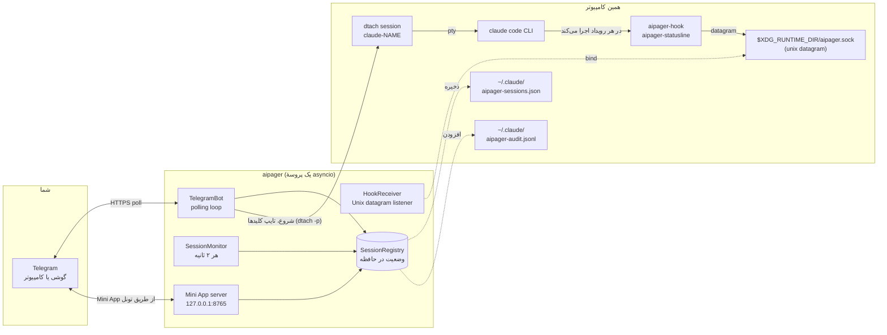

# معماری

<!-- i18n-source: docs/architecture.md @ 6295e500 -->

> این صفحه ترجمهٔ صفحهٔ انگلیسی است؛ اگر جایی با هم فرق داشتند، نسخهٔ انگلیسی درست است. ([English](../../architecture.md))

&rlm;aipager یک برنامهٔ asyncio تک‌پروسه‌ای است که در پس‌زمینه اجرا می‌شود. سه دنیا را به هم وصل می‌کند: چت تلگرام شما، پروسه‌های Claude Code که زیر `dtach` اجرا می‌کنید، و سیستم هوک‌های Claude Code. همه‌چیز از یک event loop می‌گذرد: بدون worker pool، بدون پایگاه داده، بدون صف بین پروسه‌ها.

## نمودار اجزا

هر چه در نمودار هست، جز تلگرام، روی همین کامپیوتر اجرا می‌شود. aipager با چند جای دیگر هم حرف می‌زند: تونل Cloudflare برای Mini App (و یک بار GitHub، برای `cloudflared`)، `telegram.org` برای اسکریپت Mini App، چک کردن نسخه‌ها وقتی آپدیت می‌خواهید، دانلود مدل تبدیل صدا به متن وقتی اولین بار ویس می‌فرستید، و مقصد گزارش مشکل وقتی یکی می‌فرستید. همه در [مدل امنیتی ← ارتباطات شبکه](security.md#network-surface) آمده‌اند.

## ساختار پروسه

یک فراخوانی `asyncio.run` در `aipager/cli/daemon.py` همه‌چیز را می‌گرداند. داخل آن:

- &rlm;**`TelegramBot`** (`aipager/bot/`): یک `Application` از `python-telegram-bot` را در اختیار دارد. آپدیت‌ها را از تلگرام می‌گیرد، آن‌ها را به گرداننده‌های پیام، دکمه و ویس می‌دهد، و کارت‌های در حال کار، نوار وضعیت سنجاق‌شده و جواب‌ها را آپدیت نگه می‌دارد.
- &rlm;**`HookReceiver`** (`aipager/dtach/hook_receiver.py`): یک سوکت datagram یونیکس در &lrm;`$XDG_RUNTIME_DIR/aipager.sock` باز می‌کند و JSONی را که `aipager-hook` و `aipager-statusline` می‌فرستند می‌خواند، و بر اساس `hook_event_name` آن (یا `type` برای پیام‌های خود aipager؛ [رویدادهای هوک](hooks.md) را ببینید) کار را پخش می‌کند.
- &rlm;**`SessionMonitor`** (`aipager/session_monitor.py`): هر ۲ ثانیه بیدار می‌شود تا &lrm;`/tmp/claude-dtach-*.sock` را بگردد، سشن‌هایی را که پیدا می‌کند با فهرست سشن‌ها هماهنگ کند و نگهبان‌ها را اجرا کند: کارت در حال کاری که دیگر جلو نمی‌رود، پیامی که Claude Code هیچ‌وقت تحویل نگرفت، درخواست اجازه‌ای که ۵ دقیقه هیچ خبری از آن نیست و گفتگوی ذخیره‌شده نشان می‌دهد تمام شده (`AIPAGER_INTERACTIVE_TIMEOUT`)، کاری که پایانش دیده نشد.
- &rlm;**`SessionRegistry`** (`aipager/state.py`): شیءهای `TrackedSession` که با اسم سشن پیدا می‌شوند. هنگام خاموش شدن، و هر وقت چیزی که باید بعد از ری‌استارت بماند عوض شود، (به‌شکل اتمی) در &lrm;`~/.claude/aipager-sessions.json` ذخیره می‌شود.
- **سرور Mini App** (`aipager/miniapp/server.py`): یک اپ aiohttp روی `127.0.0.1` و پورت `MINIAPP_PORT` (پیش‌فرض 8765)، که تا وقتی روشن است (پیش‌فرض) از طریق یک تونل Cloudflare مدیریت‌شده به تلگرام می‌رسد. داشبورد &lrm;`/app` را سرو می‌کند.

همهٔ این‌ها به‌شکل task روی همان loop اجرا می‌شوند. کارهایی که loop را معطل می‌کنند در threadهای جدا اجرا می‌شوند: تبدیل ویس به متن، ساختن و فرستادن گزارش مشکل، چک کردن آپدیت و برنامه‌ریزی ری‌استارت، دانلود اسکریپت Mini App و `cloudflared`، و چک کردن لاگین در شروع.

## ترتیب شروع

از `aipager/cli/daemon.py`:

1. تنظیمات قدیمی (`config.env`،&rlm; `team.yaml`) را یک بار به `aipager.yaml` منتقل می‌کند و فایل‌های قدیمی را کنار می‌گذارد.
2. اگر aipager دیگری روی سوکت جواب بدهد، شروع نمی‌شود؛ بعد قفل aipager را می‌گیرد (&lrm;`~/.local/share/aipager/daemon.lock`).
3. توکن ربات را با تلگرام چک می‌کند (`getMe`).
4. فایل‌های خود Claude Code را درست می‌کند: هر هوک aipager یا خط وضعیتی را که در &lrm;`~/.claude/settings.json` (یا &lrm;`$CLAUDE_CONFIG_DIR/settings.json`، فایلی که سشن‌های aipager می‌خوانند) نیست اضافه می‌کند، و به سؤال‌های اولین اجرای Claude Code که کاربر تلگرام نمی‌تواند جوابشان را بدهد، جواب می‌دهد ([مدل امنیتی](security.md#who-decides-whether-a-tool-call-runs) را ببینید).
5. &rlm;`SessionRegistry.load()`&lrm;:&rlm; &lrm;`~/.claude/aipager-sessions.json` را می‌خواند. اگر فایل نباشد یا خوانده نشود، با فهرست خالی شروع می‌کند.
6. آدرس Mini App را پیدا می‌کند (آدرس خودتان یا Tailscale)، بعد `bot.start()`&lrm;: گرفتن آپدیت‌ها از تلگرام شروع می‌شود.
7. &rlm;`HookReceiver.start()`&lrm;: فایل سوکت جامانده را پاک می‌کند، سوکت را باز می‌کند و گوش می‌دهد.
8. &rlm;`bot.recover_sessions()`&lrm;: کارت‌ها و درخواست‌های سشن‌هایی را که موقع خاموش شدن aipager در حال کار یا منتظر بودند برمی‌گرداند ([فرمان‌ها ← جواب‌ها](commands.md#idle-responses) را ببینید).
9. &rlm;`SessionMonitor.start()`&lrm;: تیک ۲ ثانیه‌ای را شروع می‌کند.
10. سرور Mini App شروع می‌شود، بعد تونل (وقتی آدرس خودتان را نداده‌اید)، و دکمه‌های &lrm;`📱 App` منتشر می‌شوند.
11. &rlm;aipager منتظر سیگنال‌ها می‌ماند: SIGINT یا SIGTERM متوقفش می‌کند و SIGUSR1 چت‌ها و قانون‌ها را دوباره می‌خواند ([استفادهٔ تیمی ← خواندن دوبارهٔ تنظیمات بدون ری‌استارت](groups.md#live-reload)).

## ترتیب خاموش شدن

1. &rlm;SIGINT یا SIGTERM رویداد `stop` را روشن می‌کند.
2. یک &lrm;`/update` در حال اجرا کمی فرصت می‌گیرد و بعد نصب‌کننده‌اش متوقف می‌شود ([فرمان‌ها ← آپدیت](commands.md#update) را ببینید).
3. `registry.save()`&lrm;.
4. تونل متوقف می‌شود، بعد سرور Mini App.
5. &rlm;`session_monitor.stop()`&lrm;،&rlm; `hook_receiver.stop()`&lrm; (سوکت را می‌بندد و فایلش را پاک می‌کند).
6. &rlm;`bot.stop()`&lrm;: انیمیشن‌ها را لغو می‌کند و `Application` را متوقف می‌کند.
7. دوباره `registry.save()`&lrm;، برای کارتی که ارسالش هنوز در جریان بود.

ری‌استارتی که از تلگرام انجام می‌شود به این وابسته است که کل این مسیر قبل از اینکه جانشین سوکت را باز کند تا آخر اجرا شود. رفتاری که شما می‌بینید در [فرمان‌های ربات ← ری‌استارت](commands.md#restart) آمده است.

## جای فایل‌ها و سوکت‌ها

| مسیر | کاربرد | صاحب |
|---|---|---|
| &lrm;`$XDG_RUNTIME_DIR/aipager.sock` | سوکت datagram یونیکس برای رویدادهای هوک (بدون &lrm;`$XDG_RUNTIME_DIR` در &lrm;`/tmp/aipager.sock`؛&rlm; &lrm;`$AIPAGER_SOCKET_PATH` بر هر دو مقدم است) | aipager (bind می‌کند) |
| `aipager-reply-<id>.sock` (کنار سوکت کنترل) | یک سوکت جواب کوتاه‌عمر برای هر درخواست اجازه‌ای که هوک منتظرش است | `aipager-hook` |
| `aipager-flood-mute.json`،&rlm; `aipager-flood-backoff.json` (کنار سوکت کنترل) | وضعیت فعلی محدودیت سرعت تلگرام، برای `aipager status` و doctor | aipager |
| `aipager-modelswitch-<name>.json` (کنار سوکت کنترل) | علامت یک تعویض مدل که خود aipager تایپ کرده، برای ۳۰ ثانیه ([هوک‌ها](hooks.md#premodelswitch)) | aipager (می‌نویسد)، `aipager-hook` (برمی‌دارد) |
| &lrm;`/tmp/claude-dtach-<name>.sock` | سوکت کنترل dtach برای هر سشن | dtach |
| &lrm;`/tmp/claude-status-<name>.json` | دادهٔ خط وضعیت هر سشن | `aipager-statusline` |
| &lrm;`/tmp/claude-notes-<name>/`&lrm; | یک یادداشت اجازه برای هر پیام تلگرامی که هنوز برداشته نشده، و علامت `turn-open` که هوک تا وقتی یک کار در جریان است نگه می‌دارد (پیامی که به آن کار اضافه شود فقط می‌تواند قانون‌هایش را سخت‌تر کند) | aipager (یادداشت‌ها را می‌نویسد)، `aipager-hook` (یادداشت‌ها را مصرف می‌کند؛ `turn-open` را می‌نویسد و هر دو پاکش می‌کنند) |
| &lrm;`/tmp/claude-policy-<name>.json` | عکس فوری اصلی از اجازه‌های کار در جریان | `aipager-hook` (موقع برداشتن پیام می‌نویسد)، بررسی `PreToolUse` می‌خواندش |
| &lrm;`/tmp/claude-policy-.floor-<uid>.json` | کف ایمنی، یعنی فهرست داخلی به‌علاوهٔ بخش `safety:`&lrm; شما، برای حالت‌های جایگزین هوک | aipager |
| &lrm;`/tmp/claude-reply-<name>.txt` | پیامی که به آن جواب دادید، وقتی به یک پیام قدیمی‌تر جواب می‌دهید | aipager |
| &lrm;`/tmp/aipager-files/<chat>/`&lrm; | فایل‌ها و ویس‌هایی که از تلگرام فرستاده شده، در یک پوشهٔ خصوصی برای هر چت (`0700`، فایل‌ها `0600`) | aipager |
| &lrm;`/tmp/aipager.log` | خروجی ری‌استارت خودکار وقتی سرویسی در کار نیست | aipager |
| &lrm;`~/.claude/aipager-sessions.json` | وضعیت ماندگار فهرست سشن‌ها | aipager |
| &lrm;`~/.claude/aipager-audit.jsonl` | لاگ اجازه دادن، رد کردن و جواب‌ها | aipager (فقط اضافه می‌کند) |
| &lrm;`~/.claude/aipager-flood-state.json` | تاریخچهٔ محدودیت سرعت تلگرام برای هر چت، که بعد از ری‌استارت هم می‌ماند ([رفع مشکل](troubleshooting.md#the-bot-went-quiet-flood-control)) | aipager |
| &lrm;`~/.claude/aipager-tunnel.json`،&rlm; `aipager-cloudflared.log` | تونل Mini App که aipager نگهش می‌دارد: پروسه‌اش، پورت‌های محلی‌اش و هش آدرسش (هیچ‌وقت خود آدرس)، تا aipager بعدی بعد از یک ری‌استارت برنامه‌ریزی‌شده آن را تحویل بگیرد (حالت دسترسی 600)؛ و هشدارهای cloudflared | aipager؛ این رکورد را نگهبانِ تونلِ نگه‌داشته‌شده و `aipager uninstall` هم پاک می‌کنند |
| &lrm;`~/.claude/aipager-pending-users.json` | کسانی که در گروهی که ربات در آن کار نمی‌کند ربات را صدا زده‌اند، یا عضو گروهی که ربات در آن کار می‌کند نیستند، تا `aipager config` بتواند اضافه‌شان کند (حالت دسترسی 0600، هر بار کامل عوض می‌شود، ۲۰۰ نفر آخری که در ۳۰ روز گذشته دیده شده‌اند) | aipager (می‌نویسد)، `aipager config` (می‌خواند) |
| &lrm;`~/aipager-users/<label>/`&lrm; | پوشهٔ root پیش‌فرض اعضا ([پوشه‌های root](groups.md#root-folders))، با حالت دسترسی 0700، جایی که اعضای `user` و `read_only` سشن‌هایشان را شروع می‌کنند؛ `aipager uninstall` نگهشان می‌دارد | aipager (در اولین &lrm;`/new` یا «سشن جدید» یک عضو در Mini App می‌سازدش) |
| &lrm;`~/.claude/settings.json` (یا &lrm;`$CLAUDE_CONFIG_DIR/settings.json`) | تنظیم هوک‌های Claude Code؛ همان فایلی که سشن‌های aipager می‌خوانند، از پوشهٔ تنظیمات Claude Code برای محیطی که می‌گیرند ([عیب‌یابی](troubleshooting.md#using-an-api-key-a-gateway-or-another-provider)) | `aipager config` /&rlm; `aipager setup`؛ در هر شروع، aipager هر هوک یا خط وضعیتی را که کم باشد اضافه می‌کند و `skipDangerousModePermissionPrompt` را تنظیم می‌کند ([مدل امنیتی](security.md#who-decides-whether-a-tool-call-runs))، و دوباره پیش از شروع یک سشن وقتی آن فایل تازه باشد |
| &lrm;`settings.json.bak.*`&lrm; (کنار خود فایل)&lrm; | نسخهٔ پشتیبان قبل از هر بازنویسی | `aipager config`،&rlm; `aipager setup`،&rlm; `aipager uninstall` |
| &lrm;`~/.claude.json` (یا &lrm;`$CLAUDE_CONFIG_DIR/.claude.json`، فایل &lrm;`.claude-custom-oauth.json` با `CLAUDE_CODE_CUSTOM_OAUTH_URL`، یا &lrm;`.config.json` قدیمی در پوشهٔ تنظیمات وقتی Claude Code از آن استفاده می‌کند) | فایل خود Claude Code:&rlm; aipager پوشه‌ای را که سشن در آن شروع می‌شود درست پیش از شروع، مورد اعتماد علامت می‌زند (پوشهٔ خانه هم، ولی هیچ‌وقت `/` یا پوشه‌ای بالاتر از پوشهٔ خانه)، تا سؤال اعتماد Claude Code جلوی سشنی را که از تلگرام شروع می‌شود نگیرد. موقع شروع aipager چیزی علامت نمی‌خورد. اگر نشود کامل خواندش یا یک Claude در حال اجرا در همین فاصله تغییرش داده باشد، هیچ‌وقت بازنویسی نمی‌شود. همچنین برای کلید `ANTHROPIC_API_KEY` سشن به سؤال «use this API key?» جواب می‌دهد (`customApiKeyResponses`،&rlm; ۲۰ کاراکتر آخر کلید) و وقتی سشن اطلاعات ورود دارد، اجرای اول Claude Code را تمام‌شده علامت می‌زند (`hasCompletedOnboarding`)، تا این سؤال‌ها هم سشنی را که از تلگرام شروع شده متوقف نکنند ([ارائه‌دهنده‌ها](troubleshooting.md#using-an-api-key-a-gateway-or-another-provider)). | aipager |
| &lrm;`~/.claude/.credentials.json` (یا همان فایل در پوشهٔ تنظیمات) ← &lrm;`.credentials.json.stale` | فایل لاگین Claude Code؛ وقتی سشنی با `CLAUDE_CODE_OAUTH_TOKEN` شروع شود و این فایل فقط یک لاگین منقضی یا خالی داشته باشد کنار گذاشته می‌شود (وگرنه بر توکن مقدم می‌شد)؛ برای برگرداندن، دوباره سر جایش بگذاریدش | aipager |
| &lrm;`~/.config/aipager/aipager.yaml` | توکن ربات، چت‌ها، اعضا و نقش‌ها، تنظیمات Mini App | `aipager config` (حالت دسترسی 600)؛ وقتی تلگرام یک گروه را به سوپرگروه ارتقا می‌دهد aipager بخش آن گروه را جابه‌جا می‌کند، و وقتی تنظیمات قدیمی Mini App را به آن منتقل می‌کند یک کپی `aipager.yaml.bak.<time>`&lrm; نگه می‌دارد |
| &lrm;`~/.config/aipager/policy.yaml` | قانون‌های هر نقش و قانون‌های اضافهٔ ایمنی | خودتان (با `aipager policy validate` چک می‌شود)؛ وقتی یک نصب قدیمی منتقل می‌شود، یک بار یک نمونهٔ شروع با توضیح نوشته می‌شود |
| &lrm;`~/.config/aipager/preferences.json` | انتخاب‌های &lrm;`/settings` هر چت و هر سشن | aipager |
| &lrm;`~/.config/aipager/daemon.env` | اطلاعات ورود Claude برای سشن‌هایی که شروع می‌شوند | خودتان / `aipager service install` /&rlm; `aipager doctor --fix` (حالت دسترسی 600) |
| &lrm;`~/.config/aipager/config.env`،&rlm; `team.yaml` ← `*.bak.<time>`&lrm;،&rlm; &lrm;`*.retired.<time>`&lrm; | تنظیمات یک نصب قدیمی: کپی می‌شود و بعد از اینکه `aipager.yaml` آن را گرفت کنار گذاشته می‌شود | aipager،&rlm; `aipager config`،&rlm; `aipager setup` |
| &lrm;`~/.config/aipager/keyboard.json` | تغییرات اختیاری کیبورد | خودتان |
| &lrm;`~/.local/share/aipager/sessions/`&lrm; | یک پوشه برای هر سشن با `SESSION.md` آن (چه کسی می‌تواند با آن حرف بزند، و قانون‌ها)، که در هر شروع از نو ساخته می‌شود | aipager |
| &lrm;`~/.local/share/aipager/webapp-sdk/`&lrm;،&rlm; `cloudflared/`&lrm; | اسکریپت Mini App تلگرام و فایل اجرایی `cloudflared` که چک شده | aipager |
| &lrm;`~/.local/share/aipager/daemon.lock`،&rlm; `update.lock`،&rlm; `update-restart.json` | هر بار فقط یک aipager؛ هر بار فقط یک آپدیت؛ آپدیتی که بعد از ری‌استارت باید اعلام شود | aipager |
| &lrm;`~/.local/share/aipager/install.json`،&rlm; `running.json` | aipager اولین بار کی اینجا شروع شد؛ و اینکه الان در حال اجراست یا نه (تا کرش از توقف عادی جدا شود) | aipager |
| &lrm;`~/.local/state/aipager/reports.json` | گزارش مشکل: fingerprint خطاهای ثبت‌شده، تعدادها و وضعیت پیشنهادها (حالت دسترسی 600)؛ [گزارش مشکل](problem-reports.md#what-is-kept-on-your-machine) را ببینید | aipager |
| &lrm;`~/.local/state/aipager/report-sends.json` | گزارش‌هایی که امروز فرستاده شده (سقف روزانه) | aipager،&rlm; `aipager report` |
| &lrm;`~/.local/state/aipager/languages.json` | وضعیت زبان (حالت دسترسی 600): چه کسانی قبل از اضافه شدن زبان‌ها از aipager استفاده می‌کردند، آخرین زبان تلگرامی که از هر نفر دیده شد، اینکه پیشنهاد یک‌بارهٔ زبان و خط اولین آشنایی فرستاده شده یا نه، و هش هر توضیح رباتی که aipager تنظیم کرده؛ [زبان‌ها](commands.md#languages) را ببینید | aipager |
| &lrm;`~/.config/systemd/user/aipager.service` (Linux)،&rlm; &lrm;`~/Library/LaunchAgents/com.aipager.daemon.plist` (macOS)، و یک کپی &lrm;`.bak.<time>`&lrm; از فایلی که نصب جایگزینش می‌کند (روی Linux فقط وقتی فرق داشته باشد) | سرویس پس‌زمینه | `aipager service install` |
| &lrm;`~/Library/Logs/aipager.log` (macOS) | لاگ سرویس launchd، که `aipager logs` می‌خواندش | launchd، برای سرویس |

جدا از این‌ها، aipager وقتی بخواهید یک پوشهٔ جدید برای سشن می‌سازد («پوشهٔ جدید» در &lrm;`/new` یا Mini App)، و نصب‌کننده‌ها و مدل ویس وقتی آپدیت می‌کنید یا از ویس استفاده می‌کنید فایل‌های خودشان را می‌نویسند. همهٔ این‌ها زیر پوشهٔ خانهٔ شما، زیر &lrm;`/tmp` یا کنار سوکت کنترل است. aipager هیچ‌وقت دسترسی بالاتر نمی‌گیرد؛ [مدل امنیتی](security.md#privilege-boundary) را ببینید.

### یک نسخهٔ جدا (برای تست)

&rlm;`AIPAGER_INSTANCE_DIR` را برابر یک پوشهٔ مطلق که مال خودتان است بگذارید تا همهٔ فایل‌های مشترک زمان اجرا در جدول بالا به آن منتقل شوند: سوکت کنترل (و سوکت‌های جواب، فایل‌های علامت محدودیت سرعت و علامت تعویض مدل که کنارش هستند)، سوکت‌های `claude-dtach-*`&lrm;، فایل‌های `claude-policy-*`&lrm;،&rlm; `claude-notes-*`&lrm;،&rlm; `claude-status-*`&lrm; و `claude-reply-*`&lrm;، فایل کف ایمنی، پوشهٔ دانلود `aipager-files` و لاگ ری‌استارت خودکار. سشن‌هایی که این نسخه شروع می‌کند این تنظیم را به ارث می‌برند، پس هوک‌هایشان فقط با همین نسخه حرف می‌زنند، و قانون‌های ایمنی از فایل‌های منتقل‌شده هم همان‌طور محافظت می‌کنند. این نسخه &lrm;`.env` یک checkout را نمی‌خواند.

فایل‌های زیر پوشهٔ خانه جابه‌جا نمی‌شوند، پس `HOME` را هم به یک پوشهٔ جدا ببرید. `aipager start` اجرا نمی‌شود اگر پوشهٔ نسخه تنظیم شده باشد و `HOME` پوشهٔ خانهٔ واقعی شما باشد، اگر آن پوشه یک مسیر مطلق به پوشه‌ای که مال شماست نباشد، یا اگر برای مسیر یک سوکت زیادی طولانی باشد.

&rlm;&lrm;`/update` و &lrm;`/restart` جدا نمی‌شوند: روی پکیج نصب‌شدهٔ aipager و سرویس `aipager.service` اثر می‌گذارند، پس هیچ‌وقت آن‌ها را به یک نسخهٔ تست نفرستید.

&rlm;`AIPAGER_TELEGRAM_API_BASE` (مثلاً `http://127.0.0.1:41234`) همهٔ درخواست‌های Bot API و دانلود فایل‌ها را به جای `https://api.telegram.org` به آن آدرس می‌فرستد. این آدرس باید همین کامپیوتر باشد (`localhost` یا یک آدرس loopback)، مگر اینکه `AIPAGER_TELEGRAM_API_ALLOW_REMOTE=1` باشد، تا یک اشتباه تایپی نتواند توکن ربات را جای دیگری بفرستد.

هر دو تنظیم برای این هستند که تست‌های end-to-end بتوانند یک aipager دوم را کنار aipager واقعی شما، با یک تلگرام قلابی محلی، اجرا کنند. اگر هیچ‌کدام تنظیم نشده باشد، همهٔ مسیرها و آدرس‌ها همان‌هایی است که در جدول بالا آمده.

## چرا dtach

&rlm;dtach به هر سشن Claude Code یک PTY واقعی می‌دهد، بدون اینکه آن را به ترمینالی ببندد که باید باز بماند. aipager سشن را با `dtach -n` شروع می‌کند و با `dtach -p` در آن تایپ می‌کند (پیام‌ها، Escape، کلیدهایی که به یک پنجرهٔ سؤال جواب می‌دهند)؛ هیچ‌وقت صفحه را نمی‌خواند، چون هوک‌ها و گفتگوی ذخیره‌شده می‌گویند چه اتفاقی می‌افتد. می‌توانید از هر shell با `aipager session <name>`&lrm; به‌طور مستقیم به آن وصل شوید. این اتصال سشن را در ری‌استارتی که از تلگرام انجام می‌شود (&lrm;`/mode` به مود دسترسی کامل یا از آن، &lrm;`/restart`، دکمهٔ ری‌استارت) دنبال می‌کند: وقتی سوکت سشن از بین می‌رود، تا ۱۵ ثانیه منتظر می‌ماند که همان سوکت برگردد و خودش دوباره وصل می‌شود. سشنی که واقعاً بسته شده، بعد از این انتظار به shell برمی‌گردد (Ctrl-C زودتر تمامش می‌کند). این اتصال با کلید جدا شدن dtach خاموش اجرا می‌شود، پس `Ctrl-\`&lrm; به Claude می‌رسد؛ برای بیرون آمدن، ترمینال یا پنل tmux را ببندید و سشن به کارش ادامه می‌دهد.

نتیجه: Claude Code طوری اجرا می‌شود که انگار در یک ترمینال تایپ کرده‌اید، ولی آن ترمینال می‌تواند بیاید و برود بدون اینکه سشن در حال اجرا به هم بریزد. aipager سشن‌ها را با گشتن &lrm;`/tmp/claude-dtach-*.sock` در هر تیک ۲ ثانیه‌ای پیدا می‌کند. سشنی که پیدا می‌شود مال چتی است که اسمش برای آن ساخته شده، و سشنی که در ترمینال شروع شده، در نصبی که هم چت خصوصی دارد و هم گروه، مال چت خصوصی مالک است.

## این‌ها را هم ببینید

- [رویدادهای هوک](hooks.md): چه چیزهایی از سوکت کنترل می‌رسد.
- [فرمان‌های ربات](commands.md): چه چیزهایی از تلگرام می‌رسد.
- [مدل امنیتی](security.md): مرز دسترسی، رازها، لاگ ممیزی.
- [رفع مشکل](troubleshooting.md): مرجع `aipager doctor`.

