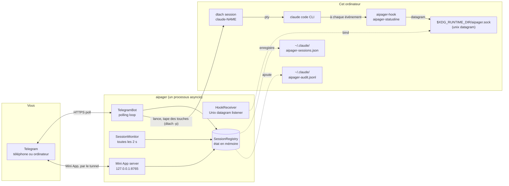

# Architecture

<!-- i18n-source: docs/architecture.md @ d4381f41 -->

> Cette page est une traduction de la page anglaise ; si les deux ne disent pas la même chose, c'est la version anglaise qui fait foi. ([English](../../architecture.md))

aipager est un programme asyncio d'un seul processus qui tourne en arrière-plan. Il relie trois mondes : votre discussion Telegram, les processus Claude Code que vous lancez sous `dtach`, et le système de hooks de Claude Code. Tout passe par une seule boucle d'événements : pas de pool de workers, pas de base de données, pas de files d'attente entre processus.

## Schéma des parties

Tout ce qui est dans le schéma tourne sur cet ordinateur, sauf Telegram. aipager parle aussi à quelques autres serveurs : le tunnel Cloudflare de la Mini App (et GitHub, une fois, pour son `cloudflared`), `telegram.org` pour le script de la Mini App, la vérification des versions quand vous demandez une mise à jour, le téléchargement du modèle vocal la première fois que vous utilisez les messages vocaux, et l'adresse qui reçoit les rapports de problèmes quand vous en envoyez un. Ils sont tous listés dans [Modèle de sécurité → connexions réseau](security.md#network-surface).

## Comment le processus fonctionne

Un seul appel `asyncio.run` dans `aipager/cli/daemon.py` fait tout tourner. À l'intérieur :

- **`TelegramBot`** (`aipager/bot/`) : possède une `Application` de `python-telegram-bot`. Il reçoit les mises à jour de Telegram, passe chacune au gestionnaire des messages, des boutons ou des messages vocaux, et tient à jour les cartes d'activité, la barre d'état épinglée et les réponses.
- **`HookReceiver`** (`aipager/dtach/hook_receiver.py`) : ouvre un socket datagram Unix à `$XDG_RUNTIME_DIR/aipager.sock`, lit le JSON qu'envoient `aipager-hook` et `aipager-statusline`, et répartit le travail selon son `hook_event_name` (ou `type`, pour les messages d'aipager lui-même ; voir [événements de hook](hooks.md)).
- **`SessionMonitor`** (`aipager/session_monitor.py`) : se réveille toutes les 2 s pour parcourir `/tmp/claude-dtach-*.sock`, faire concorder les sessions qu'il trouve avec la liste des sessions, et faire tourner les surveillances : une carte d'activité qui ne bouge plus, un message que Claude Code n'a jamais reçu, une demande d'autorisation sans nouvelles depuis 5 minutes que la conversation enregistrée montre finie (`AIPAGER_INTERACTIVE_TIMEOUT`), une tâche dont la fin n'a pas été vue.
- **`SessionRegistry`** (`aipager/state.py`) : les objets `TrackedSession`, rangés par nom. Enregistrés dans `~/.claude/aipager-sessions.json` (de façon atomique) à l'arrêt et chaque fois que change quelque chose qui doit survivre à un redémarrage.
- **Le serveur de la Mini App** (`aipager/miniapp/server.py`) : une app aiohttp liée à `127.0.0.1` sur `MINIAPP_PORT` (par défaut 8765), publiée vers Telegram par un tunnel Cloudflare géré tant qu'elle est activée (c'est le cas par défaut). Il sert le tableau de bord de `/app`.

Tout cela tourne comme des tâches sur la même boucle. Le travail qui la bloquerait tourne dans des threads à part : la transcription des messages vocaux, la création et l'envoi d'un rapport de problème, la vérification des mises à jour et la préparation du redémarrage, le téléchargement du script de la Mini App et de `cloudflared`, et la vérification de connexion au démarrage.

## Ordre de démarrage

D'après `aipager/cli/daemon.py` :

1. Déplacer une ancienne configuration (`config.env`, `team.yaml`) vers `aipager.yaml`, une seule fois, et mettre les anciens fichiers de côté.
2. Refuser de démarrer si un autre aipager répond sur le socket, puis prendre le verrou d'aipager (`~/.local/share/aipager/daemon.lock`).
3. Vérifier le token du bot auprès de Telegram (`getMe`).
4. Remettre en ordre les fichiers de Claude Code lui-même : ajouter dans `~/.claude/settings.json` (ou `$CLAUDE_CONFIG_DIR/settings.json`, le fichier que lisent les sessions du daemon) tout hook d'aipager qui manque et la ligne d'état, et répondre aux questions du premier lancement auxquelles une personne sur Telegram ne pourrait pas répondre (voir [sécurité](security.md#who-decides-whether-a-tool-call-runs)).
5. `SessionRegistry.load()` : lit `~/.claude/aipager-sessions.json`. Un fichier absent ou illisible fait démarrer avec une liste vide.
6. Trouver l'adresse de la Mini App (votre propre URL, ou Tailscale), puis `bot.start()` : commence à interroger Telegram.
7. `HookReceiver.start()` : supprime un vieux fichier de socket, se lie au socket, écoute.
8. `bot.recover_sessions()` : ramène les cartes et les demandes des sessions qui travaillaient ou attendaient quand aipager s'est arrêté (voir [commandes → réponses](commands.md#idle-responses)).
9. `SessionMonitor.start()` : commence le passage toutes les 2 s.
10. Le serveur de la Mini App démarre, puis le tunnel (quand vous n'avez pas défini votre propre URL), et les boutons `📱 App` sont publiés.
11. aipager attend les signaux : SIGINT ou SIGTERM l'arrêtent, SIGUSR1 recharge les discussions et les règles ([groupes → recharger sans redémarrer](groups.md#live-reload)).

## Ordre d'arrêt

1. SIGINT ou SIGTERM déclenche l'événement `stop`.
2. Un `/update` en cours dispose d'un court délai, puis son installateur est arrêté (voir [commandes → mise à jour](commands.md#update)).
3. `registry.save()`.
4. Le tunnel s'arrête, puis le serveur de la Mini App.
5. `session_monitor.stop()`, `hook_receiver.stop()` (ferme le socket et supprime son fichier).
6. `bot.stop()` : annule les animations et arrête l'`Application`.
7. `registry.save()` à nouveau, pour une carte dont l'envoi était encore en cours.

Le redémarrage lancé depuis Telegram compte sur le fait que tout ce chemin aille jusqu'au bout avant que le remplaçant se lie au socket. Ce que vous voyez est décrit dans [commandes du bot → redémarrer](commands.md#restart).

## Où se trouvent les fichiers et les sockets

| Chemin | Rôle | Qui l'écrit |
|---|---|---|
| `$XDG_RUNTIME_DIR/aipager.sock` | Socket datagram Unix pour les événements de hook (`/tmp/aipager.sock` sans `$XDG_RUNTIME_DIR` ; `$AIPAGER_SOCKET_PATH` remplace les deux) | aipager (se lie au socket) |
| `aipager-reply-<id>.sock` (à côté du socket de contrôle) | Un socket de réponse de courte durée pour chaque demande d'autorisation que le hook attend | `aipager-hook` |
| `aipager-flood-mute.json`, `aipager-flood-backoff.json` (à côté du socket de contrôle) | L'état actuel des limites de Telegram, pour `aipager status` et `aipager doctor` | aipager |
| `aipager-modelswitch-<name>.json` (à côté du socket de contrôle) | Marque un changement de modèle tapé par aipager, pendant 30 s ([hooks](hooks.md#premodelswitch)) | aipager (écrit), `aipager-hook` (le prend) |
| `/tmp/claude-dtach-<name>.sock` | Socket de contrôle dtach de chaque session | dtach |
| `/tmp/claude-status-<name>.json` | Les données de la ligne d'état de chaque session | `aipager-statusline` |
| `/tmp/claude-notes-<name>/` | Une note d'autorisation pour chaque message Telegram pas encore pris, et une marque `turn-open` que le hook garde pendant qu'une tâche tourne (un message qui rejoint la tâche ne peut que rendre ses règles plus strictes) | aipager (notes, écrites), `aipager-hook` (notes consommées ; `turn-open` écrite, et effacée par les deux) |
| `/tmp/claude-policy-<name>.json` | L'instantané de référence des autorisations de la tâche en cours | `aipager-hook` (écrit quand le message est pris), lu par la vérification `PreToolUse` |
| `/tmp/claude-policy-.floor-<uid>.json` | Le socle de sécurité, la liste intégrée plus votre section `safety:`, pour les solutions de repli du hook | aipager |
| `/tmp/claude-reply-<name>.txt` | Le message auquel vous avez répondu, quand vous répondez à un message plus ancien | aipager |
| `/tmp/claude-bgjob-<job>.json` | Relie une tâche d'arrière-plan de Claude Code à la session dont la conversation y est passée (`job`, `session`, l'identifiant de conversation de la tâche, le PID du claude de la session, la date, et `ended` une fois arrivé le `SessionEnd` de la tâche elle-même), pour que les hooks de cette tâche comptent pour la session ([hooks](hooks.md#what-the-daemon-receives)) ; droits 0600, supprimé quand la session est ramenée ou se termine | aipager (écrit), `aipager-hook` et `aipager-statusline` (lisent) |
| `/tmp/claude-bgjob-pids.json` | Le PID du `claude` propre à chaque session en cours, pour les hooks d'une tâche d'arrière-plan qui tournent avant que son fichier de liaison existe (droits 0600) | aipager (écrit), `aipager-hook` et `aipager-statusline` (lisent) |
| `/tmp/claude-exit-<name>.json` | Le code de sortie de `claude` et l'heure de son démarrage et de sa fin (`{"code", "start", "end"}`, droits 0600) : le shell de lancement de la session le supprime avant que `claude` démarre et l'écrit quand `claude` se termine, et l'avis de fin de la session en tire la raison ([dépannage](troubleshooting.md#a-session-dropped-off-the-pinned-status-bar-it-is-gone)) | le shell de lancement de la session (écrit), aipager (lit) |
| `/tmp/aipager-files/<chat>/` | Les fichiers et les messages vocaux envoyés depuis Telegram, un dossier privé par discussion (`0700`, fichiers `0600`) | aipager |
| `/tmp/aipager.log` | La sortie d'un redémarrage par aipager lui-même quand il n'y a pas de service | aipager |
| `~/.claude/aipager-sessions.json` | L'état durable de la liste des sessions | aipager |
| `~/.claude/aipager-audit.jsonl` | Le journal des Autoriser / Refuser / réponses | aipager (ajout seulement) |
| `~/.claude/aipager-flood-state.json` | L'historique des limites de Telegram de chaque discussion, gardé d'un redémarrage à l'autre ([dépannage](troubleshooting.md#the-bot-went-quiet-flood-control)) | aipager |
| `~/.claude/aipager-tunnel.json`, `aipager-cloudflared.log`, `aipager-cloudflared.err` | Le tunnel de la Mini App que garde aipager : son processus, ses ports locaux et une empreinte de son adresse (jamais l'adresse), pour que l'aipager suivant puisse le reprendre après un redémarrage prévu (droits 600) ; les avertissements de cloudflared ; la dernière sortie d'erreur de cloudflared (droits 600), qui dit pourquoi un tunnel n'a pas pu démarrer ([dépannage](troubleshooting.md#the-mini-app-link-isnt-working)) | aipager ; l'enregistrement est aussi supprimé par le gardien du tunnel conservé et par `aipager uninstall` |
| `~/.claude/aipager-pending-users.json` | Les personnes qui se sont adressées au bot dans un groupe qu'il ne sert pas, ou qui ne sont pas membres d'un groupe qu'il sert, pour qu'`aipager config` puisse les ajouter (droits 0600, réécrit en entier à chaque écriture, les 200 plus récentes vues dans les 30 derniers jours) | aipager (écrit), `aipager config` (lit) |
| `~/aipager-users/<label>/` | Les [dossiers racines](groups.md#root-folders) par défaut des membres (droits 0700), où les membres `user` et `read_only` lancent leurs sessions ; gardés par `aipager uninstall` | aipager (créés au premier `/new` d'un membre ou à sa première « Nouvelle session » dans la Mini App) |
| `~/.claude/settings.json` (ou `$CLAUDE_CONFIG_DIR/settings.json`) | La configuration des hooks de Claude Code : celui que lisent les sessions du daemon, dans le dossier de configuration de Claude Code de l'environnement qu'elles reçoivent ([dépannage](troubleshooting.md#using-an-api-key-a-gateway-or-another-provider)) | `aipager config` / `aipager setup` ; à chaque démarrage, aipager ajoute tout hook ou toute ligne d'état d'aipager qui manque et règle `skipDangerousModePermissionPrompt` ([sécurité](security.md#who-decides-whether-a-tool-call-runs)), et de nouveau avant le démarrage d'une session quand ce fichier est nouveau |
| `settings.json.bak.*` (à côté) | Les copies faites avant chaque réécriture | `aipager config`, `aipager setup`, `aipager uninstall` |
| `~/.claude.json` (ou `$CLAUDE_CONFIG_DIR/.claude.json`, `.claude-custom-oauth.json` avec `CLAUDE_CODE_CUSTOM_OAUTH_URL`, ou l'ancien `.config.json` du dossier de configuration quand Claude Code l'utilise) | Le fichier de Claude Code lui-même : aipager marque comme fiable le dossier où une session démarre, juste avant qu'elle démarre (le dossier personnel compris, jamais `/` ni un dossier au-dessus du dossier personnel), pour que la question de confiance de Claude Code ne bloque pas une session lancée depuis Telegram. Rien n'est marqué au démarrage d'aipager. Jamais réécrit quand il ne peut pas être lu en entier ou qu'un Claude en cours d'exécution l'a modifié entre-temps. De la même façon, il répond à la question « use this API key? » pour le `ANTHROPIC_API_KEY` de la session (`customApiKeyResponses`, les 20 derniers caractères de la clé) et marque le premier lancement de Claude Code comme fait quand la session a de quoi se connecter (`hasCompletedOnboarding`), pour que ces questions ne bloquent pas non plus une session démarrée depuis Telegram ([fournisseurs](troubleshooting.md#using-an-api-key-a-gateway-or-another-provider)). | aipager |
| `~/.claude/.credentials.json` (ou celui du dossier de configuration) → `.credentials.json.stale` | Le fichier de connexion de Claude Code, mis de côté quand une session démarre avec `CLAUDE_CODE_OAUTH_TOKEN` défini et que le fichier ne contient qu'une connexion expirée ou vide (sinon il passerait avant le token) ; remettez-le en place pour annuler | aipager |
| `~/.config/aipager/aipager.yaml` | Token du bot, discussions, membres + rôles, paramètres de la Mini App | `aipager config` (droits 600) ; aipager déplace l'entrée d'un groupe quand Telegram le transforme en supergroupe, et garde une copie `aipager.yaml.bak.<time>` quand il y range d'anciens paramètres de la Mini App |
| `~/.config/aipager/policy.yaml` | Règles par rôle + ajouts au socle de sécurité | vous (vérifié avec `aipager policy validate`) ; un modèle commenté est écrit une fois quand une ancienne installation est migrée |
| `~/.config/aipager/preferences.json` | Les choix de `/settings` de chaque discussion et de chaque session | aipager |
| `~/.config/aipager/daemon.env` | L'identifiant Claude des sessions lancées | vous / `aipager service install` / `aipager doctor --fix` (droits 600) |
| `~/.config/aipager/config.env`, `team.yaml` → `*.bak.<time>`, `*.retired.<time>` | La configuration d'une ancienne installation : copiée, puis renommée à part une fois qu'`aipager.yaml` la contient | aipager, `aipager config`, `aipager setup` |
| `~/.config/aipager/keyboard.json` | Changements optionnels du clavier | vous |
| `~/.local/share/aipager/sessions/` | Un dossier par session avec son `SESSION.md` (qui peut s'adresser à elle, et les règles), refait à chaque lancement | aipager |
| `~/.local/share/aipager/webapp-sdk/`, `cloudflared/` | Le script de Mini App de Telegram et le binaire `cloudflared` vérifié | aipager |
| `~/.local/share/aipager/daemon.lock`, `update.lock`, `update-restart.json` | Un seul aipager à la fois ; une seule mise à jour à la fois ; la mise à jour à annoncer après le redémarrage | aipager |
| `~/.local/share/aipager/install.json`, `running.json` | Quand aipager a démarré ici pour la première fois ; s'il tourne en ce moment (pour distinguer un plantage d'un arrêt propre) | aipager |
| `~/.local/state/aipager/reports.json` | Rapports de problèmes : les empreintes des erreurs enregistrées, leurs nombres et l'état des propositions (droits 600) ; voir [rapports de problèmes](problem-reports.md#what-is-kept-on-your-machine) | aipager |
| `~/.local/state/aipager/report-sends.json` | Les rapports de problèmes envoyés aujourd'hui (la limite par jour) | aipager, `aipager report` |
| `~/.local/state/aipager/languages.json` | L'état des langues (droits 600) : qui utilisait déjà aipager avant l'arrivée des langues, la dernière langue Telegram vue chez chaque personne, si la proposition de langue (faite une seule fois) et la ligne du premier contact sont parties, et une empreinte de chaque description du bot qu'aipager a définie ; voir [Langues](commands.md#languages) | aipager |
| `~/.local/state/aipager/tunnel-status.json` | L'état du tunnel de la Mini App (en démarrage, en marche, ou en panne avec la cause et le moment du prochain essai ; jamais son adresse ; droits 600), pour `aipager doctor` ([dépannage](troubleshooting.md#the-mini-app-link-isnt-working)) | aipager (écrit, supprimé à l'arrêt), `aipager doctor` (lu) |
| `~/.config/systemd/user/aipager.service` (Linux), `~/Library/LaunchAgents/com.aipager.daemon.plist` (macOS), et une copie `.bak.<time>` de celui qu'une installation remplace (sur Linux, seulement s'il est différent) | Le service en arrière-plan | `aipager service install` |
| `~/Library/Logs/aipager.log` (macOS) | Le journal du service launchd, lu par `aipager logs` | launchd, pour le service |

En plus de ceux-ci, aipager crée un nouveau dossier de session quand vous en demandez un (« Nouveau dossier » dans `/new` ou dans la Mini App), et les installateurs et le modèle vocal écrivent leurs propres fichiers quand vous faites une mise à jour ou utilisez les messages vocaux. Tout cela se trouve dans votre dossier personnel, sous `/tmp`, ou à côté du socket de contrôle. aipager ne demande jamais plus de droits ; voir [sécurité](security.md#privilege-boundary).

### Une instance isolée (pour les tests)

Définissez `AIPAGER_INSTANCE_DIR` comme un dossier absolu qui vous appartient et tous les fichiers d'exécution partagés ci-dessus vont dedans : le socket de contrôle (et, à côté, les sockets de réponse, les fichiers de signal des limites et la marque de changement de modèle), les sockets `claude-dtach-*`, les fichiers `claude-policy-*`, `claude-notes-*`, `claude-status-*`, `claude-reply-*`, `claude-bgjob-*` et `claude-exit-*`, le fichier du socle, le dossier de téléchargement `aipager-files` et le journal du redémarrage par aipager lui-même. Les sessions que l'instance lance héritent du réglage, donc leurs hooks ne parlent qu'à cette instance, et les règles de sécurité protègent les fichiers déplacés de la même façon. L'instance ne lit pas le `.env` d'une copie de travail du dépôt.

Les fichiers de votre dossier personnel ne bougent pas, donc faites aussi pointer `HOME` vers un dossier à part. `aipager start` refuse de tourner quand le dossier d'instance est défini et que `HOME` est votre vrai dossier personnel, quand le dossier n'est pas un chemin absolu vers un dossier qui vous appartient, ou quand il est trop long pour un chemin de socket.

`/update` et `/restart` ne sont pas isolés : ils agissent sur le paquet aipager installé et sur le service `aipager.service`, alors ne les envoyez jamais à une instance de test.

`AIPAGER_TELEGRAM_API_BASE` (par exemple `http://127.0.0.1:41234`) envoie chaque requête à la Bot API et chaque téléchargement de fichier à cette adresse au lieu de `https://api.telegram.org`. Elle doit être cet ordinateur (`localhost` ou une adresse de bouclage) sauf si `AIPAGER_TELEGRAM_API_ALLOW_REMOTE=1`, pour qu'une faute de frappe ne puisse pas envoyer le token du bot ailleurs.

Ces deux réglages existent pour que les tests de bout en bout puissent faire tourner un second aipager, face à une doublure locale de Telegram, à côté de votre vrai aipager. Sans eux, chaque chemin et chaque adresse sont ceux du tableau ci-dessus.

## Pourquoi dtach

dtach donne à chaque session Claude Code un vrai PTY sans l'attacher à un terminal qui devrait rester ouvert. aipager lance une session avec `dtach -n` et tape dedans avec `dtach -p` (les messages, Échap, les touches qui répondent à une boîte de dialogue) ; il ne lit jamais l'écran, puisque les hooks et l'historique de la conversation disent ce qui se passe. Vous pouvez vous y attacher en interactif depuis n'importe quel shell avec `aipager session <name>` pour un accès direct. Cet attachement suit la session à travers un redémarrage lancé depuis Telegram (`/mode` vers le Mode Accès complet ou depuis celui-ci, `/restart`, Redémarrer) : quand le socket de la session disparaît, il attend jusqu'à 15 s que le même socket revienne et se rattache tout seul. Une session vraiment terminée vous rend la main au shell au bout de cette attente (Ctrl-C l'écourte). L'attachement tourne avec la touche de détachement de dtach désactivée, donc `Ctrl-\` va à Claude ; pour partir, fermez le terminal ou le panneau tmux et la session continue de tourner.

Dans la session dtach, une session qu'aipager lance exécute `dtach -> bash -> claude`, et une session lancée avec `aipager session` exécute `dtach -> sh -> claude` : le shell attend `claude` pour pouvoir noter son code de sortie (`claude-exit-<name>.json`), que lit l'avis de fin de la session. Les arguments d'`aipager session` arrivent à `claude` tels quels, sans jamais passer par l'analyse du shell.

Un redémarrage depuis Telegram termine le dtach de la session et le relance sur la même conversation. Une session dont la conversation est passée à l'arrière-plan de Claude Code (← sur une saisie vide ; voir [dépannage](troubleshooting.md#a-session-moved-to-claude-codes-background)) redémarre de la même façon, avec une étape de plus d'abord : aipager exécute `claude stop <job>` et attend qu'aucun processus d'arrière-plan ne tienne plus la conversation, puis termine le dtach de la session et le relance sur la conversation de la tâche, avec les paramètres propres d'aipager. Tant qu'une session est à l'arrière-plan de Claude Code, aipager ne tape rien dans son dtach.

Résultat : Claude Code tourne comme si vous tapiez dans un terminal, mais ce terminal peut aller et venir sans déranger la session en cours. aipager découvre les sessions en parcourant `/tmp/claude-dtach-*.sock` à chaque passage du moniteur toutes les 2 s. Une session découverte appartient à la discussion pour laquelle son nom a été créé, et une session lancée dans le terminal appartient à la discussion privée du propriétaire sur une installation qui a une discussion privée et un groupe.

## Voir aussi

- [Événements de hook](hooks.md) : ce qui arrive par le socket de contrôle.
- [Commandes du bot](commands.md) : ce qui arrive depuis Telegram.
- [Modèle de sécurité](security.md) : limite des droits, secrets, audit.
- [Dépannage](troubleshooting.md) : référence d'`aipager doctor`.
