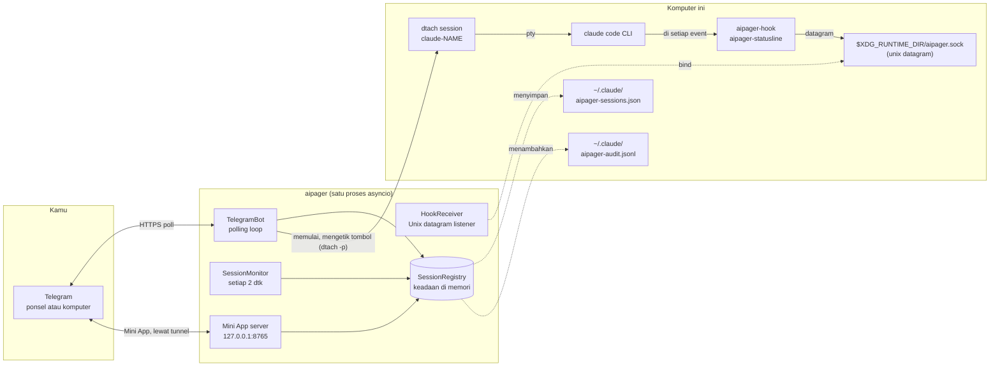

# Arsitektur

<!-- i18n-source: docs/architecture.md @ 7e36944 -->

> Halaman ini diterjemahkan dari bahasa Inggris; kalau keduanya berbeda, versi bahasa Inggris yang berlaku. ([English](../../architecture.md))

aipager adalah program asyncio satu proses yang berjalan di latar belakang. Ia menghubungkan tiga dunia: chat Telegram-mu, proses Claude Code yang kamu jalankan di bawah `dtach`, dan sistem hook Claude Code. Semuanya lewat satu event loop: tanpa pool worker, tanpa database, tanpa antrean antarproses.

## Diagram bagian-bagiannya

Semua yang ada di diagram berjalan di komputer ini, kecuali Telegram. aipager juga berbicara dengan beberapa server lain: tunnel Cloudflare untuk Mini App (dan sekali ke GitHub, untuk `cloudflared`), `telegram.org` untuk skrip Mini App, pengecekan versi saat kamu meminta pembaruan, unduhan model suara saat pertama kali memakai pesan suara, dan alamat laporan masalah saat kamu mengirim laporan. Semuanya tercantum di [Model keamanan → koneksi jaringan](security.md#network-surface).

## Cara prosesnya disusun

Satu pemanggilan `asyncio.run` di `aipager/cli/daemon.py` menjalankan semuanya. Di dalamnya:

- **`TelegramBot`** (`aipager/bot/`): memiliki `Application` dari `python-telegram-bot`. Menerima pembaruan dari Telegram, membagikannya ke penangan pesan, tombol, dan pesan suara, serta menjaga kartu kerja, bilah status yang disematkan, dan jawaban tetap terbaru.
- **`HookReceiver`** (`aipager/dtach/hook_receiver.py`): membuka soket datagram Unix di `$XDG_RUNTIME_DIR/aipager.sock`, membaca JSON yang dikirim `aipager-hook` dan `aipager-statusline`, lalu membagi pekerjaan berdasarkan `hook_event_name` (atau `type`, untuk pesan milik aipager sendiri; lihat [event hook](hooks.md)).
- **`SessionMonitor`** (`aipager/session_monitor.py`): bangun setiap 2 dtk untuk memindai `/tmp/claude-dtach-*.sock`, mencocokkan sesi yang ditemukan dengan daftar sesi, dan menjalankan para penjaga: kartu kerja yang berhenti bergerak, pesan yang tidak pernah diterima Claude Code, permintaan izin tanpa kabar selama 5 menit yang menurut percakapan tersimpan sudah selesai (`AIPAGER_INTERACTIVE_TIMEOUT`), tugas yang akhirnya terlewat.
- **`SessionRegistry`** (`aipager/state.py`): objek `TrackedSession` berdasarkan nama. Disimpan ke `~/.claude/aipager-sessions.json` (secara atomik) saat dimatikan dan setiap kali ada yang berubah yang harus bertahan melewati mulai ulang.
- **`ObserverBroadcaster`** (opsional, `aipager/bot/observer.py`): kalau `OBSERVER_BOTS` diatur, juga mengirim notifikasi ke bot pengamat yang hanya membaca ([bot pengamat](observers.md)).
- **Server Mini App** (`aipager/miniapp/server.py`): aplikasi aiohttp di `127.0.0.1` pada port `MINIAPP_PORT` (bawaannya 8765), bisa dijangkau Telegram lewat tunnel Cloudflare yang dikelola selama menyala (bawaannya menyala). Menyajikan dasbor `/app`.

Semua ini berjalan sebagai task di loop yang sama. Pekerjaan yang akan memblokir loop berjalan di thread terpisah: mengubah pesan suara menjadi teks, menyusun dan mengirim laporan masalah, mengecek pembaruan dan menyiapkan mulai ulang, mengunduh skrip Mini App dan `cloudflared`, serta pemeriksaan login saat mulai.

## Urutan saat mulai

Dari `aipager/cli/daemon.py`:

1. Pindahkan sekali konfigurasi lama (`config.env`, `team.yaml`) ke `aipager.yaml` dan sisihkan file lamanya.
2. Tolak untuk mulai kalau ada aipager lain yang menjawab di soket, lalu ambil kunci aipager (`~/.local/share/aipager/daemon.lock`).
3. Periksa token bot di Telegram (`getMe`).
4. Rapikan file milik Claude Code sendiri: tambahkan hook aipager dan baris status yang belum ada ke `~/.claude/settings.json`, dan jawab pertanyaan saat pertama kali jalan yang tidak bisa dijawab orang di Telegram (lihat [keamanan](security.md#who-decides-whether-a-tool-call-runs)).
5. `SessionRegistry.load()`: membaca `~/.claude/aipager-sessions.json`. Kalau file itu tidak ada atau tidak bisa dibaca, daftarnya mulai kosong.
6. Tentukan alamat Mini App (URL-mu sendiri atau Tailscale), lalu `bot.start()`: mulai melakukan polling ke Telegram.
7. `ObserverBroadcaster.start()`, hanya kalau dikonfigurasi.
8. `HookReceiver.start()`: menghapus file soket yang lama, bind, mendengarkan.
9. `bot.recover_sessions()`: mengembalikan kartu dan permintaan dari sesi yang sedang bekerja atau menunggu saat aipager berhenti (lihat [perintah → jawaban](commands.md#idle-responses)).
10. `SessionMonitor.start()`: memulai pemindaian setiap 2 dtk.
11. Server Mini App mulai, lalu tunnel-nya (kecuali URL-mu sendiri diatur), dan tombol `📱 App` diterbitkan.
12. aipager menunggu sinyal: SIGINT atau SIGTERM menghentikannya, SIGUSR1 memuat ulang chat dan aturan ([grup → muat ulang tanpa mulai ulang](groups.md#live-reload)).

## Urutan saat dimatikan

1. SIGINT atau SIGTERM memicu event `stop`.
2. `/update` yang sedang berjalan diberi sedikit waktu, lalu installer-nya dihentikan (lihat [perintah → pembaruan](commands.md#update)).
3. `registry.save()`.
4. Tunnel berhenti, lalu server Mini App.
5. `session_monitor.stop()`, `hook_receiver.stop()` (menutup soket dan menghapus file-nya), `observers.stop()` kalau sedang berjalan.
6. `bot.stop()`: membatalkan animasi dan menghentikan `Application`.
7. Sekali lagi `registry.save()`, untuk kartu yang pengirimannya masih berlangsung.

Mulai ulang dari Telegram mengandalkan seluruh jalur ini selesai sebelum penggantinya bind ke soket. Apa yang kamu lihat saat itu dijelaskan di [perintah bot → mulai ulang](commands.md#restart).

## Letak file dan soket

| Path | Kegunaan | Yang menulis |
|---|---|---|
| `$XDG_RUNTIME_DIR/aipager.sock` | Soket datagram Unix untuk event hook (`/tmp/aipager.sock` tanpa `$XDG_RUNTIME_DIR`; `$AIPAGER_SOCKET_PATH` menggantikan keduanya) | aipager (bind) |
| `aipager-reply-<id>.sock` (di samping soket kontrol) | Soket balasan berumur pendek untuk setiap permintaan izin yang ditunggu hook | `aipager-hook` |
| `aipager-flood-mute.json`, `aipager-flood-backoff.json` (di samping soket kontrol) | Keadaan batas Telegram saat ini, untuk `aipager status` dan doctor | aipager |
| `aipager-modelswitch-<name>.json` (di samping soket kontrol) | Menandai penggantian model yang diketik aipager, selama 30 dtk ([hooks](hooks.md#premodelswitch)) | aipager (menulis), `aipager-hook` (mengambil) |
| `/tmp/claude-dtach-<name>.sock` | Soket kontrol dtach untuk setiap sesi | dtach |
| `/tmp/claude-status-<name>.json` | Data baris status setiap sesi | `aipager-statusline` |
| `/tmp/claude-notes-<name>/` | Satu catatan izin untuk setiap pesan Telegram yang belum diambil, ditambah penanda `turn-open` yang dipegang hook selama tugas berjalan (pesan yang ikut bergabung ke tugas hanya bisa mempersempit aturannya) | aipager (catatan, menulis), `aipager-hook` (memakai catatan; menulis `turn-open`, dan keduanya menghapusnya) |
| `/tmp/claude-policy-<name>.json` | Snapshot izin untuk tugas yang sedang berjalan | `aipager-hook` (menulis saat mengambil pesan), dibaca pemeriksaan `PreToolUse` |
| `/tmp/claude-policy-.floor-<uid>.json` | Batas bawah keamanan: daftar bawaan ditambah bagian `safety:` milikmu, untuk jalur cadangan hook | aipager |
| `/tmp/claude-reply-<name>.txt` | Pesan yang kamu balas, kalau itu pesan yang lebih lama | aipager |
| `/tmp/aipager-files/` | File dan pesan suara yang dikirim dari Telegram | aipager |
| `/tmp/aipager.log` | Keluaran mulai ulang oleh aipager sendiri saat tidak ada layanan | aipager |
| `~/.claude/aipager-sessions.json` | Keadaan daftar sesi yang tahan lama | aipager |
| `~/.claude/aipager-audit.jsonl` | Log Izinkan / Tolak / jawaban | aipager (hanya menambahkan) |
| `~/.claude/aipager-flood-state.json` | Riwayat batas Telegram per chat, disimpan antar mulai ulang ([pemecahan masalah](troubleshooting.md#the-bot-went-quiet-flood-control)) | aipager |
| `~/.claude/aipager-pending-users.json` | Orang yang menyapa bot di grup yang tidak dilayaninya, atau yang bukan anggota grup yang dilayaninya, supaya `aipager config` bisa menambahkan mereka (izin 0600, ditulis ulang utuh setiap kali, 200 orang terakhir dalam 30 hari) | aipager (menulis), `aipager config` (membaca) |
| `~/aipager-users/<label>/` | [Folder utama](groups.md#root-folders) bawaan para anggota (izin 0700), tempat anggota `user` dan `read_only` memulai sesinya; `aipager uninstall` menyimpannya | aipager (dibuat saat `/new` pertama atau “Sesi baru” pertama di Mini App oleh seorang anggota) |
| `~/.claude/settings.json` | Konfigurasi hook Claude Code | `aipager config` / `aipager setup`; setiap kali mulai, aipager menambahkan hook atau baris status aipager yang belum ada dan mengatur `skipDangerousModePermissionPrompt` ([keamanan](security.md#who-decides-whether-a-tool-call-runs)) |
| `~/.claude/settings.json.bak.*` | Cadangan sebelum setiap penulisan ulang | `aipager config`, `aipager setup`, `aipager uninstall` |
| `~/.claude.json` | File milik Claude Code sendiri: saat mulai, aipager menandai folder sesi bawaannya (folder kerja aipager atau `AIPAGER_WORK_DIR`) sebagai tepercaya, supaya pertanyaan kepercayaan Claude Code tidak menghentikan sesi yang dimulai dari Telegram di sana | aipager |
| `~/.claude/.credentials.json` → `.credentials.json.stale` | File login Claude Code, disisihkan saat sebuah sesi dimulai dengan `CLAUDE_CODE_OAUTH_TOKEN` diatur dan file itu hanya berisi login yang kedaluwarsa atau kosong (kalau tidak, file itu akan mengalahkan token); untuk membatalkan, kembalikan ke tempatnya | aipager |
| `~/.config/aipager/aipager.yaml` | Token bot, chat, anggota + peran, pengaturan Mini App | `aipager config` (izin 600); aipager memindahkan entri sebuah grup saat Telegram mengubahnya menjadi supergroup, dan menyimpan salinan `aipager.yaml.bak.<time>` saat memindahkan pengaturan Mini App lama ke sana |
| `~/.config/aipager/policy.yaml` | Aturan per peran + tambahan untuk batas bawah keamanan | kamu (diperiksa dengan `aipager policy validate`); templat berkomentar ditulis sekali saat memindahkan instalasi lama |
| `~/.config/aipager/preferences.json` | Pilihan `/settings` per chat dan per sesi | aipager |
| `~/.config/aipager/daemon.env` | Kredensial Claude untuk sesi yang dimulai | kamu / `aipager service install` / `aipager doctor --fix` (izin 600) |
| `~/.config/aipager/config.env`, `team.yaml` → `*.bak.<time>`, `*.retired.<time>` | Konfigurasi instalasi lama: disalin, lalu diganti nama dan disisihkan setelah `aipager.yaml` memuatnya | aipager, `aipager config`, `aipager setup` |
| `~/.config/aipager/keyboard.json` | Perubahan keyboard opsional | kamu |
| `~/.local/share/aipager/sessions/` | Satu folder per sesi dengan `SESSION.md`-nya (siapa yang bisa menghubunginya dan aturannya), dibuat ulang setiap kali mulai | aipager |
| `~/.local/share/aipager/webapp-sdk/`, `cloudflared/` | Skrip Mini App dari Telegram dan program `cloudflared` yang sudah diverifikasi | aipager |
| `~/.local/share/aipager/daemon.lock`, `update.lock`, `update-restart.json` | Hanya satu aipager sekaligus; hanya satu pembaruan sekaligus; pembaruan yang perlu dilaporkan setelah mulai ulang | aipager |
| `~/.local/share/aipager/install.json`, `running.json` | Kapan aipager pertama kali mulai di sini; apakah sedang berjalan sekarang (untuk membedakan crash dari berhenti normal) | aipager |
| `~/.local/state/aipager/reports.json` | Laporan masalah: sidik jari error yang tercatat, jumlahnya, dan keadaan tawaran (izin 600); lihat [laporan masalah](problem-reports.md#what-is-kept-on-your-machine) | aipager |
| `~/.local/state/aipager/report-sends.json` | Laporan masalah yang dikirim hari ini (batas harian) | aipager, `aipager report` |
| `~/.local/state/aipager/languages.json` | Keadaan bahasa (izin 600): siapa yang sudah memakai aipager sebelum ada bahasa, bahasa Telegram terakhir yang terlihat pada setiap orang, apakah tawaran bahasa sekali saja dan baris kontak pertama sudah terkirim, dan sidik jari setiap deskripsi bot yang dipasang aipager; lihat [Bahasa](commands.md#languages) | aipager |
| `~/.config/systemd/user/aipager.service` (Linux), `~/Library/LaunchAgents/com.aipager.daemon.plist` (macOS), dan salinan `.bak.<time>` dari yang diganti pemasangan (di Linux hanya kalau berbeda) | Layanan latar belakang | `aipager service install` |
| `~/Library/Logs/aipager.log` (macOS) | Log layanan launchd, dibaca oleh `aipager logs` | launchd, untuk layanan |

Selain itu, aipager membuat folder sesi baru saat kamu memintanya (Folder baru di `/new` atau di Mini App), dan installer serta model suara menulis file-nya sendiri saat kamu memperbarui atau memakai pesan suara. Semua itu ada di folder home-mu, di `/tmp`, atau di samping soket kontrol. aipager tidak pernah menaikkan hak aksesnya; lihat [keamanan](security.md#privilege-boundary).

### Instance terisolasi (untuk pengujian)

Atur `AIPAGER_INSTANCE_DIR` ke folder absolut milikmu, dan setiap file kerja bersama dari daftar di atas pindah ke sana: soket kontrol (dan di sampingnya soket balasan, file sinyal batas, serta penanda penggantian model), soket `claude-dtach-*`, file `claude-policy-*`, `claude-notes-*`, `claude-status-*`, dan `claude-reply-*`, file batas bawah, folder unduhan `aipager-files`, dan log mulai ulang oleh aipager sendiri. Sesi yang dimulai instance itu mewarisi pengaturannya, jadi hook-nya hanya bicara dengan instance itu, dan aturan keamanan melindungi file yang dipindahkan dengan cara yang sama. Instance itu tidak membaca `.env` dari salinan kerja repo.

File di folder home-mu tidak ikut pindah, jadi arahkan juga `HOME` ke folder terpisah. `aipager start` menolak berjalan kalau folder instance diatur sementara `HOME` adalah folder home-mu yang asli, kalau folder itu bukan path absolut ke folder milikmu, atau kalau terlalu panjang untuk path soket.

`/update` dan `/restart` tidak terisolasi: keduanya bekerja pada paket aipager yang terpasang dan layanan `aipager.service`, jadi jangan pernah mengirimnya ke instance pengujian.

`AIPAGER_TELEGRAM_API_BASE` (misalnya `http://127.0.0.1:41234`) mengirim setiap permintaan Bot API dan setiap unduhan file ke alamat itu sebagai ganti `https://api.telegram.org`. Alamat itu harus komputer ini (`localhost` atau alamat loopback) kecuali `AIPAGER_TELEGRAM_API_ALLOW_REMOTE=1` diatur, supaya salah ketik tidak bisa mengirim token bot ke tempat lain.

Kedua pengaturan ini ada supaya tes end-to-end bisa menjalankan aipager kedua terhadap Telegram tiruan lokal di samping aipager-mu yang asli. Tanpanya, setiap path dan alamat sama seperti di tabel di atas.

## Kenapa dtach

dtach memberi setiap sesi Claude Code sebuah PTY sungguhan tanpa mengikatnya ke terminal yang harus tetap terbuka. aipager memulai sesi dengan `dtach -n` dan mengetik ke dalamnya dengan `dtach -p` (pesan, Escape, tombol untuk menjawab dialog); ia tidak pernah membaca layar, karena yang terjadi diketahui dari hook dan riwayat percakapan. Kamu bisa menyambung secara interaktif untuk akses langsung dari shell mana pun dengan `aipager session <name>`. Sambungan seperti itu mengikuti sesinya melewati mulai ulang dari Telegram (`/mode` ke atau dari Akses penuh, `/restart`, Mulai ulang): saat soket sesi hilang, ia menunggu sampai 15 dtk sampai soket yang sama kembali lalu menyambung lagi sendiri. Sesi yang benar-benar berakhir mengembalikanmu ke shell setelah menunggu (Ctrl-C mengakhiri penantian lebih awal). Sambungan ini berjalan dengan tombol lepas dtach dimatikan, jadi `Ctrl-\` diteruskan ke Claude; untuk keluar, tutup terminal atau panel tmux, dan sesinya tetap berjalan.

Hasilnya: Claude Code berjalan sama seperti saat kamu mengetik di terminal, tapi terminal itu bisa datang dan pergi tanpa mengganggu sesi yang sedang berjalan. aipager menemukan sesi dengan memindai `/tmp/claude-dtach-*.sock` di setiap putaran monitor 2 detik. Sesi yang ditemukan menjadi milik chat tempat namanya dibuat, sedangkan sesi yang dimulai di terminal, pada instalasi dengan chat pribadi dan grup, menjadi milik chat pribadi pemilik.

## Lihat juga

- [Event hook](hooks.md): apa yang datang lewat soket kontrol.
- [Perintah bot](commands.md): apa yang datang dari Telegram.
- [Model keamanan](security.md): batas hak akses, rahasia, audit.
- [Pemecahan masalah](troubleshooting.md): referensi `aipager doctor`.
