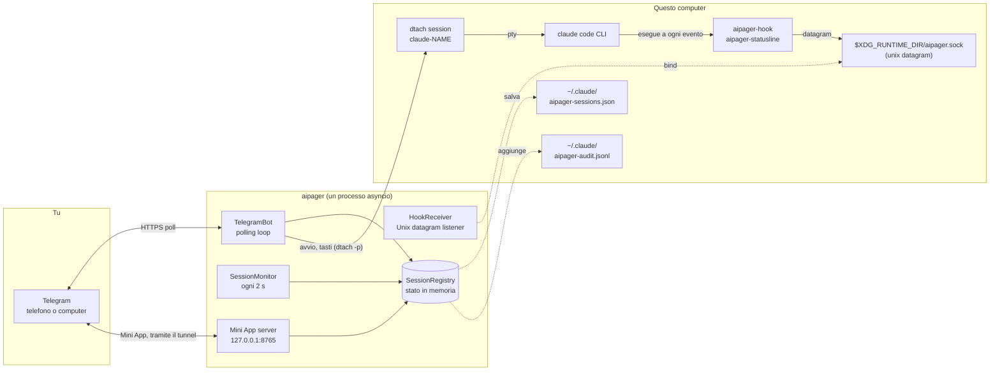

# Architettura

<!-- i18n-source: docs/architecture.md @ 05cb4380 -->

> Questa pagina è tradotta dalla pagina in inglese; se le due versioni non coincidono, vale quella in inglese. ([English](../../architecture.md))

aipager è un programma asyncio a processo singolo che gira in background. Collega tre mondi: le tue chat di Telegram, i processi di Claude Code che fai girare sotto `dtach` e il sistema di hook di Claude Code. Tutto passa da un solo event loop: niente worker pool, niente database, niente code tra processi.

## Schema dei componenti

Tutto quello che c'è nello schema, tranne Telegram, gira su questo computer. aipager si collega anche ad alcuni altri server: il tunnel Cloudflare della Mini App (e GitHub una volta, per scaricare `cloudflared`), `telegram.org` per lo script della Mini App, i controlli di versione quando chiedi un aggiornamento, il download del modello di riconoscimento vocale al primo vocale, e l'indirizzo che riceve le segnalazioni quando ne invii una. Sono tutti elencati in [Modello di sicurezza → Connessioni di rete](security.md#network-surface).

## Struttura del processo

Una sola chiamata `asyncio.run` in `aipager/cli/daemon.py` fa girare tutto il programma. Dentro ci sono:

- **`TelegramBot`** (`aipager/bot/`): tiene un'`Application` di `python-telegram-bot`. Riceve gli aggiornamenti da Telegram, li smista ai gestori di messaggi, pulsanti e vocali, e tiene aggiornate le schede di attività, la barra di stato fissata e le risposte.
- **`HookReceiver`** (`aipager/dtach/hook_receiver.py`): apre un socket Unix datagram in `$XDG_RUNTIME_DIR/aipager.sock`, legge il JSON che inviano `aipager-hook` e `aipager-statusline` e lo smista in base al suo `hook_event_name` (o al `type` per i messaggi di aipager stesso; vedi [Eventi hook](hooks.md)).
- **`SessionMonitor`** (`aipager/session_monitor.py`): si sveglia ogni 2 secondi, scorre `/tmp/claude-dtach-*.sock`, confronta le sessioni trovate con l'elenco delle sessioni e fa girare i vari controlli: schede di attività bloccate, messaggi che Claude Code non ha mai preso, richieste di permesso senza notizie da 5 minuti che la conversazione salvata mostra finite (`AIPAGER_INTERACTIVE_TIMEOUT`), attività di cui è sfuggita la fine.
- **`SessionRegistry`** (`aipager/state.py`): gli oggetti `TrackedSession` per nome. Li salva (in modo atomico) in `~/.claude/aipager-sessions.json` alla chiusura e ogni volta che cambia qualcosa che deve sopravvivere a un riavvio.
- **Server della Mini App** (`aipager/miniapp/server.py`): un'app aiohttp su `127.0.0.1`, porta `MINIAPP_PORT` (predefinita 8765), raggiungibile da Telegram tramite il tunnel Cloudflare gestito finché è attiva (di base lo è). Fornisce la dashboard di `/app`.

Girano tutti come task sullo stesso loop. Il lavoro che potrebbe bloccare il loop gira in thread separati: trasformare i vocali in testo, preparare e inviare le segnalazioni di problemi, controllare gli aggiornamenti e pianificare i riavvii, scaricare lo script della Mini App e `cloudflared`, e il controllo dell'accesso all'avvio.

## Sequenza di avvio

Da `aipager/cli/daemon.py`:

1. Sposta una volta sola la vecchia configurazione (`config.env`, `team.yaml`) in `aipager.yaml` e mette da parte i vecchi file.
2. Si rifiuta di partire se un altro aipager risponde sul socket; poi prende il lock di aipager (`~/.local/share/aipager/daemon.lock`).
3. Controlla il token del bot con Telegram (`getMe`).
4. Sistema i file di Claude Code: aggiunge a `~/.claude/settings.json` gli hook di aipager e la riga di stato che mancano, e risponde alle domande del primo avvio a cui chi usa Telegram non può rispondere (vedi [Sicurezza](security.md#who-decides-whether-a-tool-call-runs)).
5. `SessionRegistry.load()`: legge `~/.claude/aipager-sessions.json`. Se il file manca o non si legge, l'elenco parte vuoto.
6. Decide l'indirizzo della Mini App (il tuo URL, o Tailscale), poi `bot.start()`: comincia a ricevere gli aggiornamenti da Telegram.
7. `HookReceiver.start()`: cancella il file di socket rimasto, fa il bind e comincia ad ascoltare.
8. `bot.recover_sessions()`: ripristina le schede e le richieste delle sessioni che erano al lavoro o in attesa quando aipager si è fermato (vedi [Comandi → risposte](commands.md#idle-responses)).
9. `SessionMonitor.start()`: avvia il controllo ogni 2 secondi.
10. Avvia il server della Mini App, poi il tunnel (se non hai impostato un tuo URL), e pubblica il pulsante `📱 App`.
11. aipager aspetta un segnale: SIGINT o SIGTERM lo fermano, SIGUSR1 ricarica chat e regole ([Gruppi → ricaricare senza riavviare](groups.md#live-reload)).

## Sequenza di chiusura

1. SIGINT o SIGTERM impostano l'evento `stop`.
2. Un `/update` in corso ha un breve margine, poi il suo installatore viene fermato (vedi [Comandi → aggiornamenti](commands.md#update)).
3. `registry.save()`.
4. Si ferma il tunnel, poi il server della Mini App.
5. `session_monitor.stop()`, `hook_receiver.stop()` (chiude il socket e cancella il suo file).
6. `bot.stop()`: annulla le animazioni e ferma l'`Application`.
7. Di nuovo `registry.save()`, per le schede che stavano ancora finendo di inviare.

Un autoriavvio lanciato da Telegram conta sul fatto che tutto questo finisca prima che il processo sostitutivo faccia il bind del socket. Cosa vedi in quel momento è in [Comandi del bot → riavvio](commands.md#restart).

## Dove stanno file e socket

| Percorso | A cosa serve | Chi lo scrive |
|---|---|---|
| `$XDG_RUNTIME_DIR/aipager.sock` | Socket Unix datagram per gli eventi hook (`/tmp/aipager.sock` senza `$XDG_RUNTIME_DIR`; `$AIPAGER_SOCKET_PATH` vince su entrambi) | aipager (bind) |
| `aipager-reply-<id>.sock` (accanto al socket di controllo) | Socket di risposta di breve durata, uno per ogni richiesta di permesso su cui l'hook resta in attesa | `aipager-hook` |
| `aipager-flood-mute.json`, `aipager-flood-backoff.json` (accanto al socket di controllo) | Stato attuale dei limiti di Telegram, per `aipager status` e doctor | aipager |
| `aipager-modelswitch-<name>.json` (accanto al socket di controllo) | Segna per 30 secondi un cambio di modello scritto da aipager ([hook](hooks.md#premodelswitch)) | aipager (scrive), `aipager-hook` (lo prende) |
| `/tmp/claude-dtach-<name>.sock` | Socket di controllo dtach di ogni sessione | dtach |
| `/tmp/claude-status-<name>.json` | Dati della riga di stato di ogni sessione | `aipager-statusline` |
| `/tmp/claude-notes-<name>/` | Una nota di permessi per ogni messaggio di Telegram non ancora preso, più un segno `turn-open` che l'hook tiene mentre un'attività è in corso (un messaggio che si unisce a quell'attività può solo restringerne le regole) | aipager (note, scrive), `aipager-hook` (usa le note; scrive `turn-open`, che cancellano entrambi) |
| `/tmp/claude-policy-<name>.json` | L'istantanea dei permessi dell'attività in corso | `aipager-hook` (la scrive quando prende il messaggio), la legge il controllo `PreToolUse` |
| `/tmp/claude-policy-.floor-<uid>.json` | La base di sicurezza: l'elenco predefinito più la tua sezione `safety:`, per i percorsi di riserva dell'hook | aipager |
| `/tmp/claude-reply-<name>.txt` | Quando rispondi a un messaggio precedente, il messaggio a cui hai risposto | aipager |
| `/tmp/aipager-files/<chat>/` | File e vocali inviati da Telegram, una cartella privata per ogni chat (`0700`, i file `0600`) | aipager |
| `/tmp/aipager.log` | Output di un autoriavvio quando non c'è il servizio | aipager |
| `~/.claude/aipager-sessions.json` | Stato salvato dell'elenco delle sessioni | aipager |
| `~/.claude/aipager-audit.jsonl` | Log di Consenti / Nega / risposte | aipager (solo aggiunte) |
| `~/.claude/aipager-flood-state.json` | Storico dei limiti di Telegram per chat, che sopravvive ai riavvii ([risoluzione dei problemi](troubleshooting.md#the-bot-went-quiet-flood-control)) | aipager |
| `~/.claude/aipager-tunnel.json`, `aipager-cloudflared.log` | Il tunnel della Mini App che aipager tiene: il suo processo, le porte locali e un hash del suo indirizzo (mai l'indirizzo), così il prossimo aipager può riprenderlo dopo un riavvio previsto (permessi 600); gli avvisi di cloudflared | aipager; il record lo rimuovono anche il guardiano del tunnel tenuto e `aipager uninstall` |
| `~/.claude/aipager-pending-users.json` | Chi ha chiamato il bot in un gruppo che aipager non gestisce, o in uno che gestisce senza esserne membro, perché `aipager config` possa aggiungerlo (permessi 0600, sostituito per intero a ogni scrittura, tiene le 200 persone più recenti viste negli ultimi 30 giorni) | aipager (scrive), `aipager config` (legge) |
| `~/aipager-users/<label>/` | Le [cartelle radice](groups.md#root-folders) predefinite dei membri (permessi 0700), dove i membri `user` e `read_only` avviano le sessioni; `aipager uninstall` le lascia | aipager (le crea al primo `/new` del membro o al primo «Avvia sessione» nella Mini App) |
| `~/.claude/settings.json` | Configurazione degli hook di Claude Code | `aipager config` / `aipager setup`; a ogni avvio aipager rimette un hook di aipager o la riga di stato che mancano e imposta `skipDangerousModePermissionPrompt` ([sicurezza](security.md#who-decides-whether-a-tool-call-runs)) |
| `~/.claude/settings.json.bak.*` | Copie di sicurezza prima di ogni riscrittura | `aipager config`, `aipager setup`, `aipager uninstall` |
| `~/.claude.json` | File di Claude Code: aipager segna come fidata la cartella in cui parte una sessione subito prima che parta (anche la cartella home, mai `/` o una cartella sopra la home), così la domanda di fiducia di Claude Code non blocca una sessione avviata da Telegram. All'avvio di aipager non viene segnato niente. Mai riscritto se non si può leggere per intero o se un Claude in esecuzione l'ha cambiato nel frattempo | aipager |
| `~/.claude/.credentials.json` → `.credentials.json.stale` | Il file di accesso di Claude Code, messo da parte quando una sessione parte con `CLAUDE_CODE_OAUTH_TOKEN` impostato e il file contiene solo un accesso scaduto o vuoto (altrimenti vincerebbe sul token); per annullare, rimettilo al suo posto | aipager |
| `~/.config/aipager/aipager.yaml` | Token del bot, chat, membri + ruoli, impostazioni della Mini App | `aipager config` (permessi 600); aipager sposta la voce di un gruppo quando Telegram lo trasforma in supergroup, e lascia un `aipager.yaml.bak.<time>` quando ci porta dentro le vecchie impostazioni della Mini App |
| `~/.config/aipager/policy.yaml` | Regole per ruolo + aggiunte alla base di sicurezza | tu (controllale con `aipager policy validate`); un modello commentato scritto una volta quando si migra una vecchia installazione |
| `~/.config/aipager/preferences.json` | Le scelte di `/settings` per chat e per sessione | aipager |
| `~/.config/aipager/daemon.env` | Credenziali di Claude per le sessioni avviate | tu / `aipager service install` / `aipager doctor --fix` (permessi 600) |
| `~/.config/aipager/config.env`, `team.yaml` → `*.bak.<time>`, `*.retired.<time>` | Configurazione di una vecchia installazione: prima copiata, poi rinominata e messa da parte quando `aipager.yaml` la contiene | aipager, `aipager config`, `aipager setup` |
| `~/.config/aipager/keyboard.json` | Personalizzazione opzionale della tastiera | tu |
| `~/.local/share/aipager/sessions/` | Una cartella per sessione con il suo `SESSION.md` (chi può parlarci e con quali regole), ricreata a ogni avvio | aipager |
| `~/.local/share/aipager/webapp-sdk/`, `cloudflared/` | Lo script della Mini App di Telegram e il programma `cloudflared` verificato | aipager |
| `~/.local/share/aipager/daemon.lock`, `update.lock`, `update-restart.json` | Un aipager alla volta; un aggiornamento alla volta; l'aggiornamento da annunciare dopo il riavvio | aipager |
| `~/.local/share/aipager/install.json`, `running.json` | Quando aipager è partito qui per la prima volta; se è in esecuzione adesso (per distinguere un crash da una chiusura normale) | aipager |
| `~/.local/state/aipager/reports.json` | Segnalazioni di problemi: impronte degli errori registrati, conteggi e stato delle proposte (permessi 600); vedi [Segnalazioni di problemi](problem-reports.md#what-is-kept-on-your-machine) | aipager |
| `~/.local/state/aipager/report-sends.json` | Le segnalazioni inviate oggi (limite giornaliero) | aipager, `aipager report` |
| `~/.local/state/aipager/languages.json` | Stato delle lingue (permessi 600): chi usava aipager prima che esistessero le lingue, l'ultima lingua di Telegram vista per ogni persona, se la proposta di lingua (una sola volta) e la riga del primo contatto sono già partite, e un hash di ogni descrizione del bot impostata da aipager; vedi [Lingue](commands.md#languages) | aipager |
| `~/.config/systemd/user/aipager.service` (Linux), `~/Library/LaunchAgents/com.aipager.daemon.plist` (macOS), e copie `.bak.<time>` dei file sostituiti all'installazione (su Linux solo se diversi) | Il servizio in background | `aipager service install` |
| `~/Library/Logs/aipager.log` (macOS) | Il log del servizio launchd, letto da `aipager logs` | launchd, per il servizio |

Oltre a questi, aipager crea nuove cartelle di sessione quando lo chiedi tu («Nuova cartella» in `/new` o nella Mini App), e gli installatori e il modello vocale scrivono i loro file quando aggiorni o usi i vocali. Tutto sta sotto la tua cartella home, sotto `/tmp` o accanto al socket di controllo. aipager non aumenta mai i privilegi; vedi [Sicurezza](security.md#privilege-boundary).

### Istanza isolata (per i test)

Imposta `AIPAGER_INSTANCE_DIR` su una cartella tua, con un percorso assoluto, e ogni file condiviso di runtime qui sopra si sposta lì: il socket di controllo (e accanto a lui i socket di risposta, i file con lo stato dei limiti e il segno di cambio modello), i socket `claude-dtach-*`, i file `claude-policy-*`, `claude-notes-*`, `claude-status-*` e `claude-reply-*`, il file della base di sicurezza, la cartella di download `aipager-files` e il log dell'autoriavvio. Le sessioni avviate da questa istanza ereditano l'impostazione, così i loro hook parlano solo con lei, e le regole di sicurezza proteggono i file spostati allo stesso modo. Questa istanza non legge il `.env` della copia del codice sorgente.

I file sotto la cartella home non si spostano, quindi punta anche `HOME` su una cartella a parte. `aipager start` si rifiuta di partire quando la cartella dell'istanza è impostata ma `HOME` è la tua vera cartella home, quando la cartella non è un percorso assoluto verso una cartella tua, o quando è troppo lunga per un percorso di socket.

`/update` e `/restart` non sono isolati: agiscono sul pacchetto aipager installato e su `aipager.service`, quindi non mandarli mai a un'istanza di test.

`AIPAGER_TELEGRAM_API_BASE` (per esempio `http://127.0.0.1:41234`) invia ogni richiesta alla Bot API e ogni download di file a quell'indirizzo al posto di `https://api.telegram.org`. Deve essere questo computer (`localhost` o un indirizzo di loopback), a meno che non sia impostato `AIPAGER_TELEGRAM_API_ALLOW_REMOTE=1`, così un errore di battitura non manda il token del bot da un'altra parte.

Queste due impostazioni esistono perché un test end-to-end possa far girare un secondo aipager accanto al tuo vero aipager, contro una copia locale di Telegram. Senza nessuna delle due, ogni percorso e indirizzo resta quello della tabella.

## Perché dtach

dtach dà a ogni sessione di Claude Code un vero PTY senza legarla a un terminale che deve restare aperto. aipager avvia le sessioni con `dtach -n` e ci scrive con `dtach -p` (messaggi, Escape, tasti che rispondono a un dialogo); non legge mai lo schermo, perché gli hook e la cronologia della conversazione dicono già cosa è successo. Puoi collegarti in modo interattivo da qualsiasi shell con `aipager session <name>` e lavorare direttamente. Il collegamento segue la sessione attraverso un riavvio lanciato da Telegram (un `/mode` che entra o esce dalla modalità «Completo», `/restart`, «Riavvia»): quando il socket della sessione sparisce, aspetta fino a 15 secondi che torni lo stesso socket e si ricollega da solo. Una sessione che è davvero terminata ti riporta alla shell dopo l'attesa (Ctrl-C la interrompe prima). Il tasto di distacco di dtach è disattivato durante il collegamento, così `Ctrl-\` arriva a Claude; per uscire, chiudi il terminale o il pannello di tmux e la sessione continua a girare.

Il risultato: Claude Code gira come se stessi scrivendo in un terminale, ma quel terminale può andare e venire senza disturbare la sessione in corso. aipager trova le sessioni cercando `/tmp/claude-dtach-*.sock` nel suo controllo ogni 2 secondi. Una sessione trovata appartiene alla chat che corrisponde al suo nome; in un'installazione con una chat privata e un gruppo, una sessione avviata dal terminale appartiene alla chat privata del proprietario.

## Vedi anche

- [Eventi hook](hooks.md): cosa entra dal socket di controllo.
- [Comandi del bot](commands.md): cosa entra da Telegram.
- [Modello di sicurezza](security.md): confine dei privilegi, segreti, audit.
- [Risoluzione dei problemi](troubleshooting.md): riferimento di `aipager doctor`.
