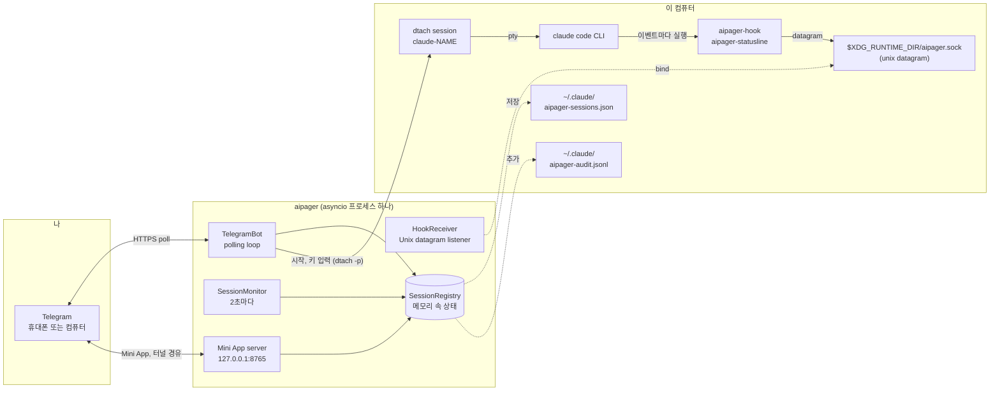

# 아키텍처

<!-- i18n-source: docs/architecture.md @ 7881bd9e -->

> 이 페이지는 영어 문서를 번역한 거예요. 내용이 서로 다르면 영어 문서가 맞아요. ([English](../../architecture.md))

aipager는 백그라운드에서 실행되는 단일 프로세스 asyncio 프로그램이에요. 세 세계를 이어 줘요. 내 Telegram 채팅, 내가 `dtach` 아래에서 실행하는 Claude Code 프로세스, 그리고 Claude Code의 hook 시스템이에요. 모든 것이 하나의 event loop를 거쳐요. worker pool도, 데이터베이스도, 프로세스 간 대기열도 없어요.

## 구성 요소 그림

그림에서 Telegram을 빼면 모두 이 컴퓨터에서 실행돼요. aipager는 다른 서버 몇 곳에도 연결해요. Mini App의 Cloudflare 터널(그리고 `cloudflared`를 받으려고 GitHub에 한 번), Mini App 스크립트를 받으려고 `telegram.org`, 업데이트를 요청했을 때 버전 확인, 음성 메시지를 처음 쓸 때 음성 인식 모델 다운로드, 문제 신고 보고서를 보낼 때 보고서를 받는 주소예요. 모두 [보안 모델 → 네트워크 연결](security.md#network-surface)에 나와 있어요.

## 프로세스 구조

`aipager/cli/daemon.py`의 `asyncio.run` 호출 하나가 프로그램 전체를 실행해요. 그 안에는 이런 것들이 있어요:

- **`TelegramBot`** (`aipager/bot/`): `python-telegram-bot`의 `Application`을 가지고 있어요. Telegram에서 업데이트를 받아 메시지, 버튼, 음성 메시지 처리기로 나눠 보내고, 작업 카드, 고정된 상태 표시줄, 답변을 최신 상태로 유지해요.
- **`HookReceiver`** (`aipager/dtach/hook_receiver.py`): `$XDG_RUNTIME_DIR/aipager.sock`에 Unix datagram 소켓을 열고, `aipager-hook`과 `aipager-statusline`이 보내는 JSON을 읽어서 `hook_event_name`(aipager 자체 메시지는 `type`, [Hook 이벤트](hooks.md) 참고)에 따라 나눠 보내요.
- **`SessionMonitor`** (`aipager/session_monitor.py`): 2초마다 깨어나서 `/tmp/claude-dtach-*.sock`을 훑고, 찾은 세션을 세션 목록과 맞춰 보고, 여러 감시를 실행해요. 멈춘 작업 카드, Claude Code가 가져가지 않은 메시지, 5분 동안 소식이 없고 저장된 대화에 끝났다고 나오는 권한 요청(`AIPAGER_INTERACTIVE_TIMEOUT`), 끝나는 순간을 놓친 작업을 살펴요.
- **`SessionRegistry`** (`aipager/state.py`): 이름별로 저장된 `TrackedSession` 객체들이에요. 종료할 때와, 재시작 뒤에도 남아야 하는 것이 바뀔 때마다 `~/.claude/aipager-sessions.json`에 (원자적으로) 저장해요.
- **Mini App 서버** (`aipager/miniapp/server.py`): `127.0.0.1`의 `MINIAPP_PORT`(기본값 8765)에서 듣는 aiohttp 앱이고, 켜져 있는 동안(기본으로 켜져 있어요) 관리형 Cloudflare 터널을 통해 Telegram에 제공돼요. `/app` 대시보드를 제공해요.

모두 같은 loop 위에서 태스크로 실행돼요. loop를 막을 수 있는 일은 별도 스레드에서 실행해요. 음성 메시지를 글로 바꾸기, 문제 신고 보고서를 만들고 보내기, 업데이트 확인과 재시작 계획, Mini App 스크립트와 `cloudflared` 다운로드, 그리고 시작할 때의 로그인 확인이에요.

## 시작 순서

`aipager/cli/daemon.py`에서:

1. 예전 설정(`config.env`, `team.yaml`)을 `aipager.yaml`로 한 번 옮기고, 예전 파일은 치워 둬요.
2. 다른 aipager가 소켓에서 응답하면 시작을 거부해요. 그다음 aipager 잠금(`~/.local/share/aipager/daemon.lock`)을 잡아요.
3. Telegram에서 봇 token을 확인해요(`getMe`).
4. Claude Code 자체 파일을 손봐요. 빠진 aipager hook과 상태 줄을 `~/.claude/settings.json` (또는 `$CLAUDE_CONFIG_DIR/settings.json`, 데몬의 세션이 읽는 파일) 파일에 추가하고, Telegram 사용자가 답할 수 없는 첫 실행 질문에 답해 둬요([보안](security.md#who-decides-whether-a-tool-call-runs) 참고).
5. `SessionRegistry.load()`: `~/.claude/aipager-sessions.json` 파일을 읽어요. 파일이 없거나 읽을 수 없으면 빈 목록으로 시작해요.
6. Mini App 주소(내 URL, 또는 Tailscale)를 정한 다음 `bot.start()`: Telegram에서 업데이트를 받기 시작해요.
7. `HookReceiver.start()`: 남아 있는 소켓 파일을 지우고, bind하고, 듣기 시작해요.
8. `bot.recover_sessions()`: aipager가 멈췄을 때 작업 중이었거나 기다리던 세션의 카드와 요청을 되살려요([명령 → 작업이 끝났을 때의 답변](commands.md#idle-responses) 참고).
9. `SessionMonitor.start()`: 2초마다 하는 검사를 시작해요.
10. Mini App 서버를 시작하고, 그다음 터널을 시작하고(내 URL을 설정하지 않았을 때), `📱 App` 버튼을 올려요.
11. aipager는 신호를 기다려요. SIGINT나 SIGTERM은 멈추게 하고, SIGUSR1은 채팅과 규칙을 다시 불러와요([그룹 → 재시작 없이 다시 불러오기](groups.md#live-reload)).

## 종료 순서

1. SIGINT나 SIGTERM이 `stop` 이벤트를 설정해요.
2. 실행 중인 `/update`에는 짧은 유예 시간이 있고, 그다음 설치 프로그램이 멈춰요([명령 → 업데이트](commands.md#update) 참고).
3. `registry.save()`.
4. 터널을 먼저 멈추고, 그다음 Mini App 서버를 멈춰요.
5. `session_monitor.stop()`, `hook_receiver.stop()`(소켓을 닫고 파일을 지워요).
6. `bot.stop()`: 애니메이션을 취소하고 `Application`을 멈춰요.
7. 아직 보내는 중이던 카드를 위해 `registry.save()`를 한 번 더 해요.

Telegram에서 시작한 자체 재시작은 대신 들어올 프로세스가 소켓을 bind하기 전에 이 과정 전체가 끝나야 해요. 그때 무엇이 보이는지는 [봇 명령 → 재시작](commands.md#restart)에 있어요.

## 파일과 소켓의 위치

| 경로 | 용도 | 누가 쓰는지 |
|---|---|---|
| `$XDG_RUNTIME_DIR/aipager.sock` | hook 이벤트용 Unix datagram 소켓(`$XDG_RUNTIME_DIR`이 없으면 `/tmp/aipager.sock`, `$AIPAGER_SOCKET_PATH`가 둘보다 우선) | aipager (bind) |
| `aipager-reply-<id>.sock` (제어 소켓 옆) | hook이 기다리는 권한 요청마다 하나씩 있는 짧게 쓰는 응답 소켓 | `aipager-hook` |
| `aipager-flood-mute.json`, `aipager-flood-backoff.json` (제어 소켓 옆) | 현재 Telegram 속도 제한 상태, `aipager status`와 doctor가 읽어요 | aipager |
| `aipager-spill-<uid>/ev-<id>.json` (제어 소켓 옆) | datagram 하나에 담기에 너무 큰 hook 이벤트, 이를 가리키는 datagram이 도착하면 aipager가 읽고 지워요. 5분이 지난 파일은 시작할 때 치워요([hook](hooks.md)) | `aipager-hook` (씀), aipager (폴더를 만들고, 파일을 읽고 지움) |
| `aipager-modelswitch-<name>.json` (제어 소켓 옆) | aipager가 입력한 모델 변경 한 번을 표시해요, 30초 동안 유효([hook](hooks.md#premodelswitch)) | aipager (씀), `aipager-hook` (가져감) |
| `/tmp/claude-dtach-<name>.sock` | 세션마다 있는 dtach 제어 소켓 | dtach |
| `/tmp/claude-status-<name>.json` | 세션마다 있는 상태 줄 데이터 | `aipager-statusline` |
| `/tmp/claude-notes-<name>/` | 아직 가져가지 않은 Telegram 메시지마다 권한 메모 하나, 그리고 작업이 진행되는 동안 hook이 유지하는 `turn-open` 표시(그 작업에 합쳐지는 메시지는 규칙을 좁힐 수만 있어요) | aipager (메모를 씀), `aipager-hook` (메모를 사용하고 `turn-open`을 씀, 둘 다 지워요) |
| `/tmp/claude-policy-<name>.json` | 현재 작업의 권한 스냅숏 | `aipager-hook` (메시지를 가져갈 때 씀), `PreToolUse` 검사가 읽어요 |
| `/tmp/claude-policy-.floor-<uid>.json` | 안전 기준선: 기본 목록과 내 `safety:` 부분, hook의 대체 경로용 | aipager |
| `/tmp/claude-reply-<name>.txt` | 예전 메시지에 답장할 때, 내가 답장한 그 메시지 | aipager |
| `/tmp/claude-bgjob-<job>.json` | Claude Code 백그라운드 작업을, 대화가 그리로 옮겨 간 세션과 연결해요(`job`, `session`, 작업의 대화 ID, 세션의 claude PID, 시각, 그리고 작업 자신의 `SessionEnd`가 오면 `ended`). 그래서 그 작업의 hook이 그 세션 몫으로 쳐져요([hook](hooks.md#what-the-daemon-receives)). 권한 0600, 세션을 다시 가져오거나 세션이 끝나면 지워져요 | aipager (씀), `aipager-hook`과 `aipager-statusline` (읽음) |
| `/tmp/claude-bgjob-pids.json` | 실행 중인 각 세션의 자기 `claude` PID. 연결 파일이 생기기 전에 실행되는 백그라운드 작업의 hook을 위한 것이에요(권한 0600) | aipager (씀), `aipager-hook`과 `aipager-statusline` (읽음) |
| `/tmp/claude-exit-<name>.json` | `claude`의 종료 코드와 시작·종료 시각(`{"code", "start", "end"}`, 권한 0600). 세션을 띄우는 shell이 `claude` 시작 전에 지우고 `claude`가 끝나면 쓰며, 세션 종료 알림이 여기서 이유를 읽어 알려 줘요([문제 해결](troubleshooting.md#a-session-dropped-off-the-pinned-status-bar-it-is-gone)) | 세션을 띄우는 shell (씀), aipager (읽음) |
| `/tmp/aipager-files/<chat>/` | Telegram에서 보낸 파일과 음성 메시지, 채팅마다 비공개 폴더 하나(`0700`, 파일은 `0600`) | aipager |
| `/tmp/aipager.log` | 서비스가 없을 때 자체 재시작의 출력 | aipager |
| `~/.claude/aipager-sessions.json` | 세션 목록의 저장된 상태 | aipager |
| `~/.claude/aipager-audit.jsonl` | 허용 / 거부 / 답변 로그 | aipager (추가만 함) |
| `~/.claude/aipager-flood-state.json` | 채팅마다의 Telegram 속도 제한 기록, 재시작해도 유지돼요([문제 해결](troubleshooting.md#the-bot-went-quiet-flood-control)) | aipager |
| `~/.claude/aipager-tunnel.json`, `aipager-cloudflared.log`, `aipager-cloudflared.err` | aipager가 붙잡고 있는 Mini App 터널: 프로세스, 로컬 포트, 주소의 해시(주소 자체는 절대 아님)를 적어 두어서 계획된 재시작 뒤 다음 aipager가 이어받을 수 있게 해요(권한 600). cloudflared의 경고도 있어요. 터널이 시작되지 못한 이유를 알려 주는 cloudflared의 마지막 오류 출력도 있어요(권한 600, [문제 해결](troubleshooting.md#the-mini-app-link-isnt-working)) | aipager. 유지된 터널의 감시 프로세스와 `aipager uninstall`도 이 기록을 지워요 |
| `~/.claude/aipager-pending-users.json` | 봇이 서비스하지 않는 그룹에서 봇을 부른 사람, 또는 서비스하는 그룹에 있지만 멤버가 아닌 사람, `aipager config`로 추가할 수 있게(권한 0600, 쓸 때마다 통째로 바꿈, 최근 30일 동안 나타난 최신 200명 보관) | aipager (씀), `aipager config` (읽음) |
| `~/aipager-users/<label>/` | 멤버의 기본 [루트 폴더](groups.md#root-folders)(권한 0700), `user`와 `read_only` 멤버가 여기서 세션을 시작해요. `aipager uninstall`은 이것을 남겨 둬요 | aipager (멤버가 처음 `/new`를 쓰거나 Mini App에서 처음 “새 세션”을 누를 때 만들어요) |
| `~/.claude/settings.json` (또는 `$CLAUDE_CONFIG_DIR/settings.json`) | Claude Code의 hook 설정: 데몬의 세션이 읽는 파일이며, 세션이 받는 환경에 맞는 Claude Code 설정 폴더에 있어요 (데몬의 환경이나 `daemon.env`의 `CLAUDE_CONFIG_DIR`, 또는 이 파일 자체의 `env` 블록에 있는 `CLAUDE_CONFIG_DIR`로 정해지고, 마지막 경우에는 파일 위치가 옮겨져요. [문제 해결](troubleshooting.md#using-an-api-key-a-gateway-or-another-provider)) | `aipager config` / `aipager setup`. 시작할 때마다 aipager가 빠진 aipager hook이나 상태 줄을 채우고 `skipDangerousModePermissionPrompt`를 설정해요([보안](security.md#who-decides-whether-a-tool-call-runs)), 그리고 그 파일이 새것이면 세션이 시작되기 전에 다시 |
| `settings.json.bak.*` (같은 폴더) | 다시 쓰기 전마다 만드는 백업 | `aipager config`, `aipager setup`, `aipager uninstall` |
| `~/.claude.json` (또는 `$CLAUDE_CONFIG_DIR/.claude.json`, `CLAUDE_CODE_CUSTOM_OAUTH_URL`이 있을 때의 `.claude-custom-oauth.json`, 또는 Claude Code가 쓸 때 설정 폴더의 예전 `.config.json`) | Claude Code 자체 파일: aipager가 세션이 시작될 폴더를 시작 직전에 신뢰하는 폴더로 표시해서(홈 폴더도 포함, `/`나 홈 폴더 위의 폴더는 절대 아님), Claude Code의 신뢰 질문이 Telegram에서 시작한 세션을 막지 않게 해요. aipager가 시작할 때는 아무것도 표시하지 않아요. 전체를 읽을 수 없거나 실행 중인 Claude가 그사이 바꿨다면 절대 다시 쓰지 않아요. 같은 방식으로 세션의 `ANTHROPIC_API_KEY`에 대한 “use this API key?” 질문에 답하고(`customApiKeyResponses`, 키의 마지막 20자), 세션에 로그인 정보가 있으면 Claude Code의 첫 실행을 끝난 것으로 표시해서(`hasCompletedOnboarding`) 이 질문들도 Telegram에서 시작한 세션을 막지 않게 해요([제공자](troubleshooting.md#using-an-api-key-a-gateway-or-another-provider)). | aipager |
| `~/.claude/.credentials.json` (또는 설정 폴더의 파일) → `.credentials.json.stale` | Claude Code의 로그인 파일, `CLAUDE_CODE_OAUTH_TOKEN`을 설정한 채 세션을 시작하는데 이 파일에 만료됐거나 빈 로그인만 있을 때 옆으로 치워 둬요(그렇지 않으면 token보다 우선해요). 되돌리려면 다시 옮겨 놓으세요 | aipager |
| `~/.config/aipager/aipager.yaml` | 봇 token, 채팅, 멤버 + 역할, Mini App 설정 | `aipager config` (권한 600). Telegram이 그룹을 supergroup으로 업그레이드하면 aipager가 그 그룹 항목을 옮기고, 예전 Mini App 설정을 안으로 옮길 때 `aipager.yaml.bak.<time>`을 남겨요 |
| `~/.config/aipager/policy.yaml` | 역할별 규칙 + 안전 기준선 추가분 | 나 (`aipager policy validate`로 확인). 예전 설치를 옮길 때 주석이 달린 템플릿을 한 번 써요 |
| `~/.config/aipager/preferences.json` | 채팅별, 세션별 `/settings` 선택 | aipager |
| `~/.config/aipager/daemon.env` | 시작되는 세션이 쓰는 Claude 로그인 정보 | 나 / `aipager service install` / `aipager doctor --fix` (권한 600) |
| `~/.config/aipager/config.env`, `team.yaml` → `*.bak.<time>`, `*.retired.<time>` | 예전 설치의 설정: 먼저 복사하고, `aipager.yaml`에 들어간 뒤 이름을 바꿔 치워 둬요 | aipager, `aipager config`, `aipager setup` |
| `~/.config/aipager/keyboard.json` | 선택 사항인 키보드 사용자 설정 | 나 |
| `~/.local/share/aipager/sessions/` | 세션마다 폴더 하나, 그 안에 `SESSION.md`(누가 대화할 수 있는지와 규칙)가 있고, 시작할 때마다 다시 만들어요 | aipager |
| `~/.local/share/aipager/webapp-sdk/`, `cloudflared/` | Telegram의 Mini App 스크립트와 확인을 거친 `cloudflared` 프로그램 | aipager |
| `~/.local/share/aipager/daemon.lock`, `update.lock`, `update-restart.json` | 한 번에 aipager 하나, 한 번에 업데이트 하나, 재시작 뒤에 알릴 업데이트 | aipager |
| `~/.local/share/aipager/install.json`, `running.json` | aipager가 여기서 처음 시작한 때, 지금 실행 중인지(비정상 종료와 정상 종료를 구별하려고) | aipager |
| `~/.local/state/aipager/reports.json` | 문제 신고: 기록된 오류 지문, 횟수, 제안 상태(권한 600). [문제 신고](problem-reports.md#what-is-kept-on-your-machine) 참고 | aipager |
| `~/.local/state/aipager/report-sends.json` | 오늘 보낸 문제 신고 보고서(하루 한도) | aipager, `aipager report` |
| `~/.local/state/aipager/languages.json` | 언어 상태(권한 600): 언어 기능이 생기기 전부터 aipager를 쓴 사람, 사람마다 마지막으로 본 Telegram 언어, 한 번만 하는 언어 제안과 첫 만남 안내 줄이 나갔는지, aipager가 설정한 봇 설명마다의 해시. [언어](commands.md#languages) 참고 | aipager |
| `~/.local/state/aipager/tunnel-status.json` | `aipager doctor`가 읽는 Mini App 터널 상태(시작 중, 작동 중, 또는 원인과 다음 시도 시간이 있는 작동 안 함. 주소는 절대 없음. 권한 600, [문제 해결](troubleshooting.md#the-mini-app-link-isnt-working)) | aipager(쓰고, 멈출 때 지움), `aipager doctor`(읽음) |
| `~/.config/systemd/user/aipager.service` (Linux), `~/Library/LaunchAgents/com.aipager.daemon.plist` (macOS), 그리고 설치 때 바뀐 파일의 `.bak.<time>` 사본(Linux에서는 내용이 다를 때만) | 백그라운드 서비스 | `aipager service install` |
| `~/Library/Logs/aipager.log` (macOS) | launchd 서비스의 로그, `aipager logs`가 읽어요 | launchd, 서비스를 위해 씀 |

이 밖에도 aipager는 내가 요청하면 새 세션 폴더를 만들고(`/new`나 Mini App의 “새 폴더”), 설치 프로그램과 음성 모델은 내가 업데이트하거나 음성 메시지를 쓸 때 자기 파일을 써요. 모두 내 홈 폴더 아래나 `/tmp` 아래, 또는 제어 소켓 옆에 있어요. aipager는 절대 권한을 높이지 않아요. [보안](security.md#privilege-boundary)을 보세요.

### 격리된 인스턴스 (테스트용)

`AIPAGER_INSTANCE_DIR`을 내 소유의 절대 경로 폴더로 설정하면, 위에 나온 공유 런타임 파일이 모두 그리로 옮겨 가요. 제어 소켓(그리고 그 옆의 응답 소켓, 속도 제한 신호 파일, 모델 변경 표시, hook 넘침 폴더), `claude-dtach-*` 소켓, `claude-policy-*`, `claude-notes-*`, `claude-status-*`, `claude-reply-*`, `claude-bgjob-*`, `claude-exit-*` 파일, 안전 기준선 파일, `aipager-files` 다운로드 폴더, 자체 재시작 로그예요. 이 인스턴스가 시작한 세션은 이 설정을 물려받아서, 그 hook은 이 인스턴스하고만 통신하고, 안전 규칙도 옮겨진 파일을 같은 방식으로 지켜요. 이 인스턴스는 소스 복사본의 `.env`를 읽지 않아요.

홈 폴더 아래의 파일은 옮겨지지 않으니 `HOME`도 별도 폴더로 지정하세요. 인스턴스 폴더를 설정했는데 `HOME`이 내 실제 홈 폴더일 때, 이 폴더가 내 폴더를 가리키는 절대 경로가 아닐 때, 또는 소켓 경로로 쓰기에 너무 길 때 `aipager start`는 실행을 거부해요.

`/update`와 `/restart`는 격리되지 않아요. 설치된 aipager 패키지와 `aipager.service`에 작용하니 테스트 인스턴스에 절대 보내지 마세요.

`AIPAGER_TELEGRAM_API_BASE`(예: `http://127.0.0.1:41234`)는 모든 Bot API 요청과 파일 다운로드를 `https://api.telegram.org` 대신 그 주소로 보내요. `AIPAGER_TELEGRAM_API_ALLOW_REMOTE=1`을 설정하지 않는 한 이 주소는 이 컴퓨터(`localhost`나 루프백 주소)여야 해요. 그래야 오타 하나로 봇 token이 다른 곳으로 가지 않아요.

이 두 설정은 E2E 테스트가 내 진짜 aipager 옆에서, 로컬에서 Telegram을 흉내 내는 서버를 상대로 두 번째 aipager를 실행할 수 있게 하려고 있어요. 둘 다 설정하지 않으면 모든 경로와 주소는 위 표와 같아요.

## 왜 dtach인가요

dtach는 Claude Code 세션마다 진짜 PTY를 주면서도, 계속 열어 둬야 하는 터미널에 묶어 두지 않아요. aipager는 `dtach -n`으로 세션을 시작하고 `dtach -p`로 입력해요(메시지, Escape, 대화 상자에 답하는 키). 화면은 절대 읽지 않아요. hook과 저장된 대화가 이미 무슨 일이 있었는지 알려 주니까요. 어떤 shell에서든 `aipager session <name>`으로 대화형으로 연결해서 직접 쓸 수 있어요. 이 연결은 Telegram에서 시작한 세션 재시작(`/mode`로 전체 권한 모드로 바꾸거나 빠져나올 때, `/restart`, 재시작)을 따라가요. 세션의 소켓이 사라지면 같은 소켓이 돌아오기를 최대 15초 기다렸다가 스스로 다시 연결해요. 정말로 끝난 세션은 기다린 뒤 shell로 돌려보내요(Ctrl-C로 기다림을 일찍 끝낼 수 있어요). 연결 중에는 dtach의 분리 키가 꺼져 있어서 `Ctrl-\`가 Claude에게 전달돼요. 나가려면 터미널이나 tmux 창을 닫으면 되고, 세션은 계속 실행돼요.

dtach 세션 안에서, aipager가 시작한 세션은 `dtach -> bash -> claude`로, `aipager session`으로 시작한 세션은 `dtach -> sh -> claude`로 실행돼요. shell이 `claude`를 기다렸다가 그 종료 코드를 기록하고(`claude-exit-<name>.json`), 세션 종료 알림이 그것을 읽어요. `aipager session`의 인수는 shell의 해석을 거치지 않고 그대로 `claude`에 전달돼요.

Telegram에서 재시작하면 세션의 dtach를 종료하고 같은 대화로 다시 시작해요. 대화가 Claude Code 백그라운드로 옮겨 간 세션(입력란이 비어 있을 때 ←, [문제 해결](troubleshooting.md#a-session-moved-to-claude-codes-background) 참고)도 같은 방식으로 재시작하지만, 그 전에 한 단계가 더 있어요. aipager가 `claude stop <job>`을 실행하고 대화를 붙잡은 백그라운드 프로세스가 없어질 때까지 기다린 다음, 세션의 dtach를 종료하고 aipager 자체 설정으로 작업의 대화에서 다시 시작해요. 세션이 Claude Code 백그라운드에 있는 동안 aipager는 그 dtach에 아무것도 입력하지 않아요.

결과적으로 Claude Code는 내가 터미널에서 입력할 때처럼 실행되지만, 그 터미널은 실행 중인 세션을 방해하지 않고 왔다 갔다 할 수 있어요. aipager는 2초마다 하는 검사에서 `/tmp/claude-dtach-*.sock`을 찾아 세션을 발견해요. 발견된 세션은 이름에 해당하는 채팅에 속하고, 개인 채팅과 그룹이 둘 다 있는 설치에서 터미널로 시작한 세션은 소유자의 개인 채팅에 속해요.

## 함께 보기

- [Hook 이벤트](hooks.md): 제어 소켓으로 들어오는 것.
- [봇 명령](commands.md): Telegram에서 들어오는 것.
- [보안 모델](security.md): 권한 경계, 비밀 정보, 감사.
- [문제 해결](troubleshooting.md): `aipager doctor` 참고 자료.
