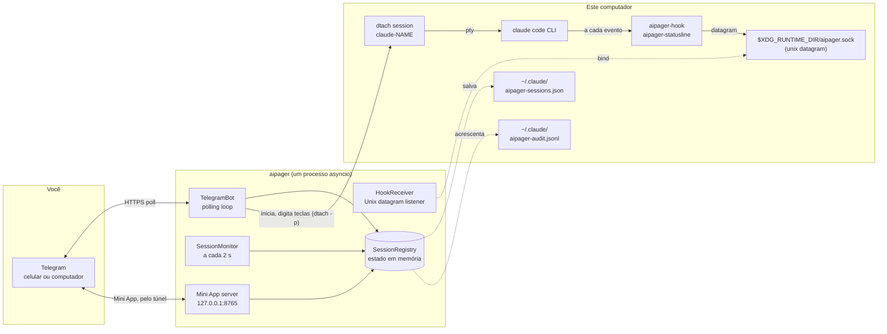

# Arquitetura

<!-- i18n-source: docs/architecture.md @ 7881bd9e -->

> Esta página é uma tradução da página em inglês; se as duas não baterem, vale a versão em inglês. ([English](../../architecture.md))

O aipager é um programa asyncio de um processo só que roda em segundo plano. Ele liga três mundos: o seu chat do Telegram, os processos do Claude Code que você roda sob o `dtach`, e o sistema de hooks do Claude Code. Tudo passa por um único event loop: sem pools de workers, sem banco de dados, sem filas entre processos.

## Diagrama das partes

Tudo o que está no diagrama, menos o Telegram, roda neste computador. O aipager também fala com alguns outros servidores: o túnel do Cloudflare do Mini App (e o GitHub, uma vez, para o `cloudflared`), o `telegram.org` para o script do Mini App, a verificação de versões quando você pede uma atualização, o download do modelo de voz na primeira vez que você usa áudios, e o destino dos relatórios de problemas quando você envia um. Todos estão em [Modelo de segurança → conexões de rede](security.md#network-surface).

## Como o processo funciona

Uma única chamada `asyncio.run` em `aipager/cli/daemon.py` toca tudo. Dentro dela:

- **`TelegramBot`** (`aipager/bot/`): tem um `Application` do `python-telegram-bot`. Recebe as atualizações do Telegram, entrega cada uma ao tratador de mensagens, botões ou áudios, e mantém em dia os cartões de atividade, a barra de status fixada e as respostas.
- **`HookReceiver`** (`aipager/dtach/hook_receiver.py`): abre um socket datagram do Unix em `$XDG_RUNTIME_DIR/aipager.sock`, lê o JSON que o `aipager-hook` e o `aipager-statusline` mandam, e distribui o trabalho pelo `hook_event_name` (ou `type`, para as mensagens do próprio aipager; veja [eventos de hook](hooks.md)).
- **`SessionMonitor`** (`aipager/session_monitor.py`): acorda a cada 2 s para olhar `/tmp/claude-dtach-*.sock`, acertar as sessões que encontra com a lista de sessões, e rodar os vigias: um cartão de atividade que parou de andar, uma mensagem que o Claude Code nunca recebeu, um pedido de permissão sem notícias por 5 minutos que a conversa salva mostra como acabado (`AIPAGER_INTERACTIVE_TIMEOUT`), uma tarefa cujo fim não foi visto.
- **`SessionRegistry`** (`aipager/state.py`): os objetos `TrackedSession` pelo nome da sessão. Salvos em `~/.claude/aipager-sessions.json` (de forma atômica) ao desligar e sempre que muda algo que precisa sobreviver a um reinício.
- **Servidor do Mini App** (`aipager/miniapp/server.py`): um app aiohttp em `127.0.0.1` na porta `MINIAPP_PORT` (padrão 8765), que enquanto está ligado (o padrão) chega ao Telegram por um túnel do Cloudflare gerenciado. Serve o painel do `/app`.

Tudo isso roda como tarefas no mesmo loop. O que travaria o loop roda em threads à parte: transformar áudio em texto, montar e enviar um relatório de problemas, verificar atualizações e planejar reinícios, baixar o script do Mini App e o `cloudflared`, e a verificação de login ao iniciar.

## Ordem de inicialização

De `aipager/cli/daemon.py`:

1. Passa uma configuração antiga (`config.env`, `team.yaml`) para `aipager.yaml`, uma vez só, e tira os arquivos velhos do caminho.
2. Não inicia se outro aipager responder no socket; depois pega a trava do aipager (`~/.local/share/aipager/daemon.lock`).
3. Confere o token do bot com o Telegram (`getMe`).
4. Acerta os arquivos do próprio Claude Code: adiciona qualquer hook do aipager ou a linha de status que falte em `~/.claude/settings.json` (ou `$CLAUDE_CONFIG_DIR/settings.json`, o arquivo que as sessões do daemon leem), e responde às perguntas da primeira execução que um usuário do Telegram não conseguiria responder (veja [Modelo de segurança](security.md#who-decides-whether-a-tool-call-runs)).
5. `SessionRegistry.load()`: lê `~/.claude/aipager-sessions.json`. Se o arquivo não existir ou não puder ser lido, começa com a lista vazia.
6. Descobre o endereço do Mini App (sua própria URL, ou o Tailscale), depois `bot.start()`: começa a receber as atualizações.
7. `HookReceiver.start()`: apaga um arquivo de socket que tenha sobrado, abre e escuta.
8. `bot.recover_sessions()`: recupera os cartões e os pedidos das sessões que estavam trabalhando ou esperando quando o aipager parou (veja [comandos → respostas](commands.md#idle-responses)).
9. `SessionMonitor.start()`: começa o tique de 2 s.
10. O servidor do Mini App inicia, depois o túnel (quando você não definiu uma URL própria), e os botões `📱 App` são publicados.
11. O aipager espera sinais: SIGINT ou SIGTERM o param, SIGUSR1 recarrega os chats e as regras ([uso em equipe → recarregar a configuração sem reiniciar](groups.md#live-reload)).

## Ordem de desligamento

1. SIGINT ou SIGTERM ligam o evento `stop`.
2. Um `/update` em andamento ganha um pouco de tempo e depois o instalador dele é parado (veja [comandos → atualizar](commands.md#update)).
3. `registry.save()`.
4. O túnel para, depois o servidor do Mini App.
5. `session_monitor.stop()`, `hook_receiver.stop()` (fecha o socket e apaga o arquivo dele).
6. `bot.stop()`: cancela as animações e para o `Application`.
7. `registry.save()` de novo, para um cartão cujo envio ainda estava em andamento.

O reinício feito pelo Telegram depende de todo esse caminho terminar antes de o substituto abrir o socket. O que você vê está em [comandos do bot → reiniciar](commands.md#restart).

## Onde ficam os arquivos e os sockets

| Caminho | Para quê | Quem |
|---|---|---|
| `$XDG_RUNTIME_DIR/aipager.sock` | Socket datagram do Unix para os eventos de hook (`/tmp/aipager.sock` sem `$XDG_RUNTIME_DIR`; `$AIPAGER_SOCKET_PATH` vale mais que os dois) | aipager (abre) |
| `aipager-reply-<id>.sock` (ao lado do socket de controle) | Um socket de resposta de vida curta para cada pedido de permissão que o hook espera | `aipager-hook` |
| `aipager-flood-mute.json`, `aipager-flood-backoff.json` (ao lado do socket de controle) | O estado atual dos limites de velocidade do Telegram, para o `aipager status` e o doctor | aipager |
| `aipager-spill-<uid>/ev-<id>.json` (ao lado do socket de controle) | Um evento de hook grande demais para um datagrama, lido e apagado pelo aipager quando chega o datagrama que aponta para ele; arquivos com mais de 5 minutos são limpos ao iniciar ([hooks](hooks.md)) | `aipager-hook` (escreve), aipager (cria a pasta, lê e apaga os arquivos) |
| `aipager-modelswitch-<name>.json` (ao lado do socket de controle) | Marca uma troca de modelo que o aipager digitou, por 30 s ([hooks](hooks.md#premodelswitch)) | aipager (escreve), `aipager-hook` (pega) |
| `/tmp/claude-dtach-<name>.sock` | Socket de controle do dtach de cada sessão | dtach |
| `/tmp/claude-status-<name>.json` | Dados da linha de status de cada sessão | `aipager-statusline` |
| `/tmp/claude-notes-<name>/` | Uma nota de permissões para cada mensagem do Telegram que ainda não foi pega, e uma marca `turn-open` que o hook mantém enquanto há uma tarefa em andamento (uma mensagem que entra na tarefa só pode deixar as regras dela mais rígidas) | aipager (escreve as notas), `aipager-hook` (consome as notas; escreve `turn-open`, e os dois a apagam) |
| `/tmp/claude-policy-<name>.json` | A cópia de referência das permissões da tarefa em andamento | `aipager-hook` (escreve ao pegar a mensagem), lida pela verificação `PreToolUse` |
| `/tmp/claude-policy-.floor-<uid>.json` | O piso de segurança, a lista própria do aipager mais a sua seção `safety:`, para os casos de reserva do hook | aipager |
| `/tmp/claude-reply-<name>.txt` | A mensagem que você respondeu, quando você responde a uma mensagem anterior | aipager |
| `/tmp/claude-bgjob-<job>.json` | Liga uma tarefa em segundo plano do Claude Code à sessão cuja conversa foi para ela (`job`, `session`, o ID da conversa da tarefa, o PID do claude da sessão, quando, e `ended` quando chegou o `SessionEnd` da própria tarefa), para que os hooks dessa tarefa contem para a sessão ([hooks](hooks.md#what-the-daemon-receives)); permissões 0600, apagado quando a sessão é trazida de volta ou termina | aipager (escreve), `aipager-hook` e `aipager-statusline` (leem) |
| `/tmp/claude-bgjob-pids.json` | O PID do `claude` de cada sessão rodando, para os hooks de uma tarefa em segundo plano que rodam antes de o arquivo de ligação dela existir (permissões 0600) | aipager (escreve), `aipager-hook` e `aipager-statusline` (leem) |
| `/tmp/claude-exit-<name>.json` | O código de saída do `claude` e quando ele começou e terminou (`{"code", "start", "end"}`, permissões 0600): o shell que inicia a sessão apaga o arquivo antes de o `claude` começar e o escreve quando o `claude` sai, e o aviso de fim da sessão diz o motivo a partir dele ([solução de problemas](troubleshooting.md#a-session-dropped-off-the-pinned-status-bar-it-is-gone)) | o shell que inicia a sessão (escreve), aipager (lê) |
| `/tmp/aipager-files/<chat>/` | Arquivos e áudios enviados pelo Telegram, uma pasta privada por chat (`0700`, arquivos `0600`) | aipager |
| `/tmp/aipager.log` | A saída de um reinício próprio quando não há serviço | aipager |
| `~/.claude/aipager-sessions.json` | O estado duradouro da lista de sessões | aipager |
| `~/.claude/aipager-audit.jsonl` | Registro de permitir, negar e respostas | aipager (só acrescenta) |
| `~/.claude/aipager-flood-state.json` | O histórico dos limites de velocidade do Telegram de cada chat, que sobrevive aos reinícios ([solução de problemas](troubleshooting.md#the-bot-went-quiet-flood-control)) | aipager |
| `~/.claude/aipager-tunnel.json`, `aipager-cloudflared.log`, `aipager-cloudflared.err` | O túnel do Mini App que o aipager mantém: o processo dele, as portas locais e um hash do endereço (nunca o endereço), para o próximo aipager poder assumi-lo depois de um reinício planejado (permissões 600); os avisos do cloudflared; a última saída de erro do cloudflared (permissões 600), que diz por que um túnel não conseguiu iniciar ([solução de problemas](troubleshooting.md#the-mini-app-link-isnt-working)) | aipager; o registro também é removido pelo guardião do túnel mantido e por `aipager uninstall` |
| `~/.claude/aipager-pending-users.json` | Pessoas que chamaram o bot num grupo onde ele não trabalha, ou que não são membros de um grupo onde ele trabalha, para o `aipager config` poder adicioná-las (permissões 0600, substituído inteiro a cada escrita, as 200 mais recentes vistas nos últimos 30 dias) | aipager (escreve), `aipager config` (lê) |
| `~/aipager-users/<label>/` | As [pastas raiz](groups.md#root-folders) padrão dos membros (permissões 0700), onde os membros `user` e `read_only` criam as sessões deles; o `aipager uninstall` as mantém | aipager (cria no primeiro `/new` ou “Nova sessão” do Mini App de um membro) |
| `~/.claude/settings.json` (ou `$CLAUDE_CONFIG_DIR/settings.json`) | A configuração de hooks do Claude Code: o que as sessões do daemon leem, da pasta de configuração do Claude Code para o ambiente que elas recebem (`CLAUDE_CONFIG_DIR` do ambiente do daemon ou do `daemon.env`, ou um `CLAUDE_CONFIG_DIR` no próprio bloco `env` desse arquivo, que o muda de lugar; [solução de problemas](troubleshooting.md#using-an-api-key-a-gateway-or-another-provider)) | `aipager config` / `aipager setup`; a cada início o aipager adiciona qualquer hook ou linha de status que falte e define `skipDangerousModePermissionPrompt` ([Modelo de segurança](security.md#who-decides-whether-a-tool-call-runs)), e de novo antes de uma sessão começar quando esse arquivo é novo |
| `settings.json.bak.*` (ao lado dele) | Cópias de segurança antes de cada reescrita | `aipager config`, `aipager setup`, `aipager uninstall` |
| `~/.claude.json` (ou `$CLAUDE_CONFIG_DIR/.claude.json`, `.claude-custom-oauth.json` com `CLAUDE_CODE_CUSTOM_OAUTH_URL`, ou o antigo `.config.json` na pasta de configuração quando o Claude Code o usa) | O arquivo do próprio Claude Code: o aipager marca como confiável a pasta onde uma sessão começa logo antes de ela começar (inclusive a pasta pessoal, nunca `/` nem uma pasta acima da pasta pessoal), para a pergunta de confiança do Claude Code não travar uma sessão criada pelo Telegram. Nada é marcado quando o aipager inicia. Nunca é reescrito quando não dá para lê-lo inteiro ou quando um Claude em execução o mudou nesse meio-tempo. Do mesmo jeito, responde à pergunta “use this API key?” para o `ANTHROPIC_API_KEY` da sessão (`customApiKeyResponses`, os últimos 20 caracteres da chave) e marca o primeiro uso do Claude Code como feito quando a sessão tem como entrar (`hasCompletedOnboarding`), para essas perguntas também não travarem uma sessão iniciada pelo Telegram ([provedores](troubleshooting.md#using-an-api-key-a-gateway-or-another-provider)). | aipager |
| `~/.claude/.credentials.json` (ou o da pasta de configuração) → `.credentials.json.stale` | O arquivo de login do Claude Code, tirado do caminho quando uma sessão inicia com `CLAUDE_CODE_OAUTH_TOKEN` definido e o arquivo só tem um login vencido ou vazio (senão ele ganharia do token); coloque de volta para desfazer | aipager |
| `~/.config/aipager/aipager.yaml` | Token do bot, chats, membros e funções, configurações do Mini App | `aipager config` (permissões 600); o aipager move a entrada de um grupo quando o Telegram o transforma em supergrupo, e guarda uma cópia `aipager.yaml.bak.<time>` quando passa para lá configurações antigas do Mini App |
| `~/.config/aipager/policy.yaml` | Regras por função e regras de segurança adicionais | você (conferido com `aipager policy validate`); um exemplo comentado é escrito uma vez quando uma instalação antiga é migrada |
| `~/.config/aipager/preferences.json` | O que foi escolhido em `/settings` para cada chat e cada sessão | aipager |
| `~/.config/aipager/daemon.env` | Credencial do Claude para as sessões iniciadas | você / `aipager service install` / `aipager doctor --fix` (permissões 600) |
| `~/.config/aipager/config.env`, `team.yaml` → `*.bak.<time>`, `*.retired.<time>` | A configuração de uma instalação antiga: copiada e depois tirada do caminho quando o `aipager.yaml` já a tem | aipager, `aipager config`, `aipager setup` |
| `~/.config/aipager/keyboard.json` | Mudanças opcionais do teclado | você |
| `~/.local/share/aipager/sessions/` | Uma pasta por sessão com o `SESSION.md` dela (quem pode falar com ela, e as regras), refeita a cada início | aipager |
| `~/.local/share/aipager/webapp-sdk/`, `cloudflared/` | O script do Mini App do Telegram e o binário `cloudflared` conferido | aipager |
| `~/.local/share/aipager/daemon.lock`, `update.lock`, `update-restart.json` | Um aipager de cada vez; uma atualização de cada vez; a atualização a anunciar depois do reinício | aipager |
| `~/.local/share/aipager/install.json`, `running.json` | Quando o aipager rodou aqui pela primeira vez; se está rodando agora (para diferenciar uma queda de uma parada normal) | aipager |
| `~/.local/state/aipager/reports.json` | Relatórios de problemas: os fingerprints dos erros registrados, as contagens e o estado das sugestões (permissões 600); veja [relatórios de problemas](problem-reports.md#what-is-kept-on-your-machine) | aipager |
| `~/.local/state/aipager/report-sends.json` | Os relatórios enviados hoje (o limite diário) | aipager, `aipager report` |
| `~/.local/state/aipager/languages.json` | O estado de idioma (permissões 600): quem já usava o aipager antes de existirem idiomas, o último idioma do Telegram visto de cada pessoa, se a oferta única de idioma e a linha de primeiro contato já foram enviadas, e um hash de cada descrição do bot que o aipager definiu; veja [Idiomas](commands.md#languages) | aipager |
| `~/.local/state/aipager/tunnel-status.json` | O estado do túnel do Mini App (iniciando, funcionando, ou sem funcionar com a causa e quando tenta de novo; nunca o endereço; permissões 600), para o `aipager doctor` ([solução de problemas](troubleshooting.md#the-mini-app-link-isnt-working)) | aipager (escreve, e apaga ao parar), `aipager doctor` (lê) |
| `~/.config/systemd/user/aipager.service` (Linux), `~/Library/LaunchAgents/com.aipager.daemon.plist` (macOS), e uma cópia `.bak.<time>` do que uma instalação substitui (no Linux só se for diferente) | O serviço em segundo plano | `aipager service install` |
| `~/Library/Logs/aipager.log` (macOS) | O log do serviço do launchd, lido pelo `aipager logs` | launchd, para o serviço |

Além disso, o aipager cria uma pasta nova para uma sessão quando você pede (Nova pasta no `/new` ou no Mini App), e os instaladores e o modelo de voz escrevem os próprios arquivos quando você atualiza ou usa a voz. Tudo fica na sua pasta pessoal, em `/tmp`, ou ao lado do socket de controle. O aipager nunca pega permissões a mais; veja [Modelo de segurança](security.md#privilege-boundary).

### Uma instância isolada (para testes)

Defina `AIPAGER_INSTANCE_DIR` como uma pasta absoluta que seja sua e todos os arquivos compartilhados da tabela acima vão para lá: o socket de controle (e os sockets de resposta, os arquivos de sinal dos limites de velocidade, a marca de troca de modelo e a pasta de transbordo dos hooks ao lado dele), os sockets `claude-dtach-*`, os arquivos `claude-policy-*`, `claude-notes-*`, `claude-status-*`, `claude-reply-*`, `claude-bgjob-*` e `claude-exit-*`, o arquivo do piso de segurança, a pasta de downloads `aipager-files` e o log do reinício próprio. As sessões que a instância inicia herdam a configuração, então os hooks delas só falam com essa instância, e as regras de segurança protegem do mesmo jeito os arquivos movidos. A instância não lê o `.env` de um checkout.

Os arquivos da sua pasta pessoal não mudam de lugar, então aponte o `HOME` também para outra pasta. O `aipager start` se recusa a iniciar quando a pasta da instância está definida e o `HOME` é a sua pasta pessoal de verdade, quando a pasta não é um caminho absoluto para uma pasta sua, ou quando ela é longa demais para o caminho de um socket.

O `/update` e o `/restart` não ficam isolados: eles agem sobre o pacote aipager instalado e o serviço `aipager.service`, então nunca os mande para uma instância de teste.

`AIPAGER_TELEGRAM_API_BASE` (por exemplo `http://127.0.0.1:41234`) manda todos os pedidos à Bot API e os downloads de arquivos para esse endereço em vez de `https://api.telegram.org`. Precisa ser este computador (`localhost` ou um endereço loopback), a não ser que você defina `AIPAGER_TELEGRAM_API_ALLOW_REMOTE=1`, para um erro de digitação não poder mandar o token do bot para outro lugar.

As duas configurações existem para os testes de ponta a ponta poderem rodar um segundo aipager contra um Telegram de mentira local, ao lado do seu de verdade. Sem nenhuma das duas, todos os caminhos e endereços são os da tabela acima.

## Por que o dtach

O dtach dá a cada sessão do Claude Code um PTY de verdade sem prendê-la a um terminal que precisa ficar aberto. O aipager inicia uma sessão com `dtach -n` e digita nela com `dtach -p` (mensagens, Escape, as teclas que respondem a uma caixa de diálogo); ele nunca lê a tela, porque os hooks e a conversa salva dizem o que acontece. Você pode se conectar de forma interativa de qualquer shell com `aipager session <name>` para ter acesso direto. Essa conexão acompanha a sessão num reinício feito pelo Telegram (`/mode` para o Modo Acesso total ou saindo dele, `/restart`, Reiniciar): quando o socket da sessão some, ela espera até 15 s pelo mesmo socket voltar e se reconecta sozinha. Uma sessão que terminou de verdade volta para o shell depois da espera (Ctrl-C encerra antes). A conexão roda com a tecla de desconexão do dtach desligada, então `Ctrl-\` chega ao Claude; para sair, feche o terminal ou o painel do tmux e a sessão continua rodando.

Dentro da sessão do dtach, uma sessão que o aipager inicia roda `dtach -> bash -> claude`, e uma iniciada com `aipager session` roda `dtach -> sh -> claude`: o shell espera o `claude` para poder registrar o código de saída dele (`claude-exit-<name>.json`), que o aviso de fim da sessão lê. Os argumentos de `aipager session` chegam ao `claude` como estão, nunca passando pela interpretação do shell.

Um reinício pelo Telegram encerra o dtach da sessão e o inicia de novo na mesma conversa. Uma sessão cuja conversa foi para o segundo plano do Claude Code (← num campo de entrada vazio; veja [solução de problemas](troubleshooting.md#a-session-moved-to-claude-codes-background)) é reiniciada do mesmo jeito, com um passo a mais antes: o aipager roda `claude stop <job>` e espera até nenhum processo em segundo plano segurar a conversa, depois encerra o dtach da sessão e o inicia na conversa da tarefa com as configurações próprias do aipager. Enquanto uma sessão está no segundo plano do Claude Code, o aipager não digita nada no dtach dela.

O resultado: o Claude Code roda como se você digitasse num terminal, mas esse terminal pode ir e vir sem atrapalhar a sessão em andamento. O aipager encontra as sessões olhando `/tmp/claude-dtach-*.sock` a cada tique de 2 s do vigia. Uma sessão encontrada pertence ao chat para o qual o nome dela foi criado, e uma criada no terminal pertence ao chat privado do dono numa instalação com chat privado e grupo.

## Veja também

- [Eventos de hook](hooks.md): o que chega pelo socket de controle.
- [Comandos do bot](commands.md): o que chega pelo Telegram.
- [Modelo de segurança](security.md): limite de permissões, segredos, auditoria.
- [Solução de problemas](troubleshooting.md): referência do `aipager doctor`.
