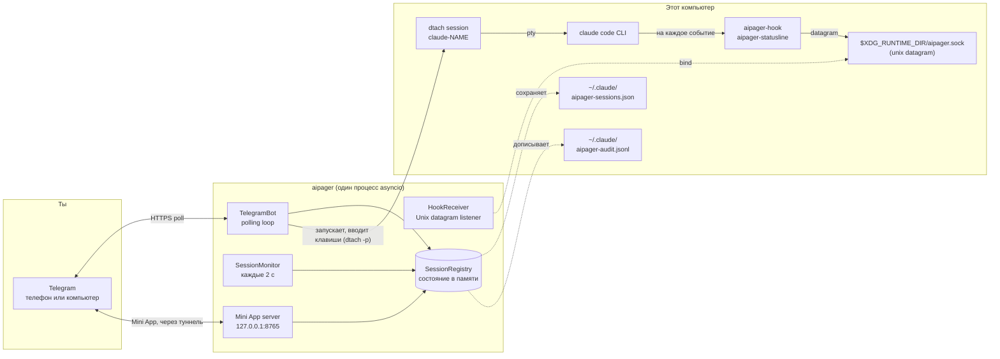

# Архитектура

<!-- i18n-source: docs/architecture.md @ a7e34bee -->

> Эта страница переведена с английской; если они расходятся, верна английская версия. ([English](../../architecture.md))

aipager это программа на asyncio из одного процесса, которая работает в фоне. Она соединяет три мира: твой чат в Telegram, процессы Claude Code, которые ты запускаешь под `dtach`, и систему hooks Claude Code. Всё проходит через один цикл событий: никаких пулов воркеров, никакой базы данных, никаких очередей между процессами.

## Схема частей

Всё на схеме работает на этом компьютере, кроме Telegram. aipager связывается ещё с несколькими серверами: с туннелем Cloudflare для Mini App (и один раз с GitHub, ради `cloudflared`), с `telegram.org` ради скрипта Mini App, с сервером проверки версий, когда ты просишь обновление, с сервером, откуда скачивается голосовая модель, когда впервые пользуешься голосовыми, и с адресом для отчётов о проблемах, когда ты отправляешь отчёт. Все они перечислены в разделе [Модель безопасности → сетевые соединения](security.md#network-surface).

## Как устроен процесс

Один вызов `asyncio.run` в `aipager/cli/daemon.py` ведёт всё. Внутри:

- **`TelegramBot`** (`aipager/bot/`): владеет `Application` из `python-telegram-bot`. Получает обновления от Telegram, раздаёт их обработчикам сообщений, кнопок и голосовых и держит в актуальном виде рабочие карточки, закреплённое сообщение и ответы.
- **`HookReceiver`** (`aipager/dtach/hook_receiver.py`): открывает Unix datagram-сокет в `$XDG_RUNTIME_DIR/aipager.sock`, читает JSON, который присылают `aipager-hook` и `aipager-statusline`, и распределяет работу по его `hook_event_name` (или `type`, для собственных сообщений aipager; см. [события hooks](hooks.md)).
- **`SessionMonitor`** (`aipager/session_monitor.py`): просыпается каждые 2 с, чтобы просмотреть `/tmp/claude-dtach-*.sock`, сверить найденные сессии со списком сессий и запустить сторожей: рабочая карточка, которая перестала двигаться, сообщение, которое Claude Code так и не принял, запрос разрешения без новостей 5 минут, который по сохранённой переписке уже закончен (`AIPAGER_INTERACTIVE_TIMEOUT`), задача, конец которой пропущен.
- **`SessionRegistry`** (`aipager/state.py`): объекты `TrackedSession` по именам. Сохраняются в `~/.claude/aipager-sessions.json` (атомарно) при выключении и каждый раз, когда меняется что-то, что должно пережить перезапуск.
- **Сервер Mini App** (`aipager/miniapp/server.py`): приложение aiohttp на `127.0.0.1` с портом `MINIAPP_PORT` (по умолчанию 8765), доступное Telegram через управляемый туннель Cloudflare, пока оно включено (по умолчанию так). Отдаёт панель `/app`.

Всё это работает как задачи в одном цикле. Работа, которая бы его блокировала, идёт в отдельных потоках: превращение голосовых в текст, сборка и отправка отчёта о проблеме, проверка обновлений и подготовка перезапуска, скачивание скрипта Mini App и `cloudflared` и проверка входа при старте.

## Порядок запуска

Из `aipager/cli/daemon.py`:

1. Один раз перенести старую конфигурацию (`config.env`, `team.yaml`) в `aipager.yaml` и убрать старые файлы в сторону.
2. Отказаться запускаться, если на сокете отвечает другой aipager, затем взять блокировку aipager (`~/.local/share/aipager/daemon.lock`).
3. Проверить токен бота в Telegram (`getMe`).
4. Привести в порядок файлы самого Claude Code: добавить в `~/.claude/settings.json` (или `$CLAUDE_CONFIG_DIR/settings.json`, файл, который читают сессии демона) недостающие hooks aipager и строку состояния и ответить на вопросы первого запуска, на которые человек в Telegram ответить не может (см. [безопасность](security.md#who-decides-whether-a-tool-call-runs)).
5. `SessionRegistry.load()`: читает `~/.claude/aipager-sessions.json`. Если файла нет или он не читается, список начинается пустым.
6. Определить адрес Mini App (твой собственный URL или Tailscale), затем `bot.start()`: начинает опрашивать Telegram.
7. `HookReceiver.start()`: удаляет старый файл сокета, привязывается к сокету, слушает.
8. `bot.recover_sessions()`: возвращает карточки и запросы сессий, которые работали или ждали, когда aipager остановился (см. [команды → ответы](commands.md#idle-responses)).
9. `SessionMonitor.start()`: начинает проход каждые 2 с.
10. Запускается сервер Mini App, потом туннель (если не задан твой собственный URL), и публикуются кнопки `📱 App`.
11. aipager ждёт сигналов: SIGINT или SIGTERM его останавливают, SIGUSR1 перезагружает чаты и правила ([группы → перезагрузка без перезапуска](groups.md#live-reload)).

## Порядок выключения

1. SIGINT или SIGTERM выставляет событие `stop`.
2. Идущий `/update` получает короткую отсрочку, потом его установщик останавливается (см. [команды → обновление](commands.md#update)).
3. `registry.save()`.
4. Останавливается туннель, потом сервер Mini App.
5. `session_monitor.stop()`, `hook_receiver.stop()` (закрывает сокет и удаляет его файл).
6. `bot.stop()`: отменяет анимации и останавливает `Application`.
7. Ещё раз `registry.save()`, для карточки, отправка которой ещё шла.

Перезапуск из Telegram рассчитывает на то, что весь этот путь пройдёт до конца, прежде чем замена привяжется к сокету. Что при этом видно тебе, описано в [команды бота → перезапуск](commands.md#restart).

## Где лежат файлы и сокеты

| Путь | Назначение | Кто пишет |
|---|---|---|
| `$XDG_RUNTIME_DIR/aipager.sock` | Unix datagram-сокет для событий hooks (`/tmp/aipager.sock` без `$XDG_RUNTIME_DIR`; `$AIPAGER_SOCKET_PATH` заменяет оба) | aipager (привязывается) |
| `aipager-reply-<id>.sock` (рядом с управляющим сокетом) | Короткоживущий сокет ответа для каждого запроса разрешения, которого ждёт hook | `aipager-hook` |
| `aipager-flood-mute.json`, `aipager-flood-backoff.json` (рядом с управляющим сокетом) | Текущее состояние лимитов Telegram, для `aipager status` и doctor | aipager |
| `aipager-modelswitch-<name>.json` (рядом с управляющим сокетом) | Отмечает смену модели, которую ввёл aipager, на 30 с ([hooks](hooks.md#premodelswitch)) | aipager (пишет), `aipager-hook` (забирает) |
| `/tmp/claude-dtach-<name>.sock` | Управляющий сокет dtach для каждой сессии | dtach |
| `/tmp/claude-status-<name>.json` | Данные строки состояния каждой сессии | `aipager-statusline` |
| `/tmp/claude-notes-<name>/` | По одной заметке о разрешениях на каждое ещё не забранное сообщение из Telegram и отметка `turn-open`, которую hook держит, пока идёт задача (сообщение, которое присоединяется к задаче, может только сузить её правила) | aipager (заметки, пишет), `aipager-hook` (расходует заметки; пишет `turn-open`, а стирают её оба) |
| `/tmp/claude-policy-<name>.json` | Опорный снимок разрешений для идущей задачи | `aipager-hook` (пишет, когда забирает сообщение), читает проверка `PreToolUse` |
| `/tmp/claude-policy-.floor-<uid>.json` | Нижний порог безопасности: встроенный список плюс твой раздел `safety:`, для запасных путей hook | aipager |
| `/tmp/claude-reply-<name>.txt` | Сообщение, на которое ты отвечаешь, когда это более старое сообщение | aipager |
| `/tmp/claude-bgjob-<job>.json` | Связывает фоновую задачу Claude Code с сессией, чья переписка в неё перешла (`job`, `session`, ID переписки задачи, PID claude этой сессии, время и `ended`, когда пришёл собственный `SessionEnd` задачи), чтобы hooks этой задачи засчитывались сессии ([hooks](hooks.md#what-the-daemon-receives)); права 0600, удаляется, когда сессию возвращают или она завершается | aipager (пишет), `aipager-hook` и `aipager-statusline` (читают) |
| `/tmp/claude-bgjob-pids.json` | PID собственного `claude` каждой работающей сессии, для hooks фоновой задачи, которые запускаются раньше, чем появится её файл связи (права 0600) | aipager (пишет), `aipager-hook` и `aipager-statusline` (читают) |
| `/tmp/claude-exit-<name>.json` | Код выхода `claude` и время его запуска и завершения (`{"code", "start", "end"}`, права 0600): shell, который запускает сессию, удаляет файл перед запуском `claude` и пишет его, когда `claude` завершается, а уведомление о конце сессии берёт из него причину ([решение проблем](troubleshooting.md#a-session-dropped-off-the-pinned-status-bar-it-is-gone)) | shell, который запускает сессию (пишет), aipager (читает) |
| `/tmp/aipager-files/<chat>/` | Файлы и голосовые, присланные из Telegram, по одной закрытой папке на каждый чат (`0700`, файлы `0600`) | aipager |
| `/tmp/aipager.log` | Вывод перезапуска самим aipager, когда службы нет | aipager |
| `~/.claude/aipager-sessions.json` | Долговременное состояние списка сессий | aipager |
| `~/.claude/aipager-audit.jsonl` | Журнал Разрешить / Отклонить / ответов | aipager (только дописывает) |
| `~/.claude/aipager-flood-state.json` | История лимитов Telegram для каждого чата, сохраняется между перезапусками ([решение проблем](troubleshooting.md#the-bot-went-quiet-flood-control)) | aipager |
| `~/.claude/aipager-tunnel.json`, `aipager-cloudflared.log` | Туннель Mini App, который держит aipager: его процесс, локальные порты и хеш его адреса (никогда не сам адрес), чтобы следующий aipager мог подхватить его после планового перезапуска (права 600); предупреждения cloudflared | aipager; запись также удаляют сторож оставленного туннеля и `aipager uninstall` |
| `~/.claude/aipager-pending-users.json` | Люди, которые обратились к боту в группе, которую он не обслуживает, или которые не участники группы, которую он обслуживает, чтобы `aipager config` мог их добавить (права 0600, целиком перезаписывается при каждой записи, последние 200 человек за 30 дней) | aipager (пишет), `aipager config` (читает) |
| `~/aipager-users/<label>/` | [Корневые папки](groups.md#root-folders) участников по умолчанию (права 0700), где участники с `user` и `read_only` запускают свои сессии; `aipager uninstall` их сохраняет | aipager (создаёт при первом `/new` или первой «Новой сессии» в Mini App у участника) |
| `~/.claude/settings.json` (или `$CLAUDE_CONFIG_DIR/settings.json`) | Конфигурация hooks Claude Code: тот, который читают сессии демона, из папки настроек Claude Code для окружения, которое они получают ([устранение неполадок](troubleshooting.md#using-an-api-key-a-gateway-or-another-provider)) | `aipager config` / `aipager setup`; при каждом запуске aipager добавляет недостающие hooks или строку состояния aipager и ставит `skipDangerousModePermissionPrompt` ([безопасность](security.md#who-decides-whether-a-tool-call-runs)), и ещё раз перед запуском сессии, если этот файл новый |
| `settings.json.bak.*` (рядом с ним) | Резервные копии перед каждой перезаписью | `aipager config`, `aipager setup`, `aipager uninstall` |
| `~/.claude.json` (или `$CLAUDE_CONFIG_DIR/.claude.json`, `.claude-custom-oauth.json` при `CLAUDE_CODE_CUSTOM_OAUTH_URL` или старый `.config.json` в папке настроек, когда Claude Code его использует) | Собственный файл Claude Code: aipager отмечает папку, в которой запускается сессия, как доверенную прямо перед запуском (домашнюю папку тоже, но никогда `/` или папку выше домашней), чтобы вопрос о доверии Claude Code не останавливал сессию, запущенную из Telegram. При запуске aipager ничего не отмечается. Никогда не перезаписывается, если его нельзя прочитать целиком или работающий Claude успел его изменить. Так же он отвечает на вопрос «use this API key?» для `ANTHROPIC_API_KEY` сессии (`customApiKeyResponses`, последние 20 символов ключа) и отмечает первый запуск Claude Code завершённым, когда у сессии есть чем войти (`hasCompletedOnboarding`), чтобы и эти вопросы не останавливали сессию, запущенную из Telegram ([провайдеры](troubleshooting.md#using-an-api-key-a-gateway-or-another-provider)). | aipager |
| `~/.claude/.credentials.json` (или тот, что в папке настроек) → `.credentials.json.stale` | Файл входа Claude Code, отодвигается в сторону, когда сессия запускается с заданным `CLAUDE_CODE_OAUTH_TOKEN`, а в файле только истёкший или пустой вход (иначе он взял бы верх над токеном); чтобы отменить, верни его на место | aipager |
| `~/.config/aipager/aipager.yaml` | Токен бота, чаты, участники + роли, настройки Mini App | `aipager config` (права 600); aipager переносит запись группы, когда Telegram делает её супергруппой, и сохраняет копию `aipager.yaml.bak.<time>`, когда переносит туда старые настройки Mini App |
| `~/.config/aipager/policy.yaml` | Правила для каждой роли + дополнения к порогу безопасности | ты (проверяется через `aipager policy validate`); шаблон с комментариями пишется один раз при переносе старой установки |
| `~/.config/aipager/preferences.json` | Выбор в `/settings` для каждого чата и каждой сессии | aipager |
| `~/.config/aipager/daemon.env` | Учётные данные Claude для запускаемых сессий | ты / `aipager service install` / `aipager doctor --fix` (права 600) |
| `~/.config/aipager/config.env`, `team.yaml` → `*.bak.<time>`, `*.retired.<time>` | Конфигурация старой установки: копируется, а потом переименовывается в сторону, когда её уже содержит `aipager.yaml` | aipager, `aipager config`, `aipager setup` |
| `~/.config/aipager/keyboard.json` | Необязательные изменения клавиатуры | ты |
| `~/.local/share/aipager/sessions/` | По папке на сессию с её `SESSION.md` (кто может к ней обращаться и правила), пересоздаётся при каждом запуске | aipager |
| `~/.local/share/aipager/webapp-sdk/`, `cloudflared/` | Скрипт Mini App от Telegram и проверенная программа `cloudflared` | aipager |
| `~/.local/share/aipager/daemon.lock`, `update.lock`, `update-restart.json` | Только один aipager одновременно; только одно обновление одновременно; обновление, о котором надо сообщить после перезапуска | aipager |
| `~/.local/share/aipager/install.json`, `running.json` | Когда aipager впервые запустился здесь; работает ли он сейчас (чтобы отличить падение от нормальной остановки) | aipager |
| `~/.local/state/aipager/reports.json` | Отчёты о проблемах: записанные отпечатки ошибок, их количество и состояние предложений (права 600); см. [отчёты о проблемах](problem-reports.md#what-is-kept-on-your-machine) | aipager |
| `~/.local/state/aipager/report-sends.json` | Отчёты о проблемах, отправленные сегодня (дневной лимит) | aipager, `aipager report` |
| `~/.local/state/aipager/languages.json` | Состояние языков (права 600): кто уже пользовался aipager до появления языков, последний язык Telegram, замеченный у каждого человека, ушли ли разовое предложение языка и строка первого контакта, и отпечаток каждого описания бота, которое поставил aipager; см. [Языки](commands.md#languages) | aipager |
| `~/.config/systemd/user/aipager.service` (Linux), `~/Library/LaunchAgents/com.aipager.daemon.plist` (macOS) и копия `.bak.<time>` того, что заменяет установка (на Linux только если он отличается) | Фоновая служба | `aipager service install` |
| `~/Library/Logs/aipager.log` (macOS) | Лог службы launchd, его читает `aipager logs` | launchd, для службы |

Кроме этого, aipager создаёт новую папку сессии, когда ты её просишь (Новая папка в `/new` или в Mini App), а установщики и голосовая модель пишут свои файлы, когда ты обновляешься или пользуешься голосовыми. Всё это лежит в твоей домашней папке, в `/tmp` или рядом с управляющим сокетом. aipager никогда не повышает свои права; см. [безопасность](security.md#privilege-boundary).

### Изолированный экземпляр (для тестов)

Задай `AIPAGER_INSTANCE_DIR` как абсолютную папку, которая принадлежит тебе, и каждый общий рабочий файл из списка выше переедет в неё: управляющий сокет (а рядом с ним сокеты ответов, файлы сигналов лимитов и отметка о смене модели), сокеты `claude-dtach-*`, файлы `claude-policy-*`, `claude-notes-*`, `claude-status-*`, `claude-reply-*`, `claude-bgjob-*` и `claude-exit-*`, файл порога, папка загрузок `aipager-files` и лог перезапуска самим aipager. Сессии, которые запускает этот экземпляр, наследуют настройку, поэтому их hooks говорят только с этим экземпляром, а правила безопасности защищают перенесённые файлы так же. Экземпляр не читает `.env` рабочей копии репозитория.

Файлы в твоей домашней папке не переезжают, поэтому направь и `HOME` на отдельную папку. `aipager start` отказывается работать, если задана папка экземпляра, а `HOME` это твоя настоящая домашняя папка, если папка не является абсолютным путём к папке, которая принадлежит тебе, или если она слишком длинная для пути сокета.

`/update` и `/restart` не изолированы: они действуют на установленный пакет aipager и службу `aipager.service`, поэтому никогда не отправляй их тестовому экземпляру.

`AIPAGER_TELEGRAM_API_BASE` (например, `http://127.0.0.1:41234`) отправляет каждый запрос к Bot API и каждую загрузку файла на этот адрес вместо `https://api.telegram.org`. Это должен быть этот компьютер (`localhost` или адрес loopback), если только не задано `AIPAGER_TELEGRAM_API_ALLOW_REMOTE=1`, чтобы опечатка не могла отправить токен бота куда-то ещё.

Обе настройки нужны, чтобы сквозные тесты могли запускать второй aipager против локальной замены Telegram рядом с твоим настоящим. Без них каждый путь и каждый адрес такие, как в таблице выше.

## Почему dtach

dtach даёт каждой сессии Claude Code настоящий PTY, не привязывая его к терминалу, который должен оставаться открытым. aipager запускает сессию через `dtach -n` и вводит в неё через `dtach -p` (сообщения, Escape, клавиши для ответа в диалоге); экран он никогда не читает, потому что о происходящем говорят hooks и история переписки. Подключиться к сессии напрямую можно из любого терминала командой `aipager session <name>`. Такое подключение следует за сессией через перезапуск из Telegram (`/mode` на режим «Полный доступ» или обратно, `/restart`, Перезапустить): когда сокет сессии пропадает, оно ждёт до 15 с, пока вернётся тот же сокет, и подключается снова само. Сессия, которая действительно завершилась, после ожидания возвращает тебя в командную строку (shell) (Ctrl-C прекращает ожидание раньше). Подключение работает с выключенной клавишей отсоединения dtach, поэтому `Ctrl-\` уходит в Claude; чтобы уйти, закрой терминал или панель tmux, и сессия продолжит работать.

Внутри сессии dtach сессия, которую запускает aipager, работает как `dtach -> bash -> claude`, а запущенная через `aipager session` как `dtach -> sh -> claude`: shell ждёт `claude`, чтобы записать его код выхода (`claude-exit-<name>.json`), который читает уведомление о конце сессии. Аргументы `aipager session` доходят до `claude` как есть, никогда не проходя через разбор shell.

Перезапуск из Telegram завершает dtach сессии и запускает его снова на той же переписке. Сессия, чья переписка ушла в фоновый режим Claude Code (← в пустой строке ввода; см. [решение проблем](troubleshooting.md#a-session-moved-to-claude-codes-background)), перезапускается так же, но сначала с одним шагом больше: aipager выполняет `claude stop <job>` и ждёт, пока ни один фоновый процесс не будет держать переписку, потом завершает dtach сессии и запускает его на переписке задачи с собственными настройками aipager. Пока сессия в фоновом режиме Claude Code, aipager ничего не вводит в её dtach.

Итог: Claude Code работает так же, как при наборе в терминале, но этот терминал может появляться и пропадать, не мешая идущей сессии. aipager находит сессии, просматривая `/tmp/claude-dtach-*.sock` на каждом проходе монитора раз в 2 с. Найденная сессия принадлежит чату, для которого было создано её имя, а сессия, запущенная в терминале, на установке с личным чатом и группой принадлежит личному чату владельца.

## См. также

- [События hooks](hooks.md): что приходит через управляющий сокет.
- [Команды бота](commands.md): что приходит из Telegram.
- [Модель безопасности](security.md): граница прав, секреты, аудит.
- [Решение проблем](troubleshooting.md): справка по `aipager doctor`.
