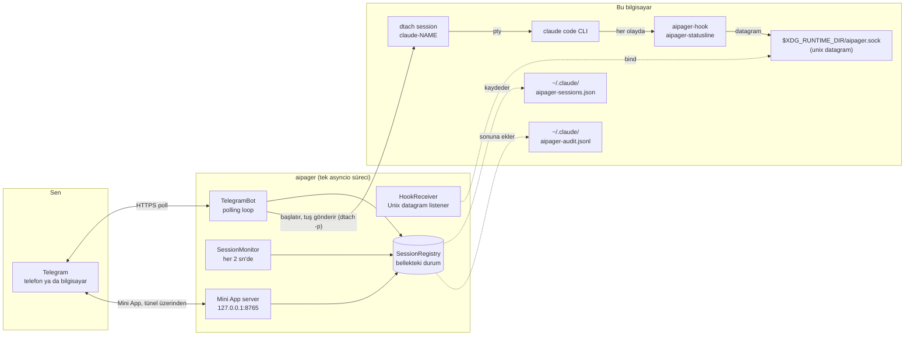

# Mimari

<!-- i18n-source: docs/architecture.md @ 7881bd9e -->

> Bu sayfa İngilizceden çevrildi; ikisi birbirini tutmazsa İngilizce sürüm geçerlidir. ([English](../../architecture.md))

aipager, arka planda çalışan tek süreçli bir asyncio programıdır. Üç dünyayı birbirine bağlar: Telegram'daki sohbetini, `dtach` altında başlattığın Claude Code süreçlerini ve Claude Code'un hook sistemini. Her şey tek bir olay döngüsünden geçer: işçi havuzu yok, veritabanı yok, süreçler arası kuyruk yok.

## Parçaların şeması

Şemadaki her şey, Telegram dışında, bu bilgisayarda çalışır. aipager birkaç sunucuyla daha konuşur: Mini App için Cloudflare tüneliyle (ve `cloudflared` için bir kez GitHub ile), Mini App betiği için `telegram.org` ile, güncelleme istediğinde sürüm kontrolüyle, sesli mesajları ilk kullandığında ses modelinin indirilmesiyle ve bir sorun raporu gönderdiğinde raporların adresiyle. Hepsi [Güvenlik modeli → ağ bağlantıları](security.md#network-surface) bölümünde listeleniyor.

## Süreç nasıl kurulu

`aipager/cli/daemon.py` içindeki tek bir `asyncio.run` çağrısı her şeyi yürütür. İçinde:

- **`TelegramBot`** (`aipager/bot/`): `python-telegram-bot` kütüphanesinin `Application` nesnesine sahiptir. Telegram'dan güncellemeleri alır, onları mesaj, düğme ve sesli mesaj işleyicilerine dağıtır ve çalışma kartlarını, sabitlenmiş durum satırını ve yanıtları güncel tutar.
- **`HookReceiver`** (`aipager/dtach/hook_receiver.py`): `$XDG_RUNTIME_DIR/aipager.sock` konumunda bir Unix datagram soketi açar, `aipager-hook` ve `aipager-statusline` programlarının gönderdiği JSON'u okur ve işi `hook_event_name` alanına (ya da aipager'ın kendi mesajları için `type` alanına; bkz. [hook olayları](hooks.md)) göre dağıtır.
- **`SessionMonitor`** (`aipager/session_monitor.py`): her 2 sn'de bir uyanır; `/tmp/claude-dtach-*.sock` dosyalarını tarar, bulunan oturumları oturum listesiyle karşılaştırır ve bekçileri çalıştırır: hareket etmeyi bırakan bir çalışma kartı, Claude Code'un hiç almadığı bir mesaj, 5 dakikadır haber gelmeyen ve konuşma geçmişine göre bitmiş bir izin isteği (`AIPAGER_INTERACTIVE_TIMEOUT`), sonu kaçırılmış bir görev.
- **`SessionRegistry`** (`aipager/state.py`): adlarıyla `TrackedSession` nesneleri. Kapanışta ve yeniden başlatmadan sağ çıkması gereken bir şey her değiştiğinde `~/.claude/aipager-sessions.json` dosyasına (atomik olarak) kaydedilir.
- **Mini App sunucusu** (`aipager/miniapp/server.py`): `127.0.0.1` üzerinde, `MINIAPP_PORT` portunda (varsayılan 8765) bir aiohttp uygulaması; açık olduğu sürece (varsayılan böyle) yönetilen bir Cloudflare tüneliyle Telegram'a açılır. `/app` panelini sunar.

Bunların hepsi aynı döngüde görevler olarak çalışır. Döngüyü bloke edecek işler ayrı iş parçacıklarında yapılır: sesli mesajları metne çevirme, sorun raporunu derleyip gönderme, güncellemeleri kontrol edip yeniden başlatmayı hazırlama, Mini App betiğini ve `cloudflared` programını indirme ve başlangıçtaki giriş kontrolü.

## Başlangıç sırası

`aipager/cli/daemon.py` dosyasından:

1. Eski yapılandırmayı (`config.env`, `team.yaml`) bir kez `aipager.yaml` dosyasına taşı ve eski dosyaları kenara koy.
2. Sokette başka bir aipager yanıt veriyorsa başlamayı reddet, ardından aipager kilidini al (`~/.local/share/aipager/daemon.lock`).
3. Bot token'ını Telegram'da doğrula (`getMe`).
4. Claude Code'un kendi dosyalarını düzenle: `~/.claude/settings.json` (ya da `$CLAUDE_CONFIG_DIR/settings.json`, daemon'un oturumlarının okuduğu dosya) dosyasına eksik aipager hook'larını ve durum satırını ekle ve Telegram'daki bir kişinin yanıtlayamayacağı ilk çalıştırma sorularını yanıtla (bkz. [güvenlik](security.md#who-decides-whether-a-tool-call-runs)).
5. `SessionRegistry.load()`: `~/.claude/aipager-sessions.json` dosyasını okur. Dosya yoksa ya da okunamıyorsa liste boş başlar.
6. Mini App adresini belirle (kendi URL'in ya da Tailscale), ardından `bot.start()`: Telegram'ı yoklamaya başlar.
7. `HookReceiver.start()`: eski soket dosyasını siler, sokete bağlanır, dinler.
8. `bot.recover_sessions()`: aipager durduğunda çalışan ya da bekleyen oturumların kartlarını ve isteklerini geri getirir (bkz. [komutlar → yanıtlar](commands.md#idle-responses)).
9. `SessionMonitor.start()`: 2 saniyelik taramayı başlatır.
10. Mini App sunucusu başlar, sonra tünel (kendi URL'in ayarlı değilse) ve `📱 App` düğmeleri yayınlanır.
11. aipager sinyalleri bekler: SIGINT ya da SIGTERM onu durdurur, SIGUSR1 sohbetleri ve kuralları yeniden yükler ([gruplar → yeniden başlatmadan yeniden yükleme](groups.md#live-reload)).

## Kapanış sırası

1. SIGINT ya da SIGTERM `stop` olayını tetikler.
2. Süren bir `/update` işlemine kısa bir süre tanınır, sonra kurucusu durdurulur (bkz. [komutlar → güncelleme](commands.md#update)).
3. `registry.save()`.
4. Tünel durur, ardından Mini App sunucusu.
5. `session_monitor.stop()`, `hook_receiver.stop()` (soketi kapatır ve dosyasını siler).
6. `bot.stop()`: animasyonları iptal eder ve `Application` nesnesini durdurur.
7. Gönderimi hâlâ süren bir kart için bir kez daha `registry.save()`.

Telegram'dan yeniden başlatma, yerine gelen sürecin sokete bağlanmasından önce bu yolun tamamının bitmesine dayanır. Bu sırada senin ne gördüğün [bot komutları → yeniden başlatma](commands.md#restart) bölümünde.

## Dosyaların ve soketlerin yerleri

| Yol | Amaç | Yazan |
|---|---|---|
| `$XDG_RUNTIME_DIR/aipager.sock` | Hook olayları için Unix datagram soketi (`$XDG_RUNTIME_DIR` yoksa `/tmp/aipager.sock`; `$AIPAGER_SOCKET_PATH` ikisinin de yerine geçer) | aipager (bağlanır) |
| `aipager-reply-<id>.sock` (kontrol soketinin yanında) | Bir hook'un beklediği her izin isteği için kısa ömürlü bir yanıt soketi | `aipager-hook` |
| `aipager-flood-mute.json`, `aipager-flood-backoff.json` (kontrol soketinin yanında) | `aipager status` ve doctor için Telegram sınırlarının o anki durumu | aipager |
| `aipager-spill-<uid>/ev-<id>.json` (kontrol soketinin yanında) | Tek bir datagram'a sığmayacak kadar büyük bir hook olayı; aipager onu, ona işaret eden datagram gelince okur ve siler; 5 dakikadan eski dosyalar başlangıçta temizlenir ([hooks](hooks.md)) | `aipager-hook` (yazar), aipager (klasörü oluşturur, dosyaları okur ve siler) |
| `aipager-modelswitch-<name>.json` (kontrol soketinin yanında) | aipager'ın yazdığı bir model değişikliğini 30 sn boyunca işaretler ([hooks](hooks.md#premodelswitch)) | aipager (yazar), `aipager-hook` (alır) |
| `/tmp/claude-dtach-<name>.sock` | Her oturum için dtach kontrol soketi | dtach |
| `/tmp/claude-status-<name>.json` | Her oturumun durum satırı verisi | `aipager-statusline` |
| `/tmp/claude-notes-<name>/` | Henüz alınmamış her Telegram mesajı için bir izin notu ve görev sürerken hook'un tuttuğu bir `turn-open` işareti (bir göreve katılan mesaj yalnızca onun kurallarını daraltabilir) | aipager (notları yazar), `aipager-hook` (notları tüketir; `turn-open` yazar, ikisi de siler) |
| `/tmp/claude-policy-<name>.json` | Süren görevin izin anlık görüntüsü | `aipager-hook` (bir mesajı aldığında yazar), `PreToolUse` kontrolü okur |
| `/tmp/claude-policy-.floor-<uid>.json` | Güvenliğin alt sınırı: yerleşik liste artı senin `safety:` bölümün, hook'un yedek yolları için | aipager |
| `/tmp/claude-reply-<name>.txt` | Daha eski bir mesajı yanıtladığında, yanıtladığın mesaj | aipager |
| `/tmp/claude-bgjob-<job>.json` | Bir Claude Code arka plan işini, konuşması o işe taşınan oturuma bağlar (`job`, `session`, işin konuşma kimliği, oturumun claude PID değeri, zaman ve işin kendi `SessionEnd` olayı geldiğinde `ended`), böylece o işin hook'ları oturum için sayılır ([hooks](hooks.md#what-the-daemon-receives)); izinler 0600, oturum geri getirildiğinde ya da sona erdiğinde silinir | aipager (yazar), `aipager-hook` ve `aipager-statusline` (okur) |
| `/tmp/claude-bgjob-pids.json` | Çalışan her oturumun kendi `claude` sürecinin PID değeri; bağlantı dosyası oluşmadan önce çalışan arka plan işi hook'ları için (izinler 0600) | aipager (yazar), `aipager-hook` ve `aipager-statusline` (okur) |
| `/tmp/claude-exit-<name>.json` | `claude` sürecinin çıkış kodu ve ne zaman başlayıp bittiği (`{"code", "start", "end"}`, izinler 0600): oturumu başlatan shell, `claude` başlamadan önce dosyayı siler ve `claude` çıkınca yazar; oturumun sona erme bildirimi nedeni buradan söyler ([sorun giderme](troubleshooting.md#a-session-dropped-off-the-pinned-status-bar-it-is-gone)) | oturumu başlatan shell (yazar), aipager (okur) |
| `/tmp/aipager-files/<chat>/` | Telegram'dan gönderilen dosyalar ve sesli mesajlar; her sohbet için ayrı ve özel bir klasör (`0700`, dosyalar `0600`) | aipager |
| `/tmp/aipager.log` | Hizmet yokken aipager'ın kendini yeniden başlatmasının çıktısı | aipager |
| `~/.claude/aipager-sessions.json` | Oturum listesinin kalıcı durumu | aipager |
| `~/.claude/aipager-audit.jsonl` | İzin ver / Reddet / yanıtların kaydı | aipager (yalnızca sonuna ekler) |
| `~/.claude/aipager-flood-state.json` | Her sohbetin Telegram sınır geçmişi, yeniden başlatmalar arasında saklanır ([sorun giderme](troubleshooting.md#the-bot-went-quiet-flood-control)) | aipager |
| `~/.claude/aipager-tunnel.json`, `aipager-cloudflared.log`, `aipager-cloudflared.err` | aipager'ın tuttuğu Mini App tüneli: süreci, yerel portları ve adresinin bir hash'i (asla adresin kendisi değil), böylece planlı bir yeniden başlatmadan sonra bir sonraki aipager onu devralabilir (izinler 600); cloudflared'in uyarıları; cloudflared'ın son hata çıktısı (izinler 600), bir tünelin neden başlayamadığını söyler ([sorun giderme](troubleshooting.md#the-mini-app-link-isnt-working)) | aipager; kaydı tutulan tünelin bekçisi ve `aipager uninstall` de siler |
| `~/.claude/aipager-pending-users.json` | Botun hizmet vermediği bir grupta bota yazan ya da hizmet verdiği bir grubun üyesi olmayan kişiler, `aipager config` onları ekleyebilsin diye (izinler 0600, her yazımda baştan yazılır, son 30 günün son 200 kişisi) | aipager (yazar), `aipager config` (okur) |
| `~/aipager-users/<label>/` | Üyelerin varsayılan [kök klasörleri](groups.md#root-folders) (izinler 0700); `user` ve `read_only` üyeler oturumlarını burada başlatır; `aipager uninstall` bunları korur | aipager (üyenin ilk `/new` komutunda ya da Mini App'teki ilk “Yeni oturum” işleminde oluşturur) |
| `~/.claude/settings.json` (ya da `$CLAUDE_CONFIG_DIR/settings.json`) | Claude Code hook yapılandırması: daemon'un oturumlarının okuduğu dosya, Claude Code'un aldıkları ortam için ayar klasöründen ([sorun giderme](troubleshooting.md#using-an-api-key-a-gateway-or-another-provider)) | `aipager config` / `aipager setup`; her başlangıçta aipager eksik hook'ları ya da aipager durum satırını ekler ve `skipDangerousModePermissionPrompt` ayarlar ([güvenlik](security.md#who-decides-whether-a-tool-call-runs)), ve o dosya yeniyse bir oturum başlamadan önce yeniden |
| `settings.json.bak.*` (yanında) | Her yeniden yazımdan önceki yedekler | `aipager config`, `aipager setup`, `aipager uninstall` |
| `~/.claude.json` (ya da `$CLAUDE_CONFIG_DIR/.claude.json`, `CLAUDE_CODE_CUSTOM_OAUTH_URL` ile `.claude-custom-oauth.json` ya da Claude Code kullandığında ayar klasöründeki eski `.config.json`) | Claude Code'un kendi dosyası: aipager, bir oturumun başlayacağı klasörü başlamadan hemen önce güvenilir olarak işaretler (ev klasörü dahil, ama asla `/` ya da ev klasörünün üstündeki bir klasör değil), böylece Claude Code'un güven sorusu Telegram'dan başlatılan bir oturumu durdurmaz. aipager başlarken hiçbir şey işaretlenmez. Tamamı okunamıyorsa ya da çalışan bir Claude onu bu arada değiştirdiyse asla yeniden yazılmaz. Aynı şekilde oturumun `ANTHROPIC_API_KEY` değeri için “use this API key?” sorusunu yanıtlar (`customApiKeyResponses`, anahtarın son 20 karakteri) ve oturumun giriş bilgisi varsa Claude Code'un ilk açılışını bitmiş olarak işaretler (`hasCompletedOnboarding`); böylece bu sorular da Telegram'dan başlatılan bir oturumu durdurmaz ([sağlayıcılar](troubleshooting.md#using-an-api-key-a-gateway-or-another-provider)). | aipager |
| `~/.claude/.credentials.json` (ya da ayar klasöründeki) → `.credentials.json.stale` | Claude Code'un giriş dosyası; bir oturum `CLAUDE_CODE_OAUTH_TOKEN` ayarlıyken başlatıldığında ve dosyada yalnızca süresi dolmuş ya da boş bir giriş varsa kenara alınır (yoksa token'ın önüne geçerdi); geri almak için yerine koy | aipager |
| `~/.config/aipager/aipager.yaml` | Bot token'ı, sohbetler, üyeler + roller, Mini App ayarları | `aipager config` (izinler 600); Telegram bir grubu süper gruba çevirdiğinde aipager grubun kaydını taşır ve eski Mini App ayarlarını oraya taşırken bir `aipager.yaml.bak.<time>` kopyası tutar |
| `~/.config/aipager/policy.yaml` | Her rol için kurallar + güvenlik alt sınırına eklemeler | sen (`aipager policy validate` ile kontrol edilir); eski bir kurulum taşınırken açıklamalı bir şablon bir kez yazılır |
| `~/.config/aipager/preferences.json` | Her sohbet ve her oturum için `/settings` seçimleri | aipager |
| `~/.config/aipager/daemon.env` | Başlatılan oturumlar için Claude kimlik bilgileri | sen / `aipager service install` / `aipager doctor --fix` (izinler 600) |
| `~/.config/aipager/config.env`, `team.yaml` → `*.bak.<time>`, `*.retired.<time>` | Eski bir kurulumun yapılandırması: kopyalanır, sonra `aipager.yaml` onu içerdiğinde yeniden adlandırılıp kenara konur | aipager, `aipager config`, `aipager setup` |
| `~/.config/aipager/keyboard.json` | İsteğe bağlı klavye değişiklikleri | sen |
| `~/.local/share/aipager/sessions/` | Her oturum için, `SESSION.md` dosyasıyla (ona kimin erişebileceği ve kurallar) bir klasör, her başlangıçta yeniden oluşturulur | aipager |
| `~/.local/share/aipager/webapp-sdk/`, `cloudflared/` | Telegram'ın Mini App betiği ve doğrulanmış `cloudflared` programı | aipager |
| `~/.local/share/aipager/daemon.lock`, `update.lock`, `update-restart.json` | Aynı anda tek bir aipager; aynı anda tek bir güncelleme; yeniden başlatmadan sonra bildirilecek bir güncelleme | aipager |
| `~/.local/share/aipager/install.json`, `running.json` | aipager'ın burada ilk ne zaman başladığı; şu an çalışıp çalışmadığı (çökmeyi normal durmadan ayırmak için) | aipager |
| `~/.local/state/aipager/reports.json` | Sorun raporları: kaydedilen hata parmak izleri, sayıları ve tekliflerin durumu (izinler 600); bkz. [sorun raporları](problem-reports.md#what-is-kept-on-your-machine) | aipager |
| `~/.local/state/aipager/report-sends.json` | Bugün gönderilen sorun raporları (günlük sınır) | aipager, `aipager report` |
| `~/.local/state/aipager/languages.json` | Dillerin durumu (izinler 600): diller gelmeden önce aipager'ı kimin kullandığı, her kişide görülen son Telegram dili, tek seferlik dil önerisinin ve ilk temas satırının gidip gitmediği ve aipager'ın koyduğu her bot açıklamasının parmak izi; bkz. [Diller](commands.md#languages) | aipager |
| `~/.local/state/aipager/tunnel-status.json` | Mini App tünelinin durumu (başlıyor, çalışıyor ya da nedeni ve bir sonraki deneme zamanıyla çalışmıyor; asla adresi değil; izinler 600), `aipager doctor` için ([sorun giderme](troubleshooting.md#the-mini-app-link-isnt-working)) | aipager (yazar, dururken siler), `aipager doctor` (okur) |
| `~/.config/systemd/user/aipager.service` (Linux), `~/Library/LaunchAgents/com.aipager.daemon.plist` (macOS) ve kurulumun değiştirdiği dosyanın bir `.bak.<time>` kopyası (Linux'ta yalnızca farklıysa) | Arka plan hizmeti | `aipager service install` |
| `~/Library/Logs/aipager.log` (macOS) | launchd hizmetinin günlüğü, `aipager logs` bunu okur | launchd, hizmet için |

Bunun dışında aipager, sen istediğinde yeni bir oturum klasörü oluşturur (`/new` ya da Mini App içindeki Yeni klasör) ve kurucular ile ses modeli, sen güncelleme yaptığında ya da sesli mesaj kullandığında kendi dosyalarını yazar. Bunların hepsi ev klasöründe, `/tmp` içinde ya da kontrol soketinin yanında durur. aipager yetkilerini asla yükseltmez; bkz. [güvenlik](security.md#privilege-boundary).

### Yalıtılmış örnek (testler için)

`AIPAGER_INSTANCE_DIR` değerini sana ait mutlak bir klasöre ayarla; yukarıdaki listedeki her paylaşılan çalışma dosyası oraya taşınır: kontrol soketi (ve yanında yanıt soketleri, sınır sinyal dosyaları, model değişikliği işareti ve hook taşma klasörü), `claude-dtach-*` soketleri, `claude-policy-*`, `claude-notes-*`, `claude-status-*`, `claude-reply-*`, `claude-bgjob-*` ve `claude-exit-*` dosyaları, alt sınır dosyası, `aipager-files` indirme klasörü ve aipager'ın kendini yeniden başlatma günlüğü. Bu örneğin başlattığı oturumlar ayarı devralır, bu yüzden hook'ları yalnızca bu örnekle konuşur ve güvenlik kuralları taşınan dosyaları da aynı şekilde korur. Örnek, repo çalışma kopyasının `.env` dosyasını okumaz.

Ev klasöründeki dosyalar taşınmaz, bu yüzden `HOME` değerini de ayrı bir klasöre yönlendir. Örnek klasörü ayarlıyken `HOME` gerçek ev klasörünse, klasör sana ait bir klasörün mutlak yolu değilse ya da soket yolu için çok uzunsa `aipager start` çalışmayı reddeder.

`/update` ve `/restart` yalıtılmış değildir: kurulu aipager paketine ve `aipager.service` hizmetine etki ederler, bu yüzden onları asla bir test örneğine gönderme.

`AIPAGER_TELEGRAM_API_BASE` (örneğin `http://127.0.0.1:41234`), her Bot API isteğini ve her dosya indirmesini `https://api.telegram.org` yerine bu adrese gönderir. `AIPAGER_TELEGRAM_API_ALLOW_REMOTE=1` ayarlı değilse bu adres bu bilgisayar olmalıdır (`localhost` ya da bir loopback adresi), böylece bir yazım hatası bot token'ını başka bir yere gönderemez.

İki ayar da uçtan uca testlerin, gerçek aipager'ının yanında yerel bir Telegram taklidine karşı ikinci bir aipager çalıştırabilmesi için var. Bunlar olmadan her yol ve her adres yukarıdaki tablodaki gibidir.

## Neden dtach

dtach her Claude Code oturumuna, açık kalması gereken bir terminale bağlamadan gerçek bir PTY verir. aipager oturumu `dtach -n` ile başlatır ve ona `dtach -p` ile yazar (mesajlar, Escape, bir iletişim kutusunu yanıtlamak için tuşlar); ekranı asla okumaz, çünkü olup biteni hook'lar ve konuşma geçmişi söyler. Doğrudan erişim için herhangi bir shell'den `aipager session <name>` ile etkileşimli olarak bağlanabilirsin. Böyle bir bağlantı, Telegram'dan yapılan bir yeniden başlatma boyunca oturumu izler (Tam erişim moduna geçen ya da ondan çıkan `/mode`, `/restart`, Yeniden başlat): oturumun soketi kaybolunca aynı soketin geri gelmesini 15 sn'ye kadar bekler ve kendiliğinden yeniden bağlanır. Gerçekten sona eren bir oturum, beklemenin ardından seni shell'e geri bırakır (Ctrl-C beklemeyi daha erken bitirir). Bağlantı, dtach'ın ayırma tuşu kapalıyken çalışır, bu yüzden `Ctrl-\` Claude'a gider; çıkmak için terminali ya da tmux bölmesini kapat, oturum çalışmaya devam eder.

dtach oturumunun içinde, aipager'ın başlattığı bir oturum `dtach -> bash -> claude`, `aipager session` ile başlatılan bir oturum ise `dtach -> sh -> claude` çalıştırır: shell, çıkış kodunu kaydedebilmek için `claude` sürecini bekler (`claude-exit-<name>.json`); oturumun sona erme bildirimi bu kodu okur. `aipager session` argümanları `claude` programına olduğu gibi ulaşır, asla shell'in ayrıştırmasından geçmez.

Telegram'dan yeniden başlatma, oturumun dtach sürecini sonlandırır ve aynı konuşmayla yeniden başlatır. Konuşması Claude Code arka planına taşınan bir oturum (boş bir giriş satırında ←; bkz. [sorun giderme](troubleshooting.md#a-session-moved-to-claude-codes-background)) aynı şekilde yeniden başlatılır, ama önce bir adım daha vardır: aipager `claude stop <job>` çalıştırır ve konuşmayı hiçbir arka plan süreci tutmayana kadar bekler, sonra oturumun dtach sürecini sonlandırır ve onu işin konuşmasıyla, aipager'ın kendi ayarlarıyla başlatır. Bir oturum Claude Code arka planındayken aipager onun dtach sürecine hiçbir şey yazmaz.

Sonuç: Claude Code, terminalde yazıyormuşsun gibi çalışır, ama o terminal süren oturumu bozmadan gelip gidebilir. aipager oturumları, her 2 saniyelik monitör taramasında `/tmp/claude-dtach-*.sock` dosyalarına bakarak bulur. Bulunan bir oturum, adının oluşturulduğu sohbete aittir; terminalde başlatılan bir oturum ise özel sohbeti ve grubu olan bir kurulumda sahibin özel sohbetine aittir.

## Ayrıca bkz.

- [Hook olayları](hooks.md): kontrol soketinden neler gelir.
- [Bot komutları](commands.md): Telegram'dan neler gelir.
- [Güvenlik modeli](security.md): yetki sınırı, gizli bilgiler, denetim.
- [Sorun giderme](troubleshooting.md): `aipager doctor` başvurusu.
