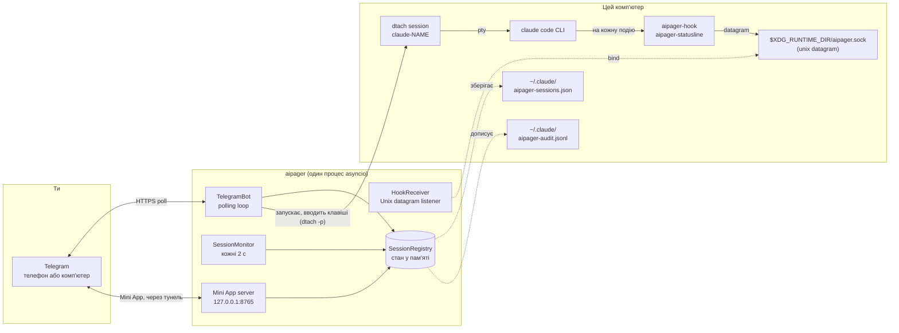

# Архітектура

<!-- i18n-source: docs/architecture.md @ 7881bd9e -->

> Цю сторінку перекладено з англійської; якщо вони розходяться, правильною є англійська версія. ([English](../../architecture.md))

aipager - це програма на asyncio з одного процесу, яка працює у фоні. Вона з'єднує три світи: твій чат у Telegram, процеси Claude Code, які ти запускаєш під `dtach`, і систему hooks Claude Code. Усе проходить через один цикл подій: жодних пулів воркерів, жодної бази даних, жодних черг між процесами.

## Схема частин

Усе на схемі працює на цьому комп'ютері, крім Telegram. aipager говорить ще з кількома серверами: з тунелем Cloudflare для Mini App (і один раз із GitHub, заради `cloudflared`), з `telegram.org` заради скрипта Mini App, з перевіркою версій, коли ти просиш оновлення, із завантаженням голосової моделі, коли вперше користуєшся голосовими, і з адресою для звітів про проблеми, коли ти надсилаєш звіт. Усі вони перелічені в розділі [Модель безпеки → мережеві з'єднання](security.md#network-surface).

## Як улаштований процес

Один виклик `asyncio.run` в `aipager/cli/daemon.py` веде все. Усередині:

- **`TelegramBot`** (`aipager/bot/`): володіє `Application` з `python-telegram-bot`. Отримує оновлення від Telegram, роздає їх обробникам повідомлень, кнопок і голосових і тримає в актуальному вигляді робочі картки, закріплений рядок стану та відповіді.
- **`HookReceiver`** (`aipager/dtach/hook_receiver.py`): відкриває Unix datagram-сокет у `$XDG_RUNTIME_DIR/aipager.sock`, читає JSON, який надсилають `aipager-hook` і `aipager-statusline`, і розподіляє роботу за його `hook_event_name` (або `type`, для власних повідомлень aipager; див. [події hooks](hooks.md)).
- **`SessionMonitor`** (`aipager/session_monitor.py`): прокидається кожні 2 с, щоб переглянути `/tmp/claude-dtach-*.sock`, звірити знайдені сесії зі списком сесій і запустити вартових: робоча картка, що перестала рухатися, повідомлення, яке Claude Code так і не прийняв, запит на дозвіл без новин 5 хвилин, який за збереженою розмовою вже закінчено (`AIPAGER_INTERACTIVE_TIMEOUT`), завдання, кінець якого пропущено.
- **`SessionRegistry`** (`aipager/state.py`): об'єкти `TrackedSession` за назвами. Зберігаються в `~/.claude/aipager-sessions.json` (атомарно) під час вимкнення і щоразу, коли змінюється щось, що має пережити перезапуск.
- **Сервер Mini App** (`aipager/miniapp/server.py`): застосунок aiohttp на `127.0.0.1` з портом `MINIAPP_PORT` (за замовчуванням 8765), доступний для Telegram через керований тунель Cloudflare, поки він увімкнений (за замовчуванням так). Віддає панель `/app`.

Усе це працює як задачі в одному циклі. Робота, яка б його блокувала, іде в окремих потоках: перетворення голосових на текст, збирання і надсилання звіту про проблему, перевірка оновлень і підготовка перезапуску, завантаження скрипта Mini App і `cloudflared` та перевірка входу під час запуску.

## Порядок запуску

З `aipager/cli/daemon.py`:

1. Один раз перенести стару конфігурацію (`config.env`, `team.yaml`) в `aipager.yaml` і відкласти старі файли вбік.
2. Відмовитися запускатися, якщо на сокеті відповідає інший aipager, потім узяти блокування aipager (`~/.local/share/aipager/daemon.lock`).
3. Перевірити токен бота в Telegram (`getMe`).
4. Упорядкувати файли самого Claude Code: додати в `~/.claude/settings.json` (або `$CLAUDE_CONFIG_DIR/settings.json`, файл, який читають сесії демона) відсутні hooks aipager і рядок стану та відповісти на питання першого запуску, на які людина в Telegram відповісти не може (див. [безпека](security.md#who-decides-whether-a-tool-call-runs)).
5. `SessionRegistry.load()`: читає `~/.claude/aipager-sessions.json`. Якщо файлу немає або він не читається, список починається порожнім.
6. Визначити адресу Mini App (твій власний URL або Tailscale), потім `bot.start()`: починає опитувати Telegram.
7. `HookReceiver.start()`: видаляє старий файл сокета, прив'язується до сокета, слухає.
8. `bot.recover_sessions()`: повертає картки й запити сесій, які працювали або чекали, коли aipager зупинився (див. [команди → відповіді](commands.md#idle-responses)).
9. `SessionMonitor.start()`: починає прохід кожні 2 с.
10. Запускається сервер Mini App, потім тунель (якщо не задано твій власний URL), і публікуються кнопки `📱 App`.
11. aipager чекає на сигнали: SIGINT або SIGTERM його зупиняють, SIGUSR1 перезавантажує чати й правила ([групи → перезавантаження без перезапуску](groups.md#live-reload)).

## Порядок вимкнення

1. SIGINT або SIGTERM виставляє подію `stop`.
2. `/update`, що триває, отримує коротку відстрочку, потім його інсталятор зупиняється (див. [команди → оновлення](commands.md#update)).
3. `registry.save()`.
4. Зупиняється тунель, потім сервер Mini App.
5. `session_monitor.stop()`, `hook_receiver.stop()` (закриває сокет і видаляє його файл).
6. `bot.stop()`: скасовує анімації та зупиняє `Application`.
7. Ще раз `registry.save()`, для картки, надсилання якої ще тривало.

Перезапуск із Telegram розраховує на те, що весь цей шлях пройде до кінця, перш ніж заміна прив'яжеться до сокета. Що при цьому видно тобі, описано в [команди бота → перезапуск](commands.md#restart).

## Де лежать файли та сокети

| Шлях | Призначення | Хто пише |
|---|---|---|
| `$XDG_RUNTIME_DIR/aipager.sock` | Unix datagram-сокет для подій hooks (`/tmp/aipager.sock` без `$XDG_RUNTIME_DIR`; `$AIPAGER_SOCKET_PATH` замінює обидва) | aipager (прив'язується) |
| `aipager-reply-<id>.sock` (поруч із керувальним сокетом) | Короткочасний сокет відповіді для кожного запиту на дозвіл, на який чекає hook | `aipager-hook` |
| `aipager-flood-mute.json`, `aipager-flood-backoff.json` (поруч із керувальним сокетом) | Поточний стан лімітів Telegram, для `aipager status` і doctor | aipager |
| `aipager-spill-<uid>/ev-<id>.json` (поруч із керувальним сокетом) | Подія hook, що не вміщається в одну датаграму; aipager читає й видаляє її, коли приходить датаграма, що на неї вказує; файли, старші за 5 хвилин, прибираються під час запуску ([hooks](hooks.md)) | `aipager-hook` (пише), aipager (створює папку, читає й видаляє файли) |
| `aipager-modelswitch-<name>.json` (поруч із керувальним сокетом) | Позначає зміну моделі, яку ввів aipager, на 30 с ([hooks](hooks.md#premodelswitch)) | aipager (пише), `aipager-hook` (забирає) |
| `/tmp/claude-dtach-<name>.sock` | Керувальний сокет dtach для кожної сесії | dtach |
| `/tmp/claude-status-<name>.json` | Дані рядка стану кожної сесії | `aipager-statusline` |
| `/tmp/claude-notes-<name>/` | По одній примітці про дозволи на кожне ще не забране повідомлення з Telegram і позначка `turn-open`, яку hook тримає, поки триває завдання (повідомлення, що приєднується до завдання, може лише звузити його правила) | aipager (примітки, пише), `aipager-hook` (витрачає примітки; пише `turn-open`, а стирають її обидва) |
| `/tmp/claude-policy-<name>.json` | Опорний знімок дозволів для завдання, що триває | `aipager-hook` (пише, коли забирає повідомлення), читає перевірка `PreToolUse` |
| `/tmp/claude-policy-.floor-<uid>.json` | Нижній поріг безпеки: вбудований список плюс твій розділ `safety:`, для запасних шляхів hook | aipager |
| `/tmp/claude-reply-<name>.txt` | Повідомлення, на яке ти відповідаєш, коли це старіше повідомлення | aipager |
| `/tmp/claude-bgjob-<job>.json` | Пов'язує фонове завдання Claude Code із сесією, чия розмова в нього перейшла (`job`, `session`, ID розмови завдання, PID claude цієї сесії, час і `ended`, коли прийшов власний `SessionEnd` завдання), щоб hooks цього завдання зараховувалися сесії ([hooks](hooks.md#what-the-daemon-receives)); права 0600, видаляється, коли сесію повертають або вона завершується | aipager (пише), `aipager-hook` і `aipager-statusline` (читають) |
| `/tmp/claude-bgjob-pids.json` | PID власного `claude` кожної сесії, що працює, для hooks фонового завдання, які запускаються раніше, ніж з'явиться його файл зв'язку (права 0600) | aipager (пише), `aipager-hook` і `aipager-statusline` (читають) |
| `/tmp/claude-exit-<name>.json` | Код виходу `claude` і час його запуску та завершення (`{"code", "start", "end"}`, права 0600): shell, що запускає сесію, видаляє файл перед запуском `claude` і пише його, коли `claude` завершується, а сповіщення про кінець сесії бере з нього причину ([розв'язання проблем](troubleshooting.md#a-session-dropped-off-the-pinned-status-bar-it-is-gone)) | shell, що запускає сесію (пише), aipager (читає) |
| `/tmp/aipager-files/<chat>/` | Файли та голосові, надіслані з Telegram, окрема приватна папка для кожного чату (`0700`, файли `0600`) | aipager |
| `/tmp/aipager.log` | Вивід перезапуску самим aipager, коли служби немає | aipager |
| `~/.claude/aipager-sessions.json` | Довготривалий стан списку сесій | aipager |
| `~/.claude/aipager-audit.jsonl` | Журнал натискань «Дозволити» / «Відхилити» і відповідей | aipager (лише дописує) |
| `~/.claude/aipager-flood-state.json` | Історія лімітів Telegram для кожного чату, зберігається між перезапусками ([розв'язання проблем](troubleshooting.md#the-bot-went-quiet-flood-control)) | aipager |
| `~/.claude/aipager-tunnel.json`, `aipager-cloudflared.log`, `aipager-cloudflared.err` | Тунель Mini App, який тримає aipager: його процес, локальні порти й хеш його адреси (ніколи не сама адреса), щоб наступний aipager міг підхопити його після планового перезапуску (права 600); попередження cloudflared; останній вивід помилок cloudflared (права 600), де сказано, чому тунель не зміг запуститися ([усунення проблем](troubleshooting.md#the-mini-app-link-isnt-working)) | aipager; запис також видаляють сторож залишеного тунелю і `aipager uninstall` |
| `~/.claude/aipager-pending-users.json` | Люди, які звернулися до бота в групі, яку він не обслуговує, або які не є учасниками групи, яку він обслуговує, щоб `aipager config` міг їх додати (права 0600, повністю перезаписується під час кожного запису, останні 200 людей за 30 днів) | aipager (пише), `aipager config` (читає) |
| `~/aipager-users/<label>/` | [Кореневі папки](groups.md#root-folders) учасників за замовчуванням (права 0700), де учасники з `user` і `read_only` запускають свої сесії; `aipager uninstall` їх зберігає | aipager (створює під час першого `/new` учасника або його першого натискання «Нова сесія» в Mini App) |
| `~/.claude/settings.json` (або `$CLAUDE_CONFIG_DIR/settings.json`) | Конфігурація hooks Claude Code: той, який читають сесії демона, з теки налаштувань Claude Code для оточення, яке вони отримують ([усунення проблем](troubleshooting.md#using-an-api-key-a-gateway-or-another-provider)) | `aipager config` / `aipager setup`; під час кожного запуску aipager додає відсутні hooks або рядок стану aipager і ставить `skipDangerousModePermissionPrompt` ([безпека](security.md#who-decides-whether-a-tool-call-runs)), і ще раз перед запуском сесії, якщо цей файл новий |
| `settings.json.bak.*` (поруч із ним) | Резервні копії перед кожним перезаписом | `aipager config`, `aipager setup`, `aipager uninstall` |
| `~/.claude.json` (або `$CLAUDE_CONFIG_DIR/.claude.json`, `.claude-custom-oauth.json` за `CLAUDE_CODE_CUSTOM_OAUTH_URL` чи старий `.config.json` у теці налаштувань, коли Claude Code його використовує) | Власний файл Claude Code: aipager позначає папку, у якій запускається сесія, як довірену просто перед запуском (домашню папку теж, але ніколи `/` чи папку вище домашньої), щоб питання про довіру Claude Code не зупиняло сесію, запущену з Telegram. Під час запуску aipager нічого не позначається. Ніколи не перезаписується, якщо його не можна прочитати повністю або запущений Claude тим часом його змінив. Так само він відповідає на запитання «use this API key?» для `ANTHROPIC_API_KEY` сесії (`customApiKeyResponses`, останні 20 символів ключа) і позначає перший запуск Claude Code завершеним, коли сесія має чим увійти (`hasCompletedOnboarding`), щоб і ці запитання не зупиняли сесію, запущену з Telegram ([провайдери](troubleshooting.md#using-an-api-key-a-gateway-or-another-provider)). | aipager |
| `~/.claude/.credentials.json` (або той, що в теці налаштувань) → `.credentials.json.stale` | Файл входу Claude Code, відсувається вбік, коли сесія запускається із заданим `CLAUDE_CODE_OAUTH_TOKEN`, а у файлі лише прострочений або порожній вхід (інакше він узяв би гору над токеном); щоб скасувати, поверни його на місце | aipager |
| `~/.config/aipager/aipager.yaml` | Токен бота, чати, учасники + ролі, налаштування Mini App | `aipager config` (права 600); aipager переносить запис групи, коли Telegram робить її супергрупою, і зберігає копію `aipager.yaml.bak.<time>`, коли переносить туди старі налаштування Mini App |
| `~/.config/aipager/policy.yaml` | Правила для кожної ролі + доповнення до порогу безпеки | ти (перевіряється через `aipager policy validate`); шаблон із коментарями пишеться один раз під час перенесення старого встановлення |
| `~/.config/aipager/preferences.json` | Вибір у `/settings` для кожного чату і кожної сесії | aipager |
| `~/.config/aipager/daemon.env` | Облікові дані Claude для сесій, що запускаються | ти / `aipager service install` / `aipager doctor --fix` (права 600) |
| `~/.config/aipager/config.env`, `team.yaml` → `*.bak.<time>`, `*.retired.<time>` | Конфігурація старого встановлення: копіюється, а потім перейменовується вбік, коли її вже містить `aipager.yaml` | aipager, `aipager config`, `aipager setup` |
| `~/.config/aipager/keyboard.json` | Необов'язкові зміни клавіатури | ти |
| `~/.local/share/aipager/sessions/` | По папці на сесію з її `SESSION.md` (хто може до неї звертатися і правила), створюється заново під час кожного запуску | aipager |
| `~/.local/share/aipager/webapp-sdk/`, `cloudflared/` | Скрипт Mini App від Telegram і перевірена програма `cloudflared` | aipager |
| `~/.local/share/aipager/daemon.lock`, `update.lock`, `update-restart.json` | Лише один aipager одночасно; лише одне оновлення одночасно; оновлення, про яке треба повідомити після перезапуску | aipager |
| `~/.local/share/aipager/install.json`, `running.json` | Коли aipager уперше запустився тут; чи працює він зараз (щоб відрізнити падіння від звичайної зупинки) | aipager |
| `~/.local/state/aipager/reports.json` | Звіти про проблеми: записані відбитки помилок, їхня кількість і стан пропозицій (права 600); див. [звіти про проблеми](problem-reports.md#what-is-kept-on-your-machine) | aipager |
| `~/.local/state/aipager/report-sends.json` | Звіти про проблеми, надіслані сьогодні (денний ліміт) | aipager, `aipager report` |
| `~/.local/state/aipager/languages.json` | Стан мов (права 600): хто вже користувався aipager до появи мов, остання мова Telegram, помічена в кожної людини, чи пішли разова пропозиція мови та рядок першого контакту, і відбиток кожного опису бота, який поставив aipager; див. [Мови](commands.md#languages) | aipager |
| `~/.local/state/aipager/tunnel-status.json` | Стан тунелю Mini App (запускається, працює або не працює, з причиною й часом наступної спроби; ніколи його адреса; права 600), для `aipager doctor` ([усунення проблем](troubleshooting.md#the-mini-app-link-isnt-working)) | aipager (пише й видаляє під час зупинки), `aipager doctor` (читає) |
| `~/.config/systemd/user/aipager.service` (Linux), `~/Library/LaunchAgents/com.aipager.daemon.plist` (macOS) і копія `.bak.<time>` того, що замінює встановлення (на Linux лише якщо воно відрізняється) | Фонова служба | `aipager service install` |
| `~/Library/Logs/aipager.log` (macOS) | Лог служби launchd, його читає `aipager logs` | launchd, для служби |

Крім цього, aipager створює нову папку сесії, коли ти про це просиш (Нова папка в `/new` або в Mini App), а інсталятори та голосова модель пишуть свої файли, коли ти оновлюєшся або користуєшся голосовими. Усе це лежить у твоїй домашній папці, у `/tmp` або поруч із керувальним сокетом. aipager ніколи не підвищує своїх прав; див. [безпека](security.md#privilege-boundary).

### Ізольований екземпляр (для тестів)

Задай `AIPAGER_INSTANCE_DIR` як абсолютну папку, що належить тобі, і кожен спільний робочий файл зі списку вище переїде в неї: керувальний сокет (а поруч із ним сокети відповідей, файли сигналів лімітів, позначка про зміну моделі й папка для завеликих подій hooks), сокети `claude-dtach-*`, файли `claude-policy-*`, `claude-notes-*`, `claude-status-*`, `claude-reply-*`, `claude-bgjob-*` і `claude-exit-*`, файл порогу, папка завантажень `aipager-files` і лог перезапуску самим aipager. Сесії, які запускає цей екземпляр, успадковують налаштування, тому їхні hooks говорять лише з цим екземпляром, а правила безпеки захищають перенесені файли так само. Екземпляр не читає `.env` робочої копії репозиторію.

Файли у твоїй домашній папці не переїжджають, тому спрямуй і `HOME` на окрему папку. `aipager start` відмовляється працювати, якщо задано папку екземпляра, а `HOME` - це твоя справжня домашня папка, якщо папка не є абсолютним шляхом до папки, що належить тобі, або якщо вона задовга для шляху сокета.

`/update` і `/restart` не ізольовані: вони діють на встановлений пакет aipager і службу `aipager.service`, тому ніколи не надсилай їх тестовому екземпляру.

`AIPAGER_TELEGRAM_API_BASE` (наприклад, `http://127.0.0.1:41234`) надсилає кожен запит до Bot API і кожне завантаження файлу на цю адресу замість `https://api.telegram.org`. Це має бути цей комп'ютер (`localhost` або адреса loopback), якщо лише не задано `AIPAGER_TELEGRAM_API_ALLOW_REMOTE=1`, щоб друкарська помилка не могла надіслати токен бота кудись іще.

Обидва налаштування потрібні, щоб наскрізні тести могли запускати другий aipager проти локальної заміни Telegram поруч із твоїм справжнім. Без них кожен шлях і кожна адреса такі, як у таблиці вище.

## Чому dtach

dtach дає кожній сесії Claude Code справжній PTY, не прив'язуючи його до термінала, який має лишатися відкритим. aipager запускає сесію через `dtach -n` і вводить у неї через `dtach -p` (повідомлення, Escape, клавіші для відповіді в діалозі); екран він ніколи не читає, бо про те, що відбувається, кажуть hooks та історія розмови. Під'єднатися інтерактивно для прямого доступу можна з будь-якого shell через `aipager session <name>`. Таке під'єднання стежить за сесією через перезапуск із Telegram (`/mode`, що вмикає чи вимикає режим «Повний доступ», `/restart`, Перезапустити): коли сокет сесії зникає, воно чекає до 15 с, поки повернеться той самий сокет, і під'єднується знову само. Сесія, яка справді завершилася, після очікування повертає тебе в shell (Ctrl-C припиняє очікування раніше). Під'єднання працює з вимкненою клавішею від'єднання dtach, тому `Ctrl-\` іде в Claude; щоб піти, закрий термінал або панель tmux, і сесія працюватиме далі.

Усередині сесії dtach сесія, яку запускає aipager, працює як `dtach -> bash -> claude`, а запущена через `aipager session` як `dtach -> sh -> claude`: shell чекає на `claude`, щоб записати його код виходу (`claude-exit-<name>.json`), який читає сповіщення про кінець сесії. Аргументи `aipager session` доходять до `claude` як є, ніколи не проходячи через розбір shell.

Перезапуск із Telegram завершує dtach сесії й запускає його знову на тій самій розмові. Сесія, чия розмова перейшла у фоновий режим Claude Code (← у порожньому рядку введення; див. [розв'язання проблем](troubleshooting.md#a-session-moved-to-claude-codes-background)), перезапускається так само, але спершу з одним кроком більше: aipager виконує `claude stop <job>` і чекає, доки жоден фоновий процес не триматиме розмову, потім завершує dtach сесії й запускає його на розмові завдання з власними налаштуваннями aipager. Поки сесія у фоновому режимі Claude Code, aipager нічого не вводить у її dtach.

Підсумок: Claude Code працює так само, як під час набору в терміналі, але цей термінал може з'являтися і зникати, не заважаючи сесії, що триває. aipager знаходить сесії, переглядаючи `/tmp/claude-dtach-*.sock` на кожному проході монітора раз на 2 с. Знайдена сесія належить чату, для якого було створено її назву, а сесія, запущена в терміналі, на встановленні з особистим чатом і групою належить особистому чату власника.

## Див. також

- [Події hooks](hooks.md): що приходить через керувальний сокет.
- [Команди бота](commands.md): що приходить із Telegram.
- [Модель безпеки](security.md): межа прав, секрети, аудит.
- [Розв'язання проблем](troubleshooting.md): довідка про `aipager doctor`.
