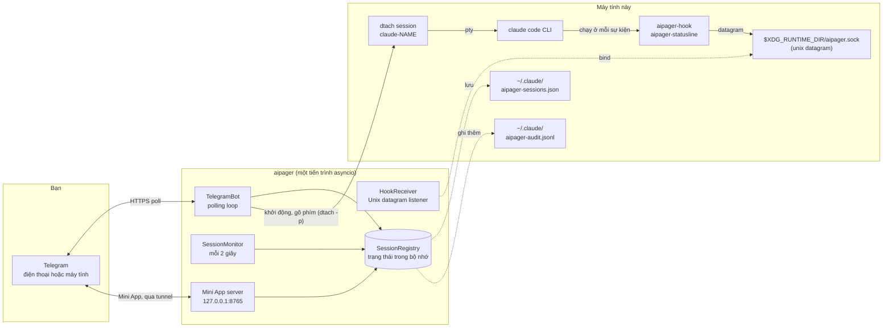

# Kiến trúc

<!-- i18n-source: docs/architecture.md @ d4381f41 -->

> Trang này được dịch từ tiếng Anh; nếu hai bản khác nhau, bản tiếng Anh là bản đúng. ([English](../../architecture.md))

aipager là một chương trình asyncio chạy nền trong một tiến trình duy nhất. Nó nối ba thế giới: chat Telegram của bạn, các tiến trình Claude Code bạn chạy trong `dtach`, và hệ thống hook của Claude Code. Mọi thứ đi qua một event loop: không có worker pool, không có cơ sở dữ liệu, không có hàng đợi giữa các tiến trình.

## Sơ đồ các phần

Mọi thứ trong sơ đồ đều chạy trên máy tính này, trừ Telegram. aipager còn nói chuyện với vài máy chủ khác: tunnel Cloudflare của Mini App (và GitHub, một lần, để lấy `cloudflared`), `telegram.org` để lấy script của Mini App, việc kiểm tra phiên bản khi bạn yêu cầu cập nhật, việc tải mô hình nhận dạng giọng nói khi bạn dùng tin nhắn thoại lần đầu, và địa chỉ nhận báo cáo sự cố khi bạn gửi một báo cáo. Tất cả được liệt kê ở [Mô hình bảo mật → kết nối mạng](security.md#network-surface).

## Cách tiến trình được tổ chức

Một lần gọi `asyncio.run` trong `aipager/cli/daemon.py` chạy toàn bộ. Bên trong đó:

- **`TelegramBot`** (`aipager/bot/`): giữ một `Application` của `python-telegram-bot`. Nhận cập nhật từ Telegram, chuyển chúng tới các phần xử lý tin nhắn, nút bấm và tin nhắn thoại, và giữ cho thẻ làm việc, thanh trạng thái được ghim và các câu trả lời luôn được cập nhật.
- **`HookReceiver`** (`aipager/dtach/hook_receiver.py`): mở một socket datagram Unix ở `$XDG_RUNTIME_DIR/aipager.sock`, đọc JSON mà `aipager-hook` và `aipager-statusline` gửi tới, rồi phân việc theo `hook_event_name` của nó (hoặc `type`, với tin nhắn của chính aipager; xem [sự kiện hook](hooks.md)).
- **`SessionMonitor`** (`aipager/session_monitor.py`): thức dậy mỗi 2 giây để quét `/tmp/claude-dtach-*.sock`, đối chiếu các phiên tìm thấy với danh sách phiên, và chạy các bộ canh chừng: một thẻ làm việc ngừng chuyển động, một tin nhắn Claude Code không bao giờ nhận, một yêu cầu cấp quyền không có tin gì trong 5 phút mà cuộc trò chuyện đã lưu cho thấy đã xong (`AIPAGER_INTERACTIVE_TIMEOUT`), một việc mà lúc kết thúc bị bỏ lỡ.
- **`SessionRegistry`** (`aipager/state.py`): các đối tượng `TrackedSession` theo tên. Được lưu vào `~/.claude/aipager-sessions.json` (một cách nguyên tử) khi tắt và mỗi khi có thay đổi cần giữ qua lần khởi động lại.
- **Máy chủ Mini App** (`aipager/miniapp/server.py`): một ứng dụng aiohttp ở `127.0.0.1` trên cổng `MINIAPP_PORT` (mặc định 8765), được đưa ra cho Telegram qua một tunnel Cloudflare được quản lý trong lúc nó bật (mặc định là bật). Cung cấp bảng điều khiển `/app`.

Tất cả những phần này chạy như các task trên cùng một loop. Việc nào có thể làm loop bị chặn thì chạy trong các thread riêng: chuyển tin nhắn thoại thành chữ, tạo và gửi báo cáo sự cố, kiểm tra cập nhật và lên kế hoạch khởi động lại, tải script của Mini App và `cloudflared`, và kiểm tra đăng nhập lúc khởi động.

## Trình tự khởi động

Từ `aipager/cli/daemon.py`:

1. Chuyển cấu hình cũ (`config.env`, `team.yaml`) sang `aipager.yaml`, một lần, và cất các file cũ đi.
2. Từ chối khởi động nếu một aipager khác đang trả lời trên socket, sau đó giữ khóa của aipager (`~/.local/share/aipager/daemon.lock`).
3. Kiểm tra token của bot với Telegram (`getMe`).
4. Sửa lại các file của chính Claude Code: thêm hook aipager và dòng trạng thái còn thiếu vào `~/.claude/settings.json` (hoặc `$CLAUDE_CONFIG_DIR/settings.json`, tệp mà các phiên của daemon đọc), và trả lời các câu hỏi ở lần chạy đầu mà một người dùng Telegram không thể trả lời (xem [bảo mật](security.md#who-decides-whether-a-tool-call-runs)).
5. `SessionRegistry.load()`: đọc `~/.claude/aipager-sessions.json`. Nếu file không có hoặc không đọc được, danh sách bắt đầu trống.
6. Xác định địa chỉ của Mini App (URL riêng của bạn, hoặc Tailscale), rồi `bot.start()`: bắt đầu nhận cập nhật từ Telegram.
7. `HookReceiver.start()`: xóa file socket cũ còn sót, bind, lắng nghe.
8. `bot.recover_sessions()`: đưa trở lại thẻ và yêu cầu của các phiên đang làm việc hoặc đang chờ lúc aipager dừng (xem [lệnh → câu trả lời khi việc kết thúc](commands.md#idle-responses)).
9. `SessionMonitor.start()`: bắt đầu vòng quét mỗi 2 giây.
10. Máy chủ Mini App khởi động, rồi tới tunnel (khi chưa đặt URL riêng), và các nút `📱 App` được đăng lên.
11. aipager chờ tín hiệu: SIGINT hoặc SIGTERM làm nó dừng, SIGUSR1 tải lại các chat và quy tắc ([nhóm → tải lại không cần khởi động lại](groups.md#live-reload)).

## Trình tự tắt

1. SIGINT hoặc SIGTERM đặt sự kiện `stop`.
2. Một lệnh `/update` đang chạy được cho thêm chút thời gian, rồi trình cài đặt của nó bị dừng (xem [lệnh → cập nhật](commands.md#update)).
3. `registry.save()`.
4. Tunnel dừng, rồi tới máy chủ Mini App.
5. `session_monitor.stop()`, `hook_receiver.stop()` (đóng socket và xóa file của nó).
6. `bot.stop()`: hủy các hiệu ứng chuyển động và dừng `Application`.
7. `registry.save()` lần nữa, cho một thẻ mà việc gửi vẫn chưa xong.

Việc tự khởi động lại từ Telegram dựa vào việc toàn bộ trình tự này chạy xong trước khi bản thay thế bind vào socket. Những gì bạn thấy lúc đó được mô tả ở [lệnh của bot → khởi động lại](commands.md#restart).

## Vị trí file và socket

| Đường dẫn | Dùng để làm gì | Ai ghi |
|---|---|---|
| `$XDG_RUNTIME_DIR/aipager.sock` | Socket datagram Unix cho các sự kiện hook (`/tmp/aipager.sock` khi không có `$XDG_RUNTIME_DIR`; `$AIPAGER_SOCKET_PATH` được ưu tiên hơn cả hai) | aipager (bind) |
| `aipager-reply-<id>.sock` (cạnh socket điều khiển) | Một socket trả lời ngắn hạn cho mỗi yêu cầu cấp quyền mà hook đang chờ | `aipager-hook` |
| `aipager-flood-mute.json`, `aipager-flood-backoff.json` (cạnh socket điều khiển) | Trạng thái giới hạn tốc độ hiện tại của Telegram, cho `aipager status` và doctor | aipager |
| `aipager-modelswitch-<name>.json` (cạnh socket điều khiển) | Đánh dấu một lần đổi mô hình do aipager gõ, trong 30 giây ([hook](hooks.md#premodelswitch)) | aipager (ghi), `aipager-hook` (nhận) |
| `/tmp/claude-dtach-<name>.sock` | Socket điều khiển của dtach cho mỗi phiên | dtach |
| `/tmp/claude-status-<name>.json` | Dữ liệu dòng trạng thái của mỗi phiên | `aipager-statusline` |
| `/tmp/claude-notes-<name>/` | Một ghi chú quyền cho mỗi tin nhắn Telegram chưa được nhận, và một dấu `turn-open` mà hook giữ trong lúc một việc đang chạy (một tin nhắn nhập vào việc đó chỉ có thể thu hẹp quy tắc của nó) | aipager (ghi chú, ghi), `aipager-hook` (dùng ghi chú; ghi `turn-open`, và cả hai cùng xóa nó) |
| `/tmp/claude-policy-<name>.json` | Bản chụp quyền chuẩn cho việc đang chạy | `aipager-hook` (ghi lúc nhận tin nhắn), được bước kiểm tra `PreToolUse` đọc |
| `/tmp/claude-policy-.floor-<uid>.json` | Mức an toàn tối thiểu: danh sách có sẵn cộng với phần `safety:` của bạn, cho các đường dự phòng của hook | aipager |
| `/tmp/claude-reply-<name>.txt` | Tin nhắn bạn đã trả lời, khi bạn trả lời một tin nhắn cũ hơn | aipager |
| `/tmp/claude-bgjob-<job>.json` | Liên kết một tác vụ chạy nền của Claude Code với phiên có cuộc trò chuyện đã chuyển sang nó (`job`, `session`, ID cuộc trò chuyện của tác vụ, PID claude của phiên, thời điểm, và `ended` khi `SessionEnd` của chính tác vụ tới), để hook của tác vụ đó được tính cho phiên ([hook](hooks.md#what-the-daemon-receives)); quyền 0600, bị xóa khi phiên được đưa về lại hoặc kết thúc | aipager (ghi), `aipager-hook` và `aipager-statusline` (đọc) |
| `/tmp/claude-bgjob-pids.json` | PID của chính `claude` của mỗi phiên đang chạy, cho hook của một tác vụ chạy nền chạy trước khi file liên kết của nó tồn tại (quyền 0600) | aipager (ghi), `aipager-hook` và `aipager-statusline` (đọc) |
| `/tmp/claude-exit-<name>.json` | Mã thoát của `claude` và thời điểm nó bắt đầu, kết thúc (`{"code", "start", "end"}`, quyền 0600): shell khởi chạy phiên xóa file trước khi `claude` bắt đầu và ghi nó khi `claude` thoát, và thông báo kết thúc phiên dựa vào nó để nói lý do ([xử lý sự cố](troubleshooting.md#a-session-dropped-off-the-pinned-status-bar-it-is-gone)) | shell khởi chạy phiên (ghi), aipager (đọc) |
| `/tmp/aipager-files/<chat>/` | File và tin nhắn thoại gửi từ Telegram, mỗi chat một thư mục riêng (`0700`, file `0600`) | aipager |
| `/tmp/aipager.log` | Đầu ra của việc tự khởi động lại khi không có dịch vụ | aipager |
| `~/.claude/aipager-sessions.json` | Trạng thái lâu dài của danh sách phiên | aipager |
| `~/.claude/aipager-audit.jsonl` | Log Cho phép / Từ chối / câu trả lời | aipager (chỉ ghi thêm) |
| `~/.claude/aipager-flood-state.json` | Lịch sử giới hạn tốc độ của Telegram cho từng chat, được giữ qua các lần khởi động lại ([xử lý sự cố](troubleshooting.md#the-bot-went-quiet-flood-control)) | aipager |
| `~/.claude/aipager-tunnel.json`, `aipager-cloudflared.log`, `aipager-cloudflared.err` | Tunnel Mini App mà aipager giữ: tiến trình, các cổng cục bộ và một mã băm của địa chỉ (không bao giờ là chính địa chỉ), để aipager kế tiếp tiếp quản nó sau một lần khởi động lại có kế hoạch (quyền 600); các cảnh báo của cloudflared; đầu ra lỗi cuối cùng của cloudflared (quyền 600), cho biết vì sao một tunnel không khởi động được ([khắc phục sự cố](troubleshooting.md#the-mini-app-link-isnt-working)) | aipager; tiến trình canh gác của tunnel được giữ lại và `aipager uninstall` cũng xóa bản ghi này |
| `~/.claude/aipager-pending-users.json` | Những người đã nhắn bot trong một nhóm mà bot không phục vụ, hoặc không phải thành viên của một nhóm mà bot phục vụ, để `aipager config` thêm họ (quyền 0600, mỗi lần ghi thì thay cả file, 200 người mới nhất trong 30 ngày qua) | aipager (ghi), `aipager config` (đọc) |
| `~/aipager-users/<label>/` | [Thư mục gốc](groups.md#root-folders) mặc định của các thành viên (quyền 0700), nơi các thành viên `user` và `read_only` bắt đầu phiên của mình; `aipager uninstall` giữ lại chúng | aipager (tạo ra ở lần `/new` đầu tiên hoặc lần “Phiên mới” đầu tiên trong Mini App của một thành viên) |
| `~/.claude/settings.json` (hoặc `$CLAUDE_CONFIG_DIR/settings.json`) | Cấu hình hook của Claude Code: tệp mà các phiên của daemon đọc, từ thư mục cấu hình của Claude Code cho môi trường chúng nhận được ([khắc phục sự cố](troubleshooting.md#using-an-api-key-a-gateway-or-another-provider)) | `aipager config` / `aipager setup`; mỗi lần khởi động, aipager thêm hook hoặc dòng trạng thái aipager còn thiếu và đặt `skipDangerousModePermissionPrompt` ([bảo mật](security.md#who-decides-whether-a-tool-call-runs)), và một lần nữa trước khi phiên bắt đầu nếu tệp đó là tệp mới |
| `settings.json.bak.*` (bên cạnh nó) | Bản sao lưu trước mỗi lần ghi lại | `aipager config`, `aipager setup`, `aipager uninstall` |
| `~/.claude.json` (hoặc `$CLAUDE_CONFIG_DIR/.claude.json`, `.claude-custom-oauth.json` khi có `CLAUDE_CODE_CUSTOM_OAUTH_URL`, hoặc `.config.json` cũ trong thư mục cấu hình khi Claude Code dùng nó) | File của chính Claude Code: aipager đánh dấu thư mục nơi một phiên bắt đầu là đáng tin ngay trước khi phiên bắt đầu (kể cả thư mục home, không bao giờ `/` hay một thư mục phía trên thư mục home), để câu hỏi về độ tin cậy của Claude Code không chặn một phiên bắt đầu từ Telegram. Lúc aipager khởi động, không có gì được đánh dấu. Không bao giờ bị ghi đè khi không đọc được trọn vẹn hoặc một Claude đang chạy đã thay đổi nó trong lúc đó. Theo cách đó, nó cũng trả lời câu hỏi “use this API key?” cho `ANTHROPIC_API_KEY` của phiên (`customApiKeyResponses`, 20 ký tự cuối của khóa) và đánh dấu lần chạy đầu của Claude Code là đã xong khi phiên có thông tin đăng nhập (`hasCompletedOnboarding`), để các câu hỏi này cũng không chặn phiên bắt đầu từ Telegram ([nhà cung cấp](troubleshooting.md#using-an-api-key-a-gateway-or-another-provider)). | aipager |
| `~/.claude/.credentials.json` (hoặc tệp trong thư mục cấu hình) → `.credentials.json.stale` | File đăng nhập của Claude Code, được cất sang một bên khi một phiên bắt đầu với `CLAUDE_CODE_OAUTH_TOKEN` được đặt mà file chỉ chứa một lần đăng nhập đã hết hạn hoặc trống (nếu không, file sẽ được ưu tiên hơn token); muốn hoàn tác thì chuyển nó về chỗ cũ | aipager |
| `~/.config/aipager/aipager.yaml` | Token bot, các chat, thành viên + vai trò, cài đặt Mini App | `aipager config` (quyền 600); aipager chuyển mục của một nhóm khi Telegram nâng cấp nó thành supergroup, và giữ một bản `aipager.yaml.bak.<time>` khi chuyển cài đặt Mini App cũ vào đó |
| `~/.config/aipager/policy.yaml` | Quy tắc theo vai trò + phần bổ sung cho mức an toàn | bạn (kiểm tra bằng `aipager policy validate`); một bản mẫu có chú thích được ghi một lần khi chuyển một bản cài cũ sang |
| `~/.config/aipager/preferences.json` | Các lựa chọn `/settings` của từng chat và từng phiên | aipager |
| `~/.config/aipager/daemon.env` | Thông tin đăng nhập Claude cho các phiên được khởi động | bạn / `aipager service install` / `aipager doctor --fix` (quyền 600) |
| `~/.config/aipager/config.env`, `team.yaml` → `*.bak.<time>`, `*.retired.<time>` | Cấu hình của một bản cài cũ: được sao chép, rồi đổi tên cất đi khi `aipager.yaml` đã chứa nó | aipager, `aipager config`, `aipager setup` |
| `~/.config/aipager/keyboard.json` | Tùy chỉnh bàn phím (không bắt buộc) | bạn |
| `~/.local/share/aipager/sessions/` | Một thư mục cho mỗi phiên với `SESSION.md` của nó (ai được nói chuyện với phiên, và các quy tắc), được tạo lại mỗi lần khởi động phiên | aipager |
| `~/.local/share/aipager/webapp-sdk/`, `cloudflared/` | Script Mini App của Telegram và chương trình `cloudflared` đã được xác minh | aipager |
| `~/.local/share/aipager/daemon.lock`, `update.lock`, `update-restart.json` | Mỗi lúc chỉ một aipager; mỗi lúc chỉ một lần cập nhật; lần cập nhật cần thông báo sau khi khởi động lại | aipager |
| `~/.local/share/aipager/install.json`, `running.json` | aipager bắt đầu ở đây lần đầu khi nào; bây giờ nó có đang chạy không (để phân biệt crash với dừng bình thường) | aipager |
| `~/.local/state/aipager/reports.json` | Báo cáo sự cố: dấu vân tay lỗi đã ghi nhận, số lần, và trạng thái của lời đề nghị (quyền 600); xem [báo cáo sự cố](problem-reports.md#what-is-kept-on-your-machine) | aipager |
| `~/.local/state/aipager/report-sends.json` | Các báo cáo sự cố đã gửi hôm nay (giới hạn mỗi ngày) | aipager, `aipager report` |
| `~/.local/state/aipager/languages.json` | Trạng thái ngôn ngữ (quyền 600): ai đã dùng aipager trước khi có ngôn ngữ, ngôn ngữ Telegram gần nhất thấy được của từng người, lời đề nghị đổi ngôn ngữ (chỉ một lần) và dòng chào đầu tiên đã được gửi chưa, và mã băm của mỗi mô tả bot mà aipager đã đặt; xem [Ngôn ngữ](commands.md#languages) | aipager |
| `~/.local/state/aipager/tunnel-status.json` | Trạng thái tunnel Mini App (đang khởi động, đang hoạt động, hoặc không hoạt động kèm nguyên nhân và lúc thử lại; không bao giờ có địa chỉ; quyền 600), dành cho `aipager doctor` ([khắc phục sự cố](troubleshooting.md#the-mini-app-link-isnt-working)) | aipager (ghi, xóa khi dừng), `aipager doctor` (đọc) |
| `~/.config/systemd/user/aipager.service` (Linux), `~/Library/LaunchAgents/com.aipager.daemon.plist` (macOS), và một bản `.bak.<time>` của file bị lần cài đặt thay thế (trên Linux chỉ khi nó khác) | Dịch vụ chạy nền | `aipager service install` |
| `~/Library/Logs/aipager.log` (macOS) | Log của dịch vụ launchd, được `aipager logs` đọc | launchd, cho dịch vụ |

Ngoài những file này, aipager tạo một thư mục phiên mới khi bạn yêu cầu (“Thư mục mới” trong `/new` hoặc trong Mini App), và các trình cài đặt cùng mô hình giọng nói ghi file riêng của chúng khi bạn cập nhật hoặc dùng tin nhắn thoại. Tất cả đều nằm trong thư mục home của bạn, trong `/tmp`, hoặc cạnh socket điều khiển. aipager không bao giờ nâng quyền; xem [bảo mật](security.md#privilege-boundary).

### Bản chạy tách biệt (để thử nghiệm)

Đặt `AIPAGER_INSTANCE_DIR` thành một thư mục tuyệt đối thuộc về bạn, và mọi file dùng chung ở trên sẽ chuyển vào đó: socket điều khiển (cùng các socket trả lời, file tín hiệu giới hạn tốc độ và dấu đổi mô hình nằm cạnh nó), các socket `claude-dtach-*`, các file `claude-policy-*`, `claude-notes-*`, `claude-status-*`, `claude-reply-*`, `claude-bgjob-*` và `claude-exit-*`, file mức an toàn tối thiểu, thư mục tải về `aipager-files` và log tự khởi động lại. Các phiên mà bản chạy này khởi động sẽ thừa hưởng cài đặt, nên hook của chúng chỉ nói chuyện với bản chạy đó, và các quy tắc an toàn bảo vệ các file đã chuyển theo cùng cách. Bản chạy này không đọc `.env` của một bản sao mã nguồn.

Các file trong thư mục home của bạn không chuyển theo, nên hãy trỏ cả `HOME` tới một thư mục riêng. `aipager start` từ chối chạy khi thư mục bản chạy được đặt mà `HOME` lại là thư mục home thật của bạn, khi thư mục đó không phải đường dẫn tuyệt đối tới một thư mục thuộc về bạn, hoặc khi nó quá dài để làm đường dẫn socket.

`/update` và `/restart` không được tách biệt: chúng tác động lên gói aipager đã cài và dịch vụ `aipager.service`, nên đừng bao giờ gửi chúng tới một bản chạy thử nghiệm.

`AIPAGER_TELEGRAM_API_BASE` (ví dụ `http://127.0.0.1:41234`) gửi mọi yêu cầu Bot API và mọi lượt tải file tới địa chỉ đó thay vì `https://api.telegram.org`. Địa chỉ đó phải là máy tính này (`localhost` hoặc một địa chỉ loopback), trừ khi đặt `AIPAGER_TELEGRAM_API_ALLOW_REMOTE=1`, để một lỗi gõ nhầm không thể gửi token của bot đi nơi khác.

Cả hai cài đặt tồn tại để các test end-to-end có thể chạy một aipager thứ hai với một Telegram giả trên máy, bên cạnh aipager thật của bạn. Khi không đặt cái nào, mọi đường dẫn và địa chỉ đều như trong bảng trên.

## Vì sao dùng dtach

dtach cho mỗi phiên Claude Code một PTY thật mà không gắn nó vào một terminal phải luôn mở. aipager bắt đầu một phiên bằng `dtach -n` và gõ vào nó bằng `dtach -p` (tin nhắn, Escape, các phím để trả lời một hộp thoại); nó không bao giờ đọc màn hình, vì hook và cuộc trò chuyện đã lưu cho biết chuyện gì xảy ra. Bạn có thể kết nối vào để dùng trực tiếp từ bất kỳ shell nào bằng `aipager session <name>`. Kết nối đó đi theo phiên qua một lần khởi động lại từ Telegram (`/mode` sang hoặc từ Chế độ Toàn quyền, `/restart`, “Khởi động lại”): khi socket của phiên biến mất, nó chờ tối đa 15 giây cho cùng socket đó quay lại rồi tự kết nối lại. Một phiên đã thực sự kết thúc sẽ trả bạn về shell sau khi chờ (Ctrl-C để thôi chờ sớm hơn). Kết nối chạy với phím tách của dtach bị tắt, nên `Ctrl-\` đi tới Claude; để thoát, đóng terminal hoặc ô tmux, và phiên vẫn tiếp tục chạy.

Bên trong phiên dtach, một phiên do aipager khởi động chạy `dtach -> bash -> claude`, còn một phiên bắt đầu bằng `aipager session` chạy `dtach -> sh -> claude`: shell chờ `claude` để có thể ghi lại mã thoát của nó (`claude-exit-<name>.json`), mà thông báo kết thúc phiên sẽ đọc. Các đối số của `aipager session` tới `claude` nguyên vẹn, không bao giờ đi qua bước phân tích của shell.

Một lần khởi động lại từ Telegram sẽ tắt dtach của phiên và khởi động lại nó trên cùng cuộc trò chuyện. Một phiên có cuộc trò chuyện đã chuyển sang chế độ chạy nền của Claude Code (← khi ô nhập trống; xem [xử lý sự cố](troubleshooting.md#a-session-moved-to-claude-codes-background)) được khởi động lại theo cùng cách, sau thêm một bước trước: aipager chạy `claude stop <job>` và chờ tới khi không còn tiến trình chạy nền nào giữ cuộc trò chuyện, rồi tắt dtach của phiên và khởi động nó trên cuộc trò chuyện của tác vụ với cài đặt riêng của aipager. Khi một phiên đang ở chế độ chạy nền của Claude Code, aipager không gõ gì vào dtach của nó.

Kết quả: Claude Code chạy như thể bạn đang gõ trong terminal, nhưng terminal đó có thể đến rồi đi mà không làm phiền phiên đang chạy. aipager tìm ra các phiên bằng cách quét `/tmp/claude-dtach-*.sock` ở mỗi vòng quét 2 giây. Một phiên được tìm thấy thuộc về chat mà tên của nó được tạo cho, còn một phiên bắt đầu trong terminal thì, trên bản cài có cả chat riêng lẫn nhóm, thuộc về chat riêng của chủ sở hữu.

## Xem thêm

- [Sự kiện hook](hooks.md): những gì đi vào qua socket điều khiển.
- [Lệnh của bot](commands.md): những gì đi vào từ Telegram.
- [Mô hình bảo mật](security.md): ranh giới quyền hạn, thông tin bí mật, log kiểm tra.
- [Xử lý sự cố](troubleshooting.md): tài liệu về `aipager doctor`.
