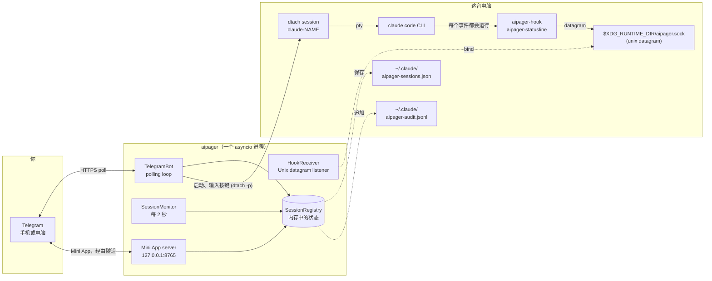

# 架构

<!-- i18n-source: docs/architecture.md @ 7881bd9e -->

> 本页译自英文；如果两者不一致，以英文版为准。（[English](../../architecture.md)）

aipager 是一个在后台运行的单进程 asyncio 程序。它连接三个世界：你的 Telegram 聊天、你在 `dtach` 下运行的 Claude Code 进程，以及 Claude Code 的 hook 系统。一切都经过同一个 event loop：没有 worker pool，没有数据库，没有进程间队列。

## 组成部分示意图

图中除了 Telegram，其余都在这台电脑上运行。aipager 还会连接其他几个服务器：Mini App 的 Cloudflare 隧道（以及为获取 `cloudflared` 访问一次 GitHub）、为获取 Mini App 脚本访问的 `telegram.org`、你请求更新时的版本检查、第一次使用语音消息时下载语音识别模型，以及你发送问题报告时的报告接收地址。这些都列在[安全模型 → 网络连接](security.md#network-surface)里。

## 进程结构

`aipager/cli/daemon.py` 里的一次 `asyncio.run` 调用运行整个程序。其中包括：

- **`TelegramBot`**（`aipager/bot/`）：持有一个 `python-telegram-bot` 的 `Application`。从 Telegram 接收更新，分发给消息、按钮和语音消息的处理程序，并让工作卡片、置顶状态栏和回答保持最新。
- **`HookReceiver`**（`aipager/dtach/hook_receiver.py`）：在 `$XDG_RUNTIME_DIR/aipager.sock` 打开一个 Unix datagram 套接字，读取 `aipager-hook` 和 `aipager-statusline` 发来的 JSON，并按其中的 `hook_event_name`（对 aipager 自己的消息则按 `type`；见 [Hook 事件](hooks.md)）分派。
- **`SessionMonitor`**（`aipager/session_monitor.py`）：每 2 秒醒来一次，扫描 `/tmp/claude-dtach-*.sock`，把找到的会话与会话列表对照，并运行各个看守：卡住不动的工作卡片、Claude Code 一直没取走的消息、5 分钟没有动静、保存的对话显示已经结束的权限请求（`AIPAGER_INTERACTIVE_TIMEOUT`）、结束时刻被错过的任务。
- **`SessionRegistry`**（`aipager/state.py`）：按名称存放的 `TrackedSession` 对象。在关闭时，以及每当有需要在重启后保留的东西发生变化时，（原子地）保存到 `~/.claude/aipager-sessions.json`。
- **Mini App 服务器**（`aipager/miniapp/server.py`）：一个监听 `127.0.0.1`、端口为 `MINIAPP_PORT`（默认 8765）的 aiohttp 应用，在开启期间（默认开启）通过托管的 Cloudflare 隧道提供给 Telegram。提供 `/app` 控制面板。

这些都作为任务运行在同一个 loop 上。可能阻塞 loop 的工作在单独的线程里运行：把语音消息转成文字、生成并发送问题报告、检查更新和规划重启、下载 Mini App 脚本和 `cloudflared`，以及启动时的登录检查。

## 启动顺序

来自 `aipager/cli/daemon.py`：

1. 把旧的配置（`config.env`、`team.yaml`）迁移到 `aipager.yaml`，只做一次，并把旧文件收起来。
2. 如果另一个 aipager 在套接字上应答，就拒绝启动；然后获取 aipager 的锁（`~/.local/share/aipager/daemon.lock`）。
3. 向 Telegram 验证机器人 token（`getMe`）。
4. 修整 Claude Code 自己的文件：把缺少的 aipager hook 和状态行加到 `~/.claude/settings.json`（或 `$CLAUDE_CONFIG_DIR/settings.json`，即守护进程的会话读取的文件），并回答 Telegram 用户无法回答的首次启动问题（见[安全](security.md#who-decides-whether-a-tool-call-runs)）。
5. `SessionRegistry.load()`：读取 `~/.claude/aipager-sessions.json`。文件不存在或无法读取时，列表从空开始。
6. 确定 Mini App 的地址（你自己的 URL，或 Tailscale），然后 `bot.start()`：开始从 Telegram 接收更新。
7. `HookReceiver.start()`：删除残留的套接字文件，bind，开始监听。
8. `bot.recover_sessions()`：恢复 aipager 停止时正在工作或等待中的会话的卡片和请求（见[命令 → 任务结束后的回答](commands.md#idle-responses)）。
9. `SessionMonitor.start()`：开始每 2 秒一次的扫描。
10. 启动 Mini App 服务器，然后启动隧道（未设置你自己的 URL 时），并发布 `📱 App` 按钮。
11. aipager 等待信号：SIGINT 或 SIGTERM 让它停止，SIGUSR1 重新加载聊天和规则（[群组 → 无需重启的重新加载](groups.md#live-reload)）。

## 关闭顺序

1. SIGINT 或 SIGTERM 设置 `stop` 事件。
2. 正在运行的 `/update` 有一小段宽限时间，然后它的安装程序会被停止（见[命令 → 更新](commands.md#update)）。
3. `registry.save()`。
4. 先停止隧道，再停止 Mini App 服务器。
5. `session_monitor.stop()`、`hook_receiver.stop()`（关闭套接字并删除它的文件）。
6. `bot.stop()`：取消动画并停止 `Application`。
7. 再次 `registry.save()`，为了那些发送还没完成的卡片。

从 Telegram 触发的自我重启依赖于这整个过程在替代进程 bind 套接字之前运行完毕。这时你会看到什么，见[机器人命令 → 重启](commands.md#restart)。

## 文件和套接字的位置

| 路径 | 用途 | 由谁写入 |
|---|---|---|
| `$XDG_RUNTIME_DIR/aipager.sock` | 用于 hook 事件的 Unix datagram 套接字（没有 `$XDG_RUNTIME_DIR` 时为 `/tmp/aipager.sock`；`$AIPAGER_SOCKET_PATH` 优先于两者） | aipager（bind） |
| `aipager-reply-<id>.sock`（在控制套接字旁边） | hook 等待的每个权限请求各有一个短期的回复套接字 | `aipager-hook` |
| `aipager-flood-mute.json`、`aipager-flood-backoff.json`（在控制套接字旁边） | 当前的 Telegram 限流状态，供 `aipager status` 和 doctor 使用 | aipager |
| `aipager-spill-<uid>/ev-<id>.json`（在控制套接字旁边） | 一个 datagram 装不下的 hook 事件，指向它的 datagram 到达时由 aipager 读取并删除；超过 5 分钟的文件在启动时清理（[hook](hooks.md)） | `aipager-hook`（写入）、aipager（创建文件夹，读取并删除文件） |
| `aipager-modelswitch-<name>.json`（在控制套接字旁边） | 标记 aipager 输入的一次模型切换，有效 30 秒（[hook](hooks.md#premodelswitch)） | aipager（写入）、`aipager-hook`（领取） |
| `/tmp/claude-dtach-<name>.sock` | 每个会话的 dtach 控制套接字 | dtach |
| `/tmp/claude-status-<name>.json` | 每个会话的状态行数据 | `aipager-statusline` |
| `/tmp/claude-notes-<name>/` | 每条尚未被取走的 Telegram 消息各有一条权限备注，还有一个在任务运行期间由 hook 保持的 `turn-open` 标记（加入该任务的消息只能收紧它的规则） | aipager（备注，写入）、`aipager-hook`（使用备注；写入 `turn-open`，两者都会清除它） |
| `/tmp/claude-policy-<name>.json` | 当前任务的权限快照 | `aipager-hook`（取走消息时写入），由 `PreToolUse` 检查读取 |
| `/tmp/claude-policy-.floor-<uid>.json` | 安全底线：内置列表加上你的 `safety:` 部分，供 hook 的后备路径使用 | aipager |
| `/tmp/claude-reply-<name>.txt` | 你回复一条较早的消息时，你回复的那条消息 | aipager |
| `/tmp/claude-bgjob-<job>.json` | 把一个 Claude Code 后台任务和对话移进它的那个会话关联起来（`job`、`session`、该任务的对话 ID、会话的 claude PID、时间，以及该任务自己的 `SessionEnd` 到来后的 `ended`），让这个任务的 hook 算作该会话的（[hook](hooks.md#what-the-daemon-receives)）；权限 0600，会话被带回来或结束时删除 | aipager（写入）、`aipager-hook` 和 `aipager-statusline`（读取） |
| `/tmp/claude-bgjob-pids.json` | 每个运行中的会话自己的 `claude` 的 PID，供在链接文件出现之前就运行的后台任务 hook 使用（权限 0600） | aipager（写入）、`aipager-hook` 和 `aipager-statusline`（读取） |
| `/tmp/claude-exit-<name>.json` | `claude` 的退出码以及它启动和结束的时间（`{"code", "start", "end"}`，权限 0600）：启动会话的 shell 在 `claude` 启动前删除它，在 `claude` 退出时写入它，会话的结束通知据此说明原因（[故障排除](troubleshooting.md#a-session-dropped-off-the-pinned-status-bar-it-is-gone)） | 启动会话的 shell（写入）、aipager（读取） |
| `/tmp/aipager-files/<chat>/` | 从 Telegram 发来的文件和语音消息，每个聊天一个私有文件夹（`0700`，文件 `0600`） | aipager |
| `/tmp/aipager.log` | 没有服务时自我重启的输出 | aipager |
| `~/.claude/aipager-sessions.json` | 会话列表的持久状态 | aipager |
| `~/.claude/aipager-audit.jsonl` | 允许 / 拒绝 / 回答的日志 | aipager（只追加） |
| `~/.claude/aipager-flood-state.json` | 每个聊天的 Telegram 限流历史，跨重启保留（[故障排除](troubleshooting.md#the-bot-went-quiet-flood-control)） | aipager |
| `~/.claude/aipager-tunnel.json`、`aipager-cloudflared.log`、`aipager-cloudflared.err` | aipager 持有的 Mini App 隧道：它的进程、本地端口和地址的哈希（从不保存地址本身），以便计划内重启后下一个 aipager 接管它（权限 600）；cloudflared 的警告；cloudflared 最后的错误输出（权限 600），说明隧道为什么没能启动（[故障排除](troubleshooting.md#the-mini-app-link-isnt-working)） | aipager；保留下来的隧道的看守进程和 `aipager uninstall` 也会删除这条记录 |
| `~/.claude/aipager-pending-users.json` | 在机器人不服务的群组里找过它的人，或在它服务的群组里但不是成员的人，供 `aipager config` 添加（权限 0600，每次写入都整个替换，保留最近 30 天里出现过的最新 200 人） | aipager（写入）、`aipager config`（读取） |
| `~/aipager-users/<label>/` | 成员的默认[根文件夹](groups.md#root-folders)（权限 0700），`user` 和 `read_only` 成员在这里启动会话；`aipager uninstall` 会保留它们 | aipager（在成员第一次 `/new` 或第一次在 Mini App 里“启动会话”时创建） |
| `~/.claude/settings.json`（或 `$CLAUDE_CONFIG_DIR/settings.json`） | Claude Code 的 hook 配置：守护进程的会话读取的那个文件，位于会话所得环境对应的 Claude Code 配置文件夹中（由守护进程环境或 `daemon.env` 中的 `CLAUDE_CONFIG_DIR` 决定，也可以是该文件自己的 `env` 块里的 `CLAUDE_CONFIG_DIR`，它会把文件移到别处；[故障排查](troubleshooting.md#using-an-api-key-a-gateway-or-another-provider)） | `aipager config` / `aipager setup`；每次启动时 aipager 会补上缺少的 aipager hook 或状态行，并设置 `skipDangerousModePermissionPrompt`（[安全](security.md#who-decides-whether-a-tool-call-runs)），当该文件是新文件时，在会话启动前还会再做一次 |
| `settings.json.bak.*`（在它旁边） | 每次改写前的备份 | `aipager config`、`aipager setup`、`aipager uninstall` |
| `~/.claude.json`（或 `$CLAUDE_CONFIG_DIR/.claude.json`、设置了 `CLAUDE_CODE_CUSTOM_OAUTH_URL` 时的 `.claude-custom-oauth.json`，或 Claude Code 使用的配置文件夹中的旧版 `.config.json`） | Claude Code 自己的文件：aipager 在会话启动前一刻，把会话所在的文件夹标记为受信任（包括主文件夹，但绝不会是 `/` 或主文件夹的上级文件夹），这样 Claude Code 的信任问题不会挡住从 Telegram 启动的会话。aipager 启动时不标记任何文件夹。无法完整读取，或运行中的 Claude 在此期间改动过时，绝不重写。同样，它会为会话的 `ANTHROPIC_API_KEY` 回答“use this API key?”（`customApiKeyResponses`，密钥的最后 20 个字符），并在会话有登录凭据时把 Claude Code 的首次运行标记为已完成（`hasCompletedOnboarding`），让这些问题也不会挡住从 Telegram 启动的会话（[服务商](troubleshooting.md#using-an-api-key-a-gateway-or-another-provider)）。 | aipager |
| `~/.claude/.credentials.json`（或配置文件夹中的那个） → `.credentials.json.stale` | Claude Code 的登录文件，在会话以设置了 `CLAUDE_CODE_OAUTH_TOKEN` 的方式启动、而该文件只有过期或空的登录时被移到一边（否则它会优先于 token）；要撤销，把它移回来 | aipager |
| `~/.config/aipager/aipager.yaml` | 机器人 token、聊天、成员 + 角色、Mini App 设置 | `aipager config`（权限 600）；当 Telegram 把群组升级为 supergroup 时，aipager 会迁移该群组的条目，并在把旧的 Mini App 设置移进来时保留一份 `aipager.yaml.bak.<time>` |
| `~/.config/aipager/policy.yaml` | 按角色的规则 + 安全底线的补充 | 你（用 `aipager policy validate` 检查）；迁移旧安装时会写入一次带注释的模板 |
| `~/.config/aipager/preferences.json` | 每个聊天和每个会话的 `/settings` 选择 | aipager |
| `~/.config/aipager/daemon.env` | 启动的会话所用的 Claude 凭据 | 你 / `aipager service install` / `aipager doctor --fix`（权限 600） |
| `~/.config/aipager/config.env`、`team.yaml` → `*.bak.<time>`、`*.retired.<time>` | 旧安装的配置：先复制，待 `aipager.yaml` 包含它后再改名收起 | aipager、`aipager config`、`aipager setup` |
| `~/.config/aipager/keyboard.json` | 可选的键盘自定义 | 你 |
| `~/.local/share/aipager/sessions/` | 每个会话一个文件夹，里面有它的 `SESSION.md`（谁可以和它对话，以及规则），每次启动都会重建 | aipager |
| `~/.local/share/aipager/webapp-sdk/`、`cloudflared/` | Telegram 的 Mini App 脚本和已校验的 `cloudflared` 程序 | aipager |
| `~/.local/share/aipager/daemon.lock`、`update.lock`、`update-restart.json` | 同一时间只有一个 aipager；同一时间只有一次更新；重启后要通知的更新 | aipager |
| `~/.local/share/aipager/install.json`、`running.json` | aipager 第一次在这里启动的时间；它现在是否在运行（用来区分崩溃和正常停止） | aipager |
| `~/.local/state/aipager/reports.json` | 问题报告：记录的错误指纹、次数和提议状态（权限 600）；见[问题报告](problem-reports.md#what-is-kept-on-your-machine) | aipager |
| `~/.local/state/aipager/report-sends.json` | 今天发送的问题报告（每日上限） | aipager、`aipager report` |
| `~/.local/state/aipager/languages.json` | 语言状态（权限 600）：谁在有语言功能之前就用过 aipager、每个人最近一次被看到的 Telegram 语言、一次性的语言提议和首次接触的那行字是否已发出，以及 aipager 设置的每条机器人描述的哈希；见[语言](commands.md#languages) | aipager |
| `~/.local/state/aipager/tunnel-status.json` | Mini App 隧道的状态（启动中、正常，或不正常及原因和下次尝试的时间；从不保存地址；权限 600），供 `aipager doctor` 读取（[故障排除](troubleshooting.md#the-mini-app-link-isnt-working)） | aipager（写入，停止时删除），`aipager doctor`（读取） |
| `~/.config/systemd/user/aipager.service`（Linux）、`~/Library/LaunchAgents/com.aipager.daemon.plist`（macOS），以及安装时被替换文件的 `.bak.<time>` 副本（在 Linux 上仅当内容不同时） | 后台服务 | `aipager service install` |
| `~/Library/Logs/aipager.log`（macOS） | launchd 服务的日志，由 `aipager logs` 读取 | launchd，为服务写入 |

除此之外，aipager 会在你要求时创建新的会话文件夹（`/new` 或 Mini App 里的“新建文件夹”），安装程序和语音模型在你更新或使用语音消息时会写入它们自己的文件。所有这些都在你的主文件夹下、`/tmp` 下，或控制套接字旁边。aipager 从不提升权限；见[安全](security.md#privilege-boundary)。

### 隔离实例（用于测试）

把 `AIPAGER_INSTANCE_DIR` 设为一个属于你的绝对路径文件夹，上面每个共享的运行时文件都会移到那里：控制套接字（以及它旁边的回复套接字、限流信号文件、模型切换标记和 hook 溢出文件夹）、`claude-dtach-*` 套接字、`claude-policy-*`、`claude-notes-*`、`claude-status-*`、`claude-reply-*`、`claude-bgjob-*` 和 `claude-exit-*` 文件、安全底线文件、`aipager-files` 下载文件夹和自我重启日志。这个实例启动的会话会继承该设置，所以它们的 hook 只与这个实例通信，安全规则也以同样的方式保护被移动的文件。这个实例不会读取源码副本里的 `.env`。

主文件夹下的文件不会移动，所以也要把 `HOME` 指向一个单独的文件夹。当设置了实例文件夹而 `HOME` 却是你真实的主文件夹时、当这个文件夹不是指向你自己文件夹的绝对路径时，或当它太长不能作为套接字路径时，`aipager start` 会拒绝运行。

`/update` 和 `/restart` 不受隔离：它们作用于已安装的 aipager 软件包和 `aipager.service`，所以绝不要把它们发给测试实例。

`AIPAGER_TELEGRAM_API_BASE`（例如 `http://127.0.0.1:41234`）会把每个 Bot API 请求和每次文件下载发到那个地址，而不是 `https://api.telegram.org`。除非设置了 `AIPAGER_TELEGRAM_API_ALLOW_REMOTE=1`，这个地址必须是本机（`localhost` 或回环地址），这样一个笔误不会把机器人 token 发到别处。

这两个设置的存在，是为了让端到端测试能在你真正的 aipager 旁边，对着一个本地的 Telegram 替身运行第二个 aipager。两个都不设置时，每个路径和地址都与上表相同。

## 为什么用 dtach

dtach 为每个 Claude Code 会话提供一个真正的 PTY，而不用把它绑在一个必须一直开着的终端上。aipager 用 `dtach -n` 启动会话，用 `dtach -p` 向它输入（消息、Escape、回答对话框的按键）；它从不读取屏幕，因为 hook 和保存的对话已经说明了发生的事情。你可以在任何 shell 里用 `aipager session <name>` 以交互方式连接，直接操作。这个连接会跟随会话经历一次从 Telegram 触发的重启（`/mode` 切换到或离开完全访问模式、`/restart`、重启）：当会话的套接字消失时，它最多等待 15 秒让同一个套接字回来，然后自己重新连接。真正结束的会话会在等待之后把你带回 shell（Ctrl-C 可以提前结束等待）。连接时 dtach 的分离键是关闭的，所以 `Ctrl-\` 会传给 Claude；要离开，关闭终端或 tmux 窗格即可，会话会继续运行。

在 dtach 会话里，aipager 启动的会话运行的是 `dtach -> bash -> claude`，用 `aipager session` 启动的会话运行的是 `dtach -> sh -> claude`：shell 会等待 `claude`，以便记录它的退出码（`claude-exit-<name>.json`），会话的结束通知会读取它。`aipager session` 的参数原样传给 `claude`，从不经过 shell 的解析。

从 Telegram 重启会结束会话的 dtach，再在同一个对话上重新启动它。对话移到了 Claude Code 后台的会话（在空的输入框里按 ←；见 [故障排除](troubleshooting.md#a-session-moved-to-claude-codes-background)）也以同样的方式重启，只是先多一步：aipager 运行 `claude stop <job>`，等到没有任何后台进程占着这个对话，然后结束会话的 dtach，用 aipager 自己的设置在该任务的对话上启动它。会话在 Claude Code 后台期间，aipager 不会向它的 dtach 输入任何东西。

结果是：Claude Code 运行起来就像你在终端里输入一样，但那个终端可以随来随去，而不打扰正在运行的会话。aipager 在每 2 秒一次的扫描中查找 `/tmp/claude-dtach-*.sock` 来发现会话。被发现的会话属于它的名称所对应的聊天；而在同时有私聊和群组的安装上，在终端里启动的会话属于所有者的私聊。

## 另见

- [Hook 事件](hooks.md)：通过控制套接字进来的内容。
- [机器人命令](commands.md)：从 Telegram 进来的内容。
- [安全模型](security.md)：权限边界、机密信息、审计。
- [故障排除](troubleshooting.md)：`aipager doctor` 参考。
